# Faith Paulding | Enterprise Technology Leadership & Architecture

**MBA – Engineering Management | PMP® | Certified ScrumMaster® | Ph.D. studies in Business Analytics & Data Science**

I work at the intersection of technical program delivery, enterprise application modernization, business intelligence and governed technology transformation. My professional background includes senior development leadership supporting federal modernization and data acquisition management. This portfolio connects that experience to principal-level and director-level technology responsibilities through original, independently developed case studies and implementation labs.

## Featured implementation evidence

- [28 illustrated software walkthroughs](Role_Specific_Portfolio/CLICK-BY-CLICK.md) — 196 original storyboard stages; vendor navigation unverified.
- [Eight executive leadership packages](Role_Specific_Portfolio/LEADERSHIP-PACKAGES.md) — synthetic investment and governance cases.
- [Eight local application walkthroughs](Role_Specific_Portfolio/EXECUTIVE-EVIDENCE.md).

## Software implementation gallery

Select any illustration to open its numbered walkthrough. These are original instructional reconstructions, not verified vendor screenshots. The gallery groups software by its intended portfolio role; it does not claim every tool is required by employers.

### AI Technical Program Manager

<table>
<tr>
<td width="33%" valign="top"><a href="Role_Specific_Portfolio/AI-Technical-Program-Manager/simulations/jira/walkthrough/README.md">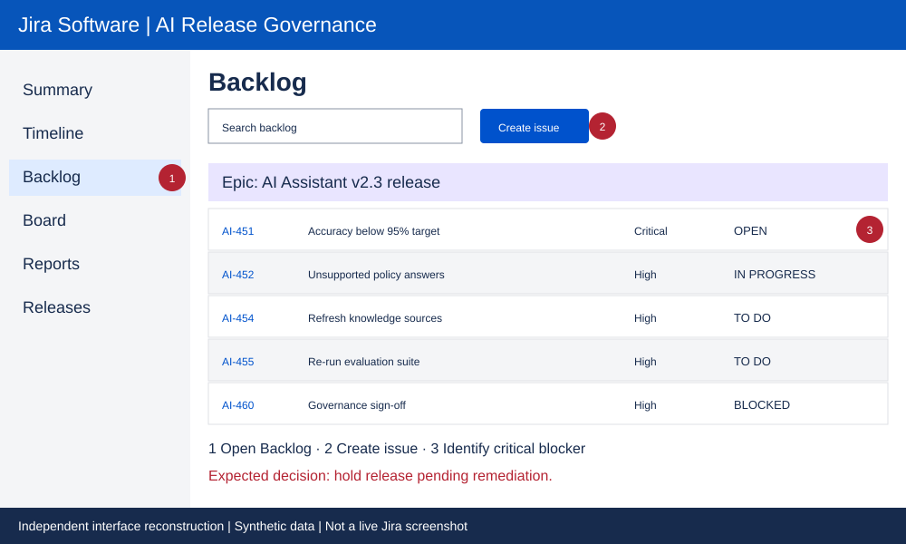</a> <strong>Jira</strong> <a href="Role_Specific_Portfolio/AI-Technical-Program-Manager/simulations/jira/walkthrough/README.md">Click-by-click walkthrough</a></td>
</tr>
</table>

### Principal AI Solution Architect

<table>
<tr>
<td width="33%" valign="top"><a href="Role_Specific_Portfolio/Principal-AI-Solution-Architect/simulations/azure-ai-foundry/walkthrough/README.md">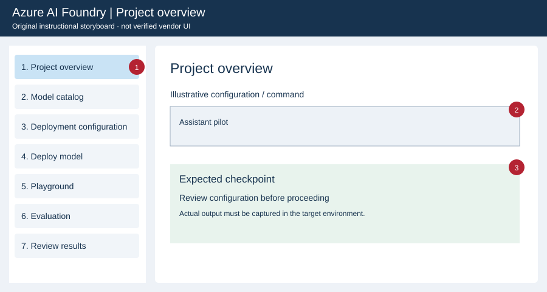</a> <strong>Azure AI Foundry</strong> <a href="Role_Specific_Portfolio/Principal-AI-Solution-Architect/simulations/azure-ai-foundry/walkthrough/README.md">Click-by-click walkthrough</a></td>
<td width="33%" valign="top"><a href="Role_Specific_Portfolio/Principal-AI-Solution-Architect/simulations/langchain/walkthrough/README.md">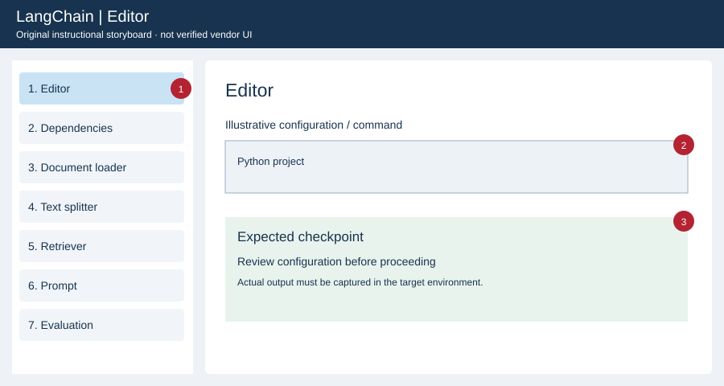</a> <strong>LangChain</strong> <a href="Role_Specific_Portfolio/Principal-AI-Solution-Architect/simulations/langchain/walkthrough/README.md">Click-by-click walkthrough</a></td>
<td width="33%" valign="top"><a href="Role_Specific_Portfolio/Principal-AI-Solution-Architect/simulations/langgraph/walkthrough/README.md">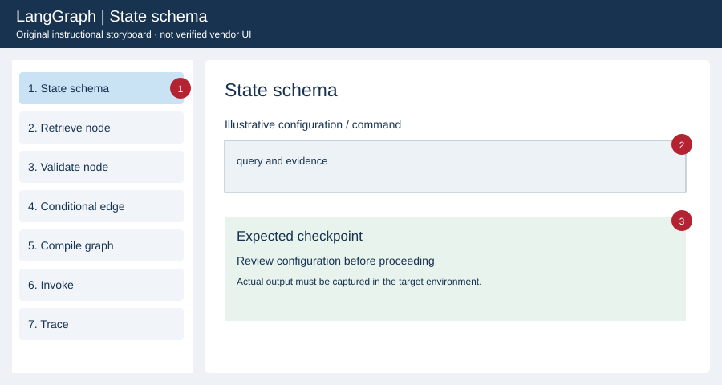</a> <strong>LangGraph</strong> <a href="Role_Specific_Portfolio/Principal-AI-Solution-Architect/simulations/langgraph/walkthrough/README.md">Click-by-click walkthrough</a></td>
</tr>
<tr>
<td width="33%" valign="top"><a href="Role_Specific_Portfolio/Principal-AI-Solution-Architect/simulations/react/walkthrough/README.md">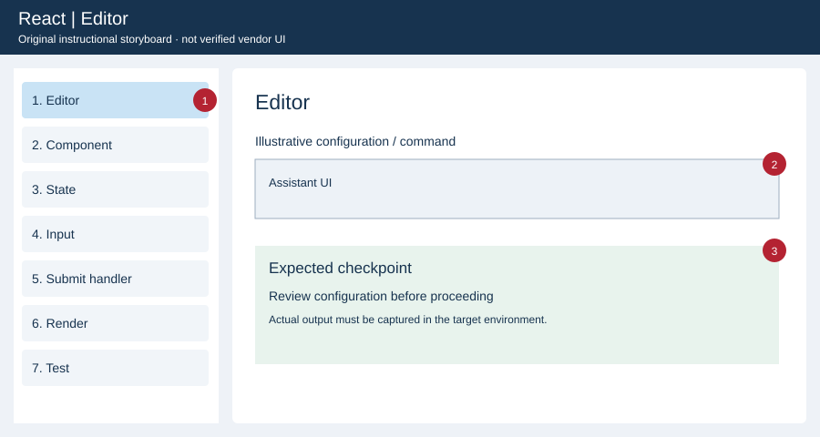</a> <strong>React</strong> <a href="Role_Specific_Portfolio/Principal-AI-Solution-Architect/simulations/react/walkthrough/README.md">Click-by-click walkthrough</a></td>
</tr>
</table>

### Director AI Digital Transformation

<table>
<tr>
<td width="33%" valign="top"><a href="Role_Specific_Portfolio/Director-AI-Digital-Transformation/simulations/copilot-studio/walkthrough/README.md">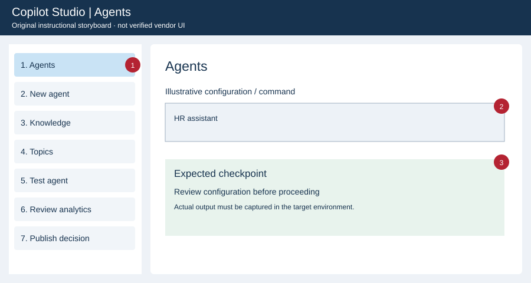</a> <strong>Copilot Studio</strong> <a href="Role_Specific_Portfolio/Director-AI-Digital-Transformation/simulations/copilot-studio/walkthrough/README.md">Click-by-click walkthrough</a></td>
<td width="33%" valign="top"><a href="Role_Specific_Portfolio/Director-AI-Digital-Transformation/simulations/crewai/walkthrough/README.md">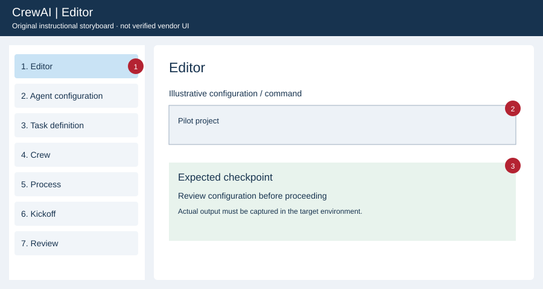</a> <strong>CrewAI</strong> <a href="Role_Specific_Portfolio/Director-AI-Digital-Transformation/simulations/crewai/walkthrough/README.md">Click-by-click walkthrough</a></td>
</tr>
</table>

### Principal Technical Program Manager

<table>
<tr>
<td width="33%" valign="top"><a href="Role_Specific_Portfolio/Principal-Technical-Program-Manager/simulations/azure-devops/walkthrough/README.md">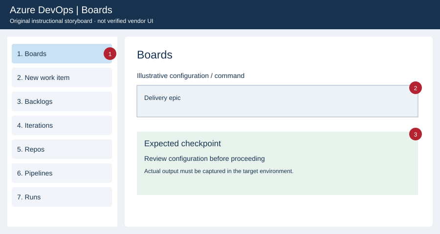</a> <strong>Azure DevOps</strong> <a href="Role_Specific_Portfolio/Principal-Technical-Program-Manager/simulations/azure-devops/walkthrough/README.md">Click-by-click walkthrough</a></td>
<td width="33%" valign="top"><a href="Role_Specific_Portfolio/Principal-Technical-Program-Manager/simulations/github-actions/walkthrough/README.md">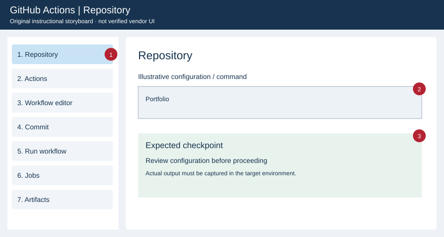</a> <strong>GitHub Actions</strong> <a href="Role_Specific_Portfolio/Principal-Technical-Program-Manager/simulations/github-actions/walkthrough/README.md">Click-by-click walkthrough</a></td>
</tr>
</table>

### Enterprise AI Architect

<table>
<tr>
<td width="33%" valign="top"><a href="Role_Specific_Portfolio/Enterprise-AI-Architect/simulations/aws/walkthrough/README.md">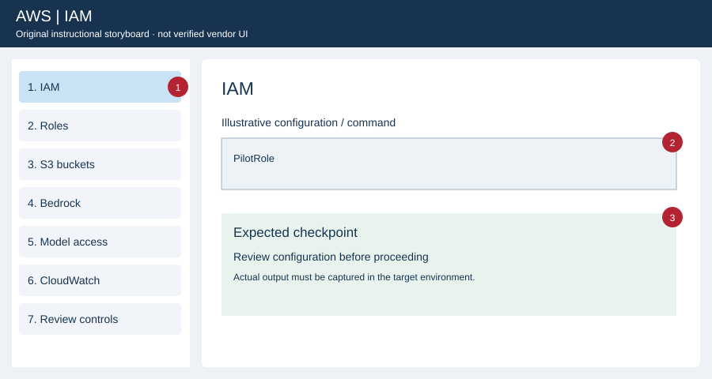</a> <strong>AWS</strong> <a href="Role_Specific_Portfolio/Enterprise-AI-Architect/simulations/aws/walkthrough/README.md">Click-by-click walkthrough</a></td>
<td width="33%" valign="top"><a href="Role_Specific_Portfolio/Enterprise-AI-Architect/simulations/google-cloud/walkthrough/README.md">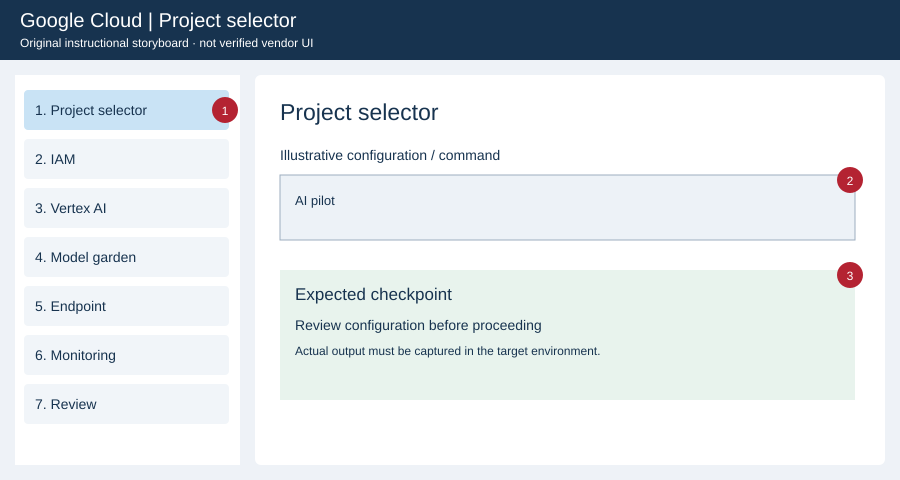</a> <strong>Google Cloud</strong> <a href="Role_Specific_Portfolio/Enterprise-AI-Architect/simulations/google-cloud/walkthrough/README.md">Click-by-click walkthrough</a></td>
<td width="33%" valign="top"><a href="Role_Specific_Portfolio/Enterprise-AI-Architect/simulations/docker/walkthrough/README.md">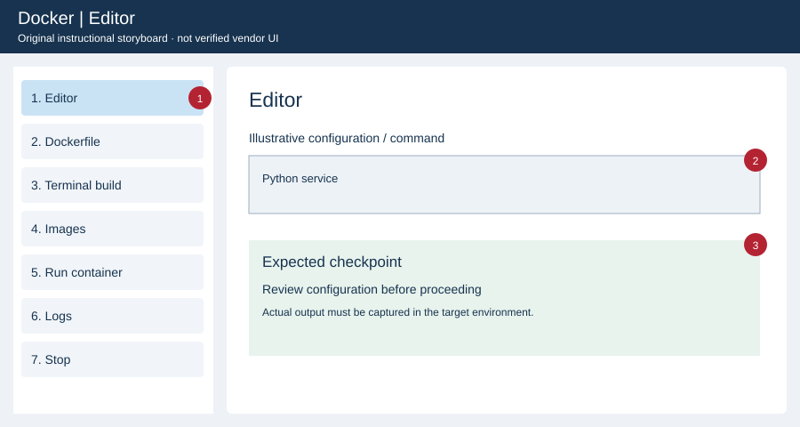</a> <strong>Docker</strong> <a href="Role_Specific_Portfolio/Enterprise-AI-Architect/simulations/docker/walkthrough/README.md">Click-by-click walkthrough</a></td>
</tr>
<tr>
<td width="33%" valign="top"><a href="Role_Specific_Portfolio/Enterprise-AI-Architect/simulations/firebase/walkthrough/README.md">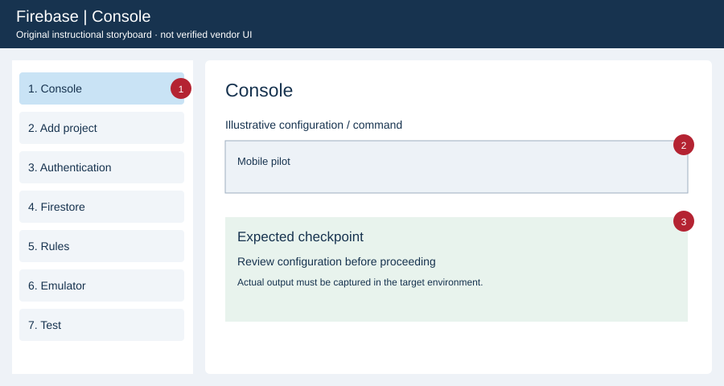</a> <strong>Firebase</strong> <a href="Role_Specific_Portfolio/Enterprise-AI-Architect/simulations/firebase/walkthrough/README.md">Click-by-click walkthrough</a></td>
<td width="33%" valign="top"><a href="Role_Specific_Portfolio/Enterprise-AI-Architect/simulations/c-/walkthrough/README.md">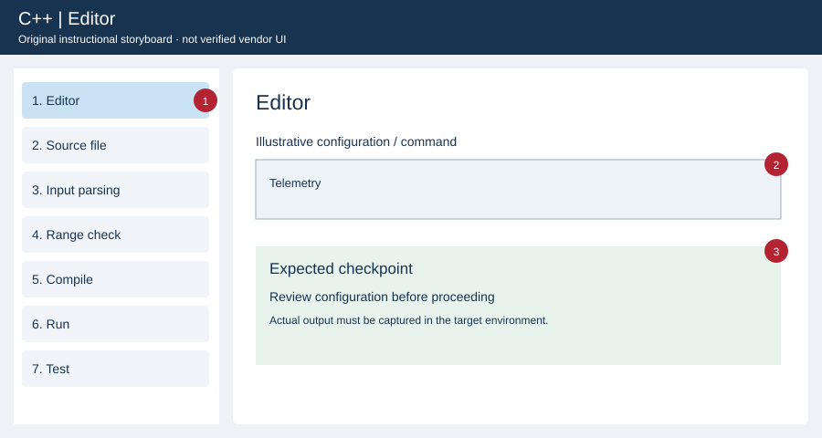</a> <strong>C++</strong> <a href="Role_Specific_Portfolio/Enterprise-AI-Architect/simulations/c-/walkthrough/README.md">Click-by-click walkthrough</a></td>
<td width="33%" valign="top"><a href="Role_Specific_Portfolio/Enterprise-AI-Architect/simulations/terraform/walkthrough/README.md">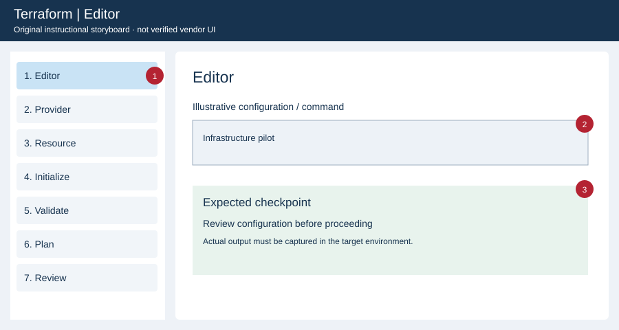</a> <strong>Terraform</strong> <a href="Role_Specific_Portfolio/Enterprise-AI-Architect/simulations/terraform/walkthrough/README.md">Click-by-click walkthrough</a></td>
</tr>
</table>

### Director Business Intelligence

<table>
<tr>
<td width="33%" valign="top"><a href="Role_Specific_Portfolio/Director-Business-Intelligence/simulations/microsoft-fabric/walkthrough/README.md">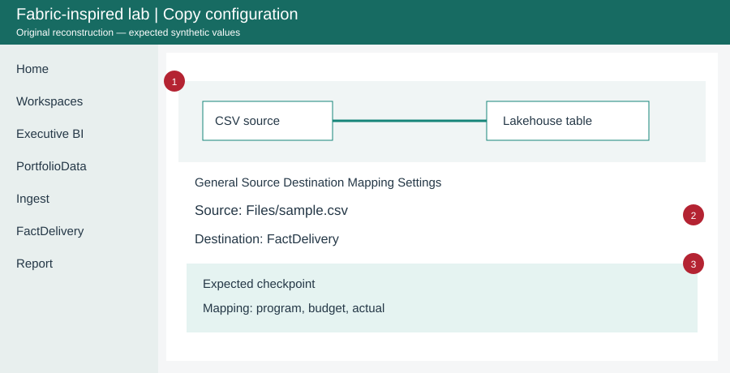</a> <strong>Microsoft Fabric</strong> <a href="Role_Specific_Portfolio/Director-Business-Intelligence/simulations/microsoft-fabric/walkthrough/README.md">Click-by-click walkthrough</a></td>
</tr>
</table>

### Director Enterprise Applications

<table>
<tr>
<td width="33%" valign="top"><a href="Role_Specific_Portfolio/Director-Enterprise-Applications/simulations/power-apps/walkthrough/README.md">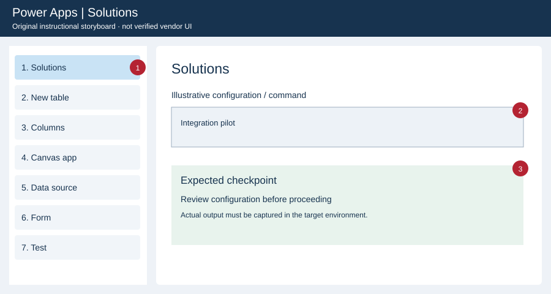</a> <strong>Power Apps</strong> <a href="Role_Specific_Portfolio/Director-Enterprise-Applications/simulations/power-apps/walkthrough/README.md">Click-by-click walkthrough</a></td>
<td width="33%" valign="top"><a href="Role_Specific_Portfolio/Director-Enterprise-Applications/simulations/mulesoft/walkthrough/README.md">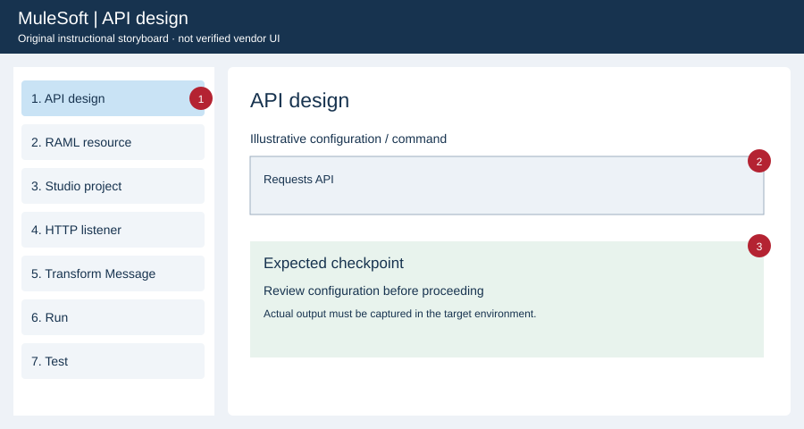</a> <strong>MuleSoft</strong> <a href="Role_Specific_Portfolio/Director-Enterprise-Applications/simulations/mulesoft/walkthrough/README.md">Click-by-click walkthrough</a></td>
<td width="33%" valign="top"><a href="Role_Specific_Portfolio/Director-Enterprise-Applications/simulations/workato/walkthrough/README.md">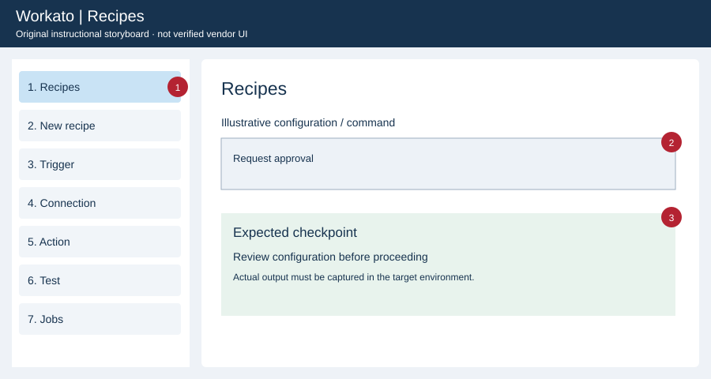</a> <strong>Workato</strong> <a href="Role_Specific_Portfolio/Director-Enterprise-Applications/simulations/workato/walkthrough/README.md">Click-by-click walkthrough</a></td>
</tr>
<tr>
<td width="33%" valign="top"><a href="Role_Specific_Portfolio/Director-Enterprise-Applications/simulations/sap-btp/walkthrough/README.md">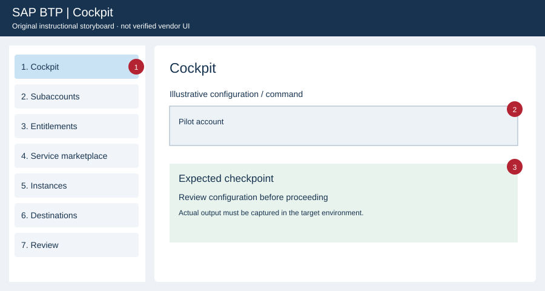</a> <strong>SAP BTP</strong> <a href="Role_Specific_Portfolio/Director-Enterprise-Applications/simulations/sap-btp/walkthrough/README.md">Click-by-click walkthrough</a></td>
<td width="33%" valign="top"><a href="Role_Specific_Portfolio/Director-Enterprise-Applications/simulations/salesforce/walkthrough/README.md">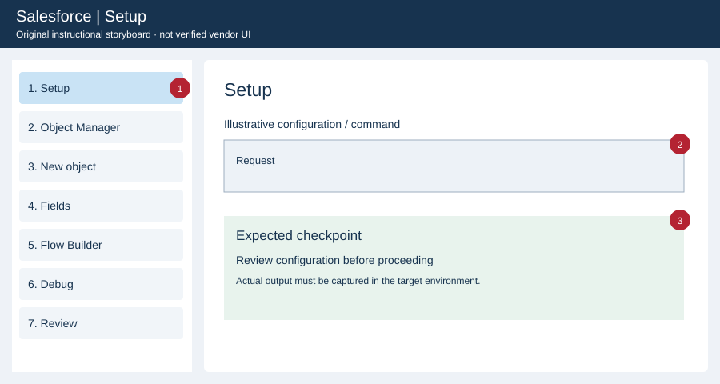</a> <strong>Salesforce</strong> <a href="Role_Specific_Portfolio/Director-Enterprise-Applications/simulations/salesforce/walkthrough/README.md">Click-by-click walkthrough</a></td>
<td width="33%" valign="top"><a href="Role_Specific_Portfolio/Director-Enterprise-Applications/simulations/servicenow/walkthrough/README.md">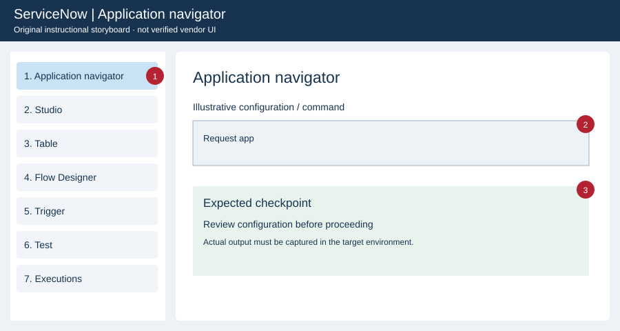</a> <strong>ServiceNow</strong> <a href="Role_Specific_Portfolio/Director-Enterprise-Applications/simulations/servicenow/walkthrough/README.md">Click-by-click walkthrough</a></td>
</tr>
<tr>
<td width="33%" valign="top"><a href="Role_Specific_Portfolio/Director-Enterprise-Applications/simulations/angular/walkthrough/README.md">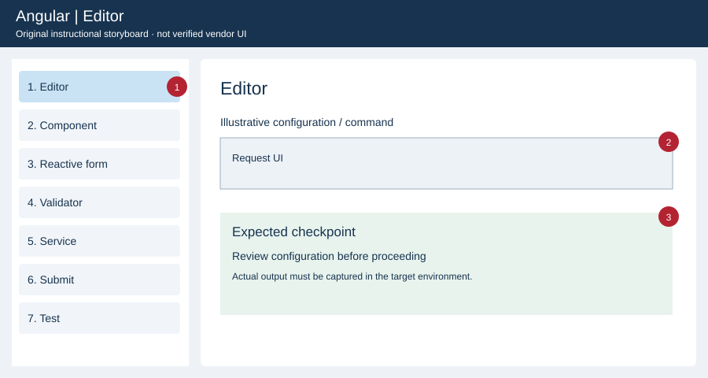</a> <strong>Angular</strong> <a href="Role_Specific_Portfolio/Director-Enterprise-Applications/simulations/angular/walkthrough/README.md">Click-by-click walkthrough</a></td>
<td width="33%" valign="top"><a href="Role_Specific_Portfolio/Director-Enterprise-Applications/simulations/vue/walkthrough/README.md">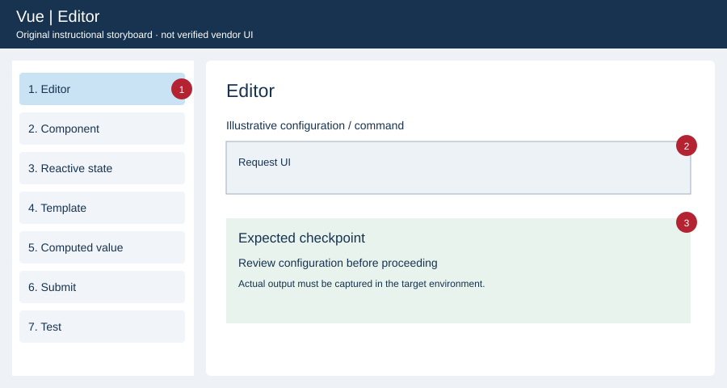</a> <strong>Vue</strong> <a href="Role_Specific_Portfolio/Director-Enterprise-Applications/simulations/vue/walkthrough/README.md">Click-by-click walkthrough</a></td>
<td width="33%" valign="top"> <strong>Meteor</strong> <a href="Role_Specific_Portfolio/Director-Enterprise-Applications/simulations/meteor/walkthrough/README.md">Click-by-click walkthrough</a></td>
</tr>
<tr>
<td width="33%" valign="top"><a href="Role_Specific_Portfolio/Director-Enterprise-Applications/simulations/java/walkthrough/README.md">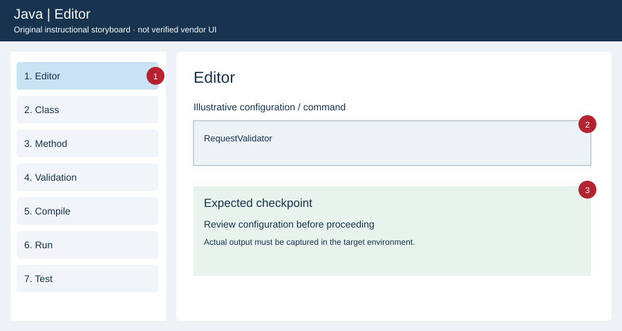</a> <strong>Java</strong> <a href="Role_Specific_Portfolio/Director-Enterprise-Applications/simulations/java/walkthrough/README.md">Click-by-click walkthrough</a></td>
<td width="33%" valign="top"> <strong>Node.js</strong> <a href="Role_Specific_Portfolio/Director-Enterprise-Applications/simulations/node-js/walkthrough/README.md">Click-by-click walkthrough</a></td>
</tr>
</table>

### Director Technology Programs

<table>
<tr>
<td width="33%" valign="top"><a href="Role_Specific_Portfolio/Director-Technology-Programs/simulations/power-bi/walkthrough/README.md">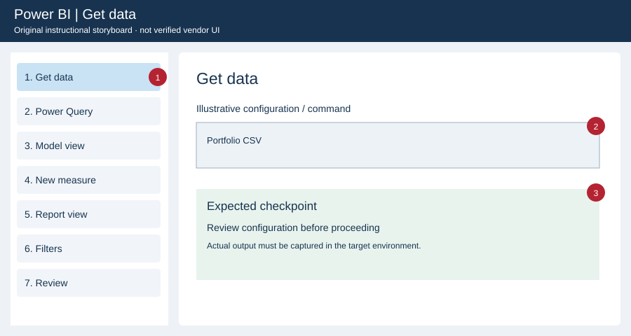</a> <strong>Power BI</strong> <a href="Role_Specific_Portfolio/Director-Technology-Programs/simulations/power-bi/walkthrough/README.md">Click-by-click walkthrough</a></td>
</tr>
</table>

## Leadership focus

Principal and director-level technology delivery, enterprise architecture, analytics and transformation.

## Flagship implementations

| Project | Evidence |
|---|---|
| [AI Delivery Command Center](Role_Specific_Portfolio/AI-Technical-Program-Manager/flagship/README.md) | Release gate; local reference code and test cases |
| [Intelligent Enterprise Assistant](Role_Specific_Portfolio/Principal-AI-Solution-Architect/flagship/README.md) | Grounded retrieval; local reference code and test cases |
| [AI Adoption Office](Role_Specific_Portfolio/Director-AI-Digital-Transformation/flagship/README.md) | Investment assessment; local reference code and test cases |
| [Technical Program Delivery System](Role_Specific_Portfolio/Principal-Technical-Program-Manager/flagship/README.md) | Dependency scheduling; local reference code and test cases |
| [Governed AI Platform](Role_Specific_Portfolio/Enterprise-AI-Architect/flagship/README.md) | Policy routing; local reference code and test cases |
| [Executive Intelligence Platform](Role_Specific_Portfolio/Director-Business-Intelligence/flagship/README.md) | ETL and KPI aggregation; local reference code and test cases |
| [Enterprise Integration Hub](Role_Specific_Portfolio/Director-Enterprise-Applications/flagship/README.md) | Request validation and approval; local reference code and test cases |
| [Strategic Technology Portfolio](Role_Specific_Portfolio/Director-Technology-Programs/flagship/README.md) | Earned value forecasting; local reference code and test cases |

## Eight role-specific projects

| Target role | Original project | Responsibility focus |
|---|---|---|
| AI Technical Program Manager | [AI Delivery Command Center](Role_Specific_Portfolio/AI-Technical-Program-Manager/README.md) | AI use-case intake; model evaluation; dependencies; release gates; executive reporting |
| Principal AI Solution Architect | [Intelligent Enterprise Assistant](Role_Specific_Portfolio/Principal-AI-Solution-Architect/README.md) | Knowledge ingestion; RAG; agent orchestration; APIs; evaluation; deployment |
| Director of AI & Digital Transformation | [AI Adoption and Transformation Office](Role_Specific_Portfolio/Director-AI-Digital-Transformation/README.md) | Use-case prioritization; business redesign; adoption; investment; benefits |
| Principal Technical Program Manager | [Technical Program Delivery System](Role_Specific_Portfolio/Principal-Technical-Program-Manager/README.md) | Roadmaps; critical dependencies; budgets; risks; release readiness |
| Enterprise AI Architect | [Governed Enterprise AI Platform](Role_Specific_Portfolio/Enterprise-AI-Architect/README.md) | Architecture decisions; identity; orchestration; evaluation; monitoring; resilience |
| Director of Business Intelligence | [Executive Intelligence Platform](Role_Specific_Portfolio/Director-Business-Intelligence/README.md) | Pipelines; dimensional modeling; semantic models; KPI governance; executive reporting |
| Director of Enterprise Applications | [Enterprise Integration Hub](Role_Specific_Portfolio/Director-Enterprise-Applications/README.md) | Application inventory; API integration; workflows; security; ALM |
| Director of Technology Programs | [Strategic Technology Portfolio](Role_Specific_Portfolio/Director-Technology-Programs/README.md) | Investment prioritization; integrated scheduling; stage gates; financial controls; benefits realization |

[Explore the project index](Role_Specific_Portfolio/README.md) • [Implementation curriculum](Role_Specific_Portfolio/IMPLEMENTATION-CURRICULUM.md)

## Technical capabilities and development roadmap

**Professional foundation:** Power BI, Tableau, SQL, Python, Power Apps, Power Automate, SharePoint, data modeling, workflow design, requirements, Agile delivery and governance.

**Planned hands-on labs:** Generative AI, LangChain, LangGraph, CrewAI, RAG, vector databases, knowledge graphs, model evaluation, AI quality and safety; Azure, AWS, GCP, SAP BTP, Docker, Terraform, GitHub Actions, CI/CD; MuleSoft, Workato, Salesforce, ServiceNow, Dataverse; Python, JavaScript, TypeScript, Java, C++, React, Angular, Vue, Node.js, SAP UI5, Meteor, Firebase, mobile and IoT. These are learning and implementation targets, not a claim of production proficiency in every platform.

## Documentation and evidence standard

The target documentation standard for each project is a business scenario, role responsibilities, architecture, prerequisites and licensing, click-by-click configuration with original screenshots, source code, data model, integrations, security controls, test evidence, troubleshooting, deployment and rollback, and executive business outcomes. Prototype screens are labeled; vendor integrations are not represented as completed until tested.

## Existing case studies

- [Enterprise AI Architecture](Enterprise-AI-Architecture/)
- [Executive BI Analytics Portfolio](Executive-BI-Analytics-Portfolio/)
- [Executive Decision Intelligence](Executive-Decision-Intelligence/)
- [Federal Digital Transformation Playbook](Federal-Digital-Transformation-Playbook/)
- [Federal Financial Management Analytics](Federal-Financial-Management-Analytics/)
- [Government Mission Modernization](Government-Mission-Modernization/)
- [NIST AI RMF Governance](NIST-AI-RMF-Governance/)
- [PPBE Program Analytics](PPBE-Program-Analytics/)
- [Power Platform Enterprise Architecture](Power-Platform-Enterprise-Architecture/)
- [Public Sector Technology Transformation](Public-Sector-Technology-Transformation/)
- [Professional Credentials and Certifications](Professional-Credentials-and-Certifications/)

[Software licensing and permissions matrix](SOFTWARE-LICENSING-PERMISSIONS-MATRIX.md)

## Professional qualifications

MBA – Engineering Management; PMP®; Certified ScrumMaster®; doctoral studies in Business Analytics & Data Science (in progress). Additional certification-aligned labs are learning objectives, not earned credentials.

## Publication status and confidentiality

Eight local reference implementations are available with source and test cases; Python regression tests passed; vendor deployment remains unverified. Existing conceptual cases remain available. All public demonstration work uses fictional or authorized data, never confidential government or employer information.

## Visual implementation library
[Browse role-specific instructional wireframes](Role_Specific_Portfolio/VISUAL-LIBRARY.md). Actual vendor screenshots and verified click paths remain pending.

## Interactive sandbox simulations
[Browse original interactive configuration exercises](Role_Specific_Portfolio/SIMULATIONS.md). These are local simulations, not vendor deployments.

[Quality review and regression testing](Role_Specific_Portfolio/QUALITY-REVIEW.md)

## Functional browser prototypes
[Demonstration site source](docs/index.html) — eight independent browser applications with interactive business logic. Download the docs folder to run locally. GitHub Pages publication and browser testing are not yet verified.

## Integrated local applications
Run `python service.py` from the repository root, then open http://127.0.0.1:8765/service-index.html. The eight service demos submit JSON to the Python engines and store successful runs in SQLite. Use synthetic data only. Static demos remain separate offline examples. Service CI and browser execution require verification.
[Acceptance backlog](Role_Specific_Portfolio/ACCEPTANCE.md)

## Executive leadership and visual implementation evidence
[Eight executive decision cases and annotated click-by-click local application guides](Role_Specific_Portfolio/EXECUTIVE-EVIDENCE.md). Synthetic scenarios, not actual business outcomes. Browser screenshot capture is configured in CI.
