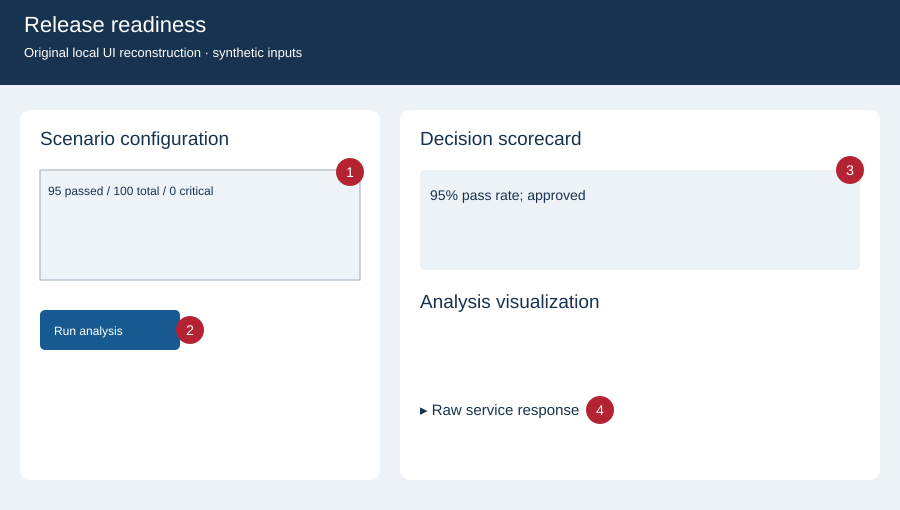

# Release readiness: technical walkthrough and executive evidence

Independent synthetic case study, not employer work or a measured business outcome.

## Click-by-click local application
1. Clone the repository and run `python service.py` from the root.
2. Open http://127.0.0.1:8765/service-index.html; select **Release readiness** (or open http://127.0.0.1:8765/service-demos/AI-Technical-Program-Manager.html directly).
3. In Scenario configuration, enter 95 passed / 100 total / 0 critical. See callout 1.
4. Select **Run analysis** (callout 2).
5. Read Decision scorecard (callout 3). Expected: 95% pass rate; approved.
6. Expand Raw service response to inspect the JSON (callout 4).
7. Change total to 0, then Run analysis again. Expected: Reject invalid input.
8. Inspect local SQLite runs table to confirm successful requests were saved. Do not use confidential data.

Actual screenshot capture is configured in browser CI, not yet verified. This drawing is an original reconstruction of the local application, not a vendor screenshot.

## Executive leadership case
| Decision element | Proposed evidence |
|---|---|
| Accountable forum | Release sponsor |
| Decision | Approve gated pilot only; require zero critical failures |
| Acceptance metric | 95% minimum pass rate |
| Risk and response | Model drift; hold release and retest |
| Evidence | Expected synthetic result: 95% pass rate; approved |

### Governance and delivery
Sponsor owns funding and acceptance; technical lead owns implementation; independent reviewer validates test evidence; operations lead owns support. Proposed 30-day pilot: week 1 baseline and scope; week 2 build; week 3 acceptance and risk review; week 4 sponsor decision. No actual sponsor decision, funding, or realized outcome is claimed. Production authorization requires security, integration and operational readiness evidence.
