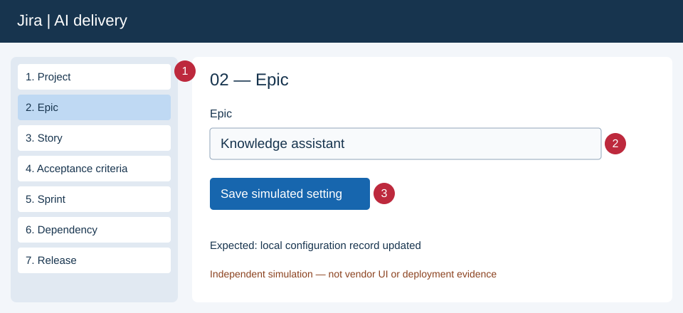
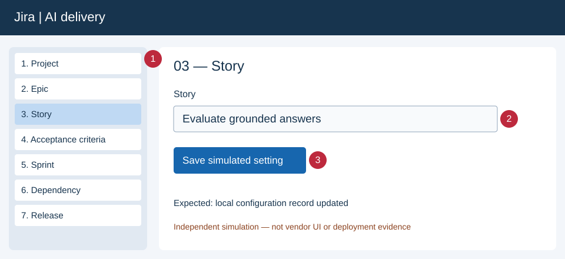
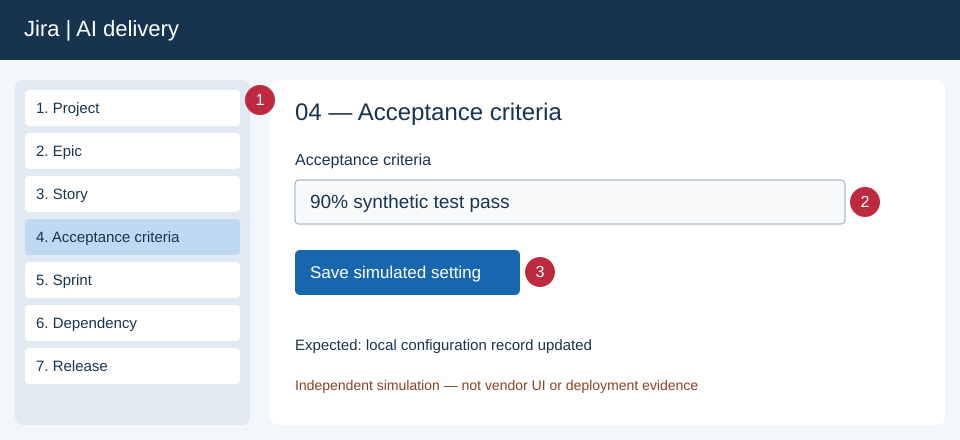
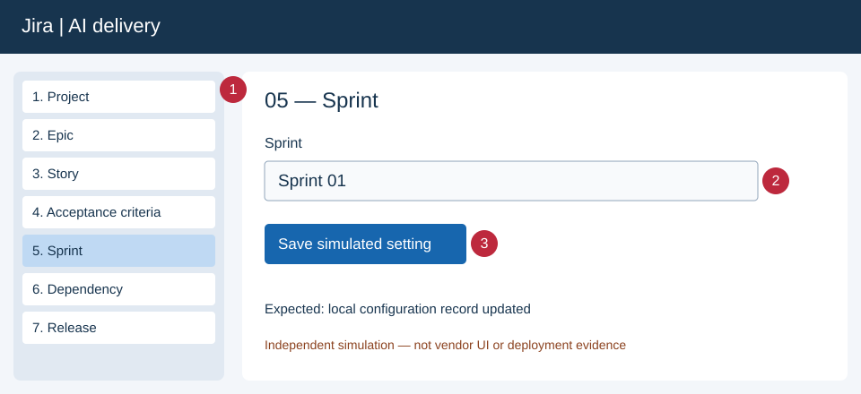
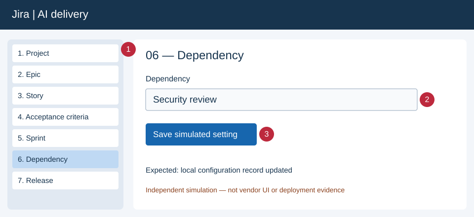
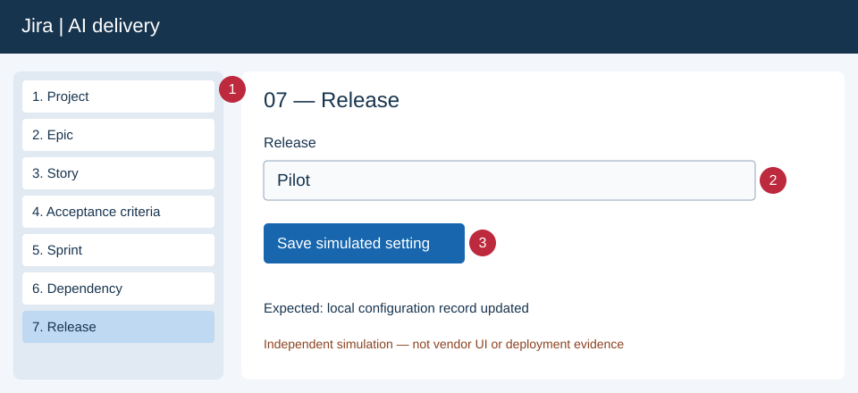

# Jira — AI delivery

Original interactive configuration simulation. Download index.html and open locally in a browser. GitHub file preview does not execute HTML. This is not a replica of the vendor interface; settings are illustrative and must be verified in a real sandbox.

[Interactive HTML source](index.html)

## 01 — Project

Select **Project** in the simulation navigation, enter `AI Enablement`, then select **Save simulated setting**. Confirm the configuration record contains the value before selecting Next step. This verifies local state only.

## 02 — Epic

Select **Epic** in the simulation navigation, enter `Knowledge assistant`, then select **Save simulated setting**. Confirm the configuration record contains the value before selecting Next step. This verifies local state only.

## 03 — Story

Select **Story** in the simulation navigation, enter `Evaluate grounded answers`, then select **Save simulated setting**. Confirm the configuration record contains the value before selecting Next step. This verifies local state only.

## 04 — Acceptance criteria

Select **Acceptance criteria** in the simulation navigation, enter `90% synthetic test pass`, then select **Save simulated setting**. Confirm the configuration record contains the value before selecting Next step. This verifies local state only.

## 05 — Sprint

Select **Sprint** in the simulation navigation, enter `Sprint 01`, then select **Save simulated setting**. Confirm the configuration record contains the value before selecting Next step. This verifies local state only.

## 06 — Dependency

Select **Dependency** in the simulation navigation, enter `Security review`, then select **Save simulated setting**. Confirm the configuration record contains the value before selecting Next step. This verifies local state only.

## 07 — Release

Select **Release** in the simulation navigation, enter `Pilot`, then select **Save simulated setting**. Confirm the configuration record contains the value before selecting Next step. This verifies local state only.

