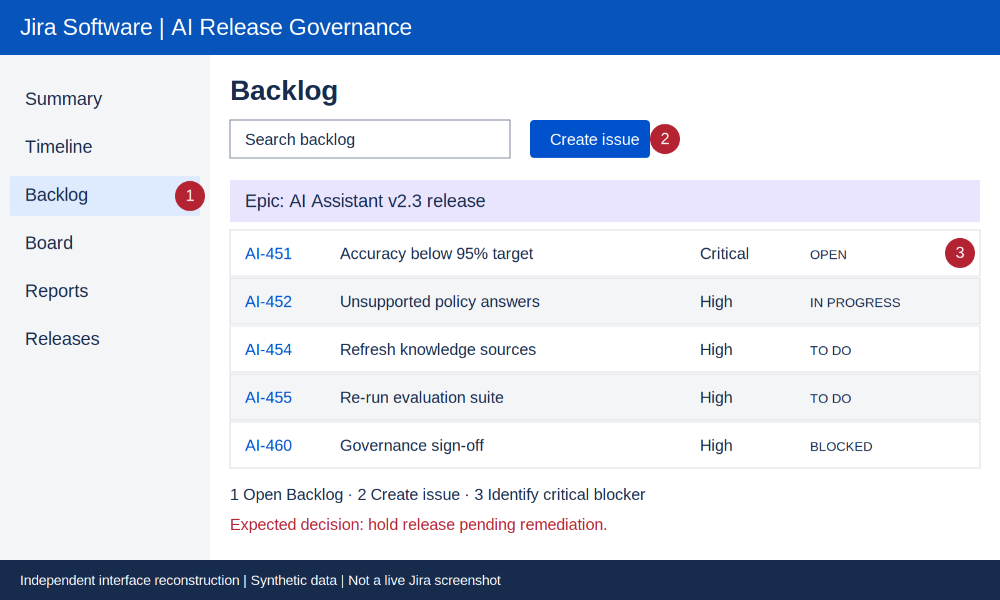
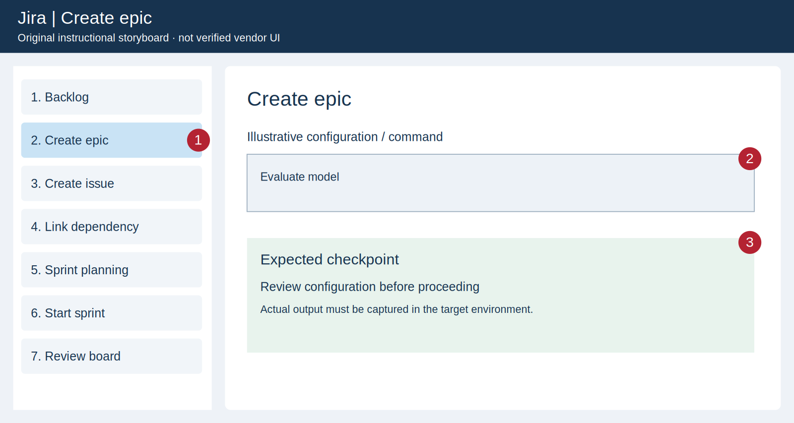
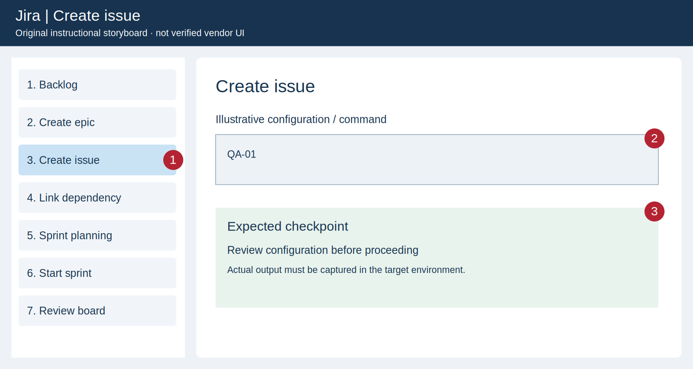
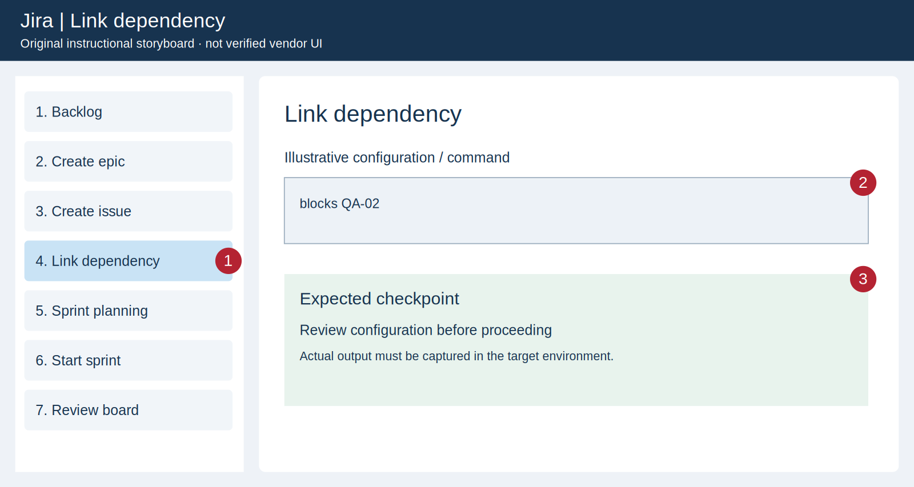
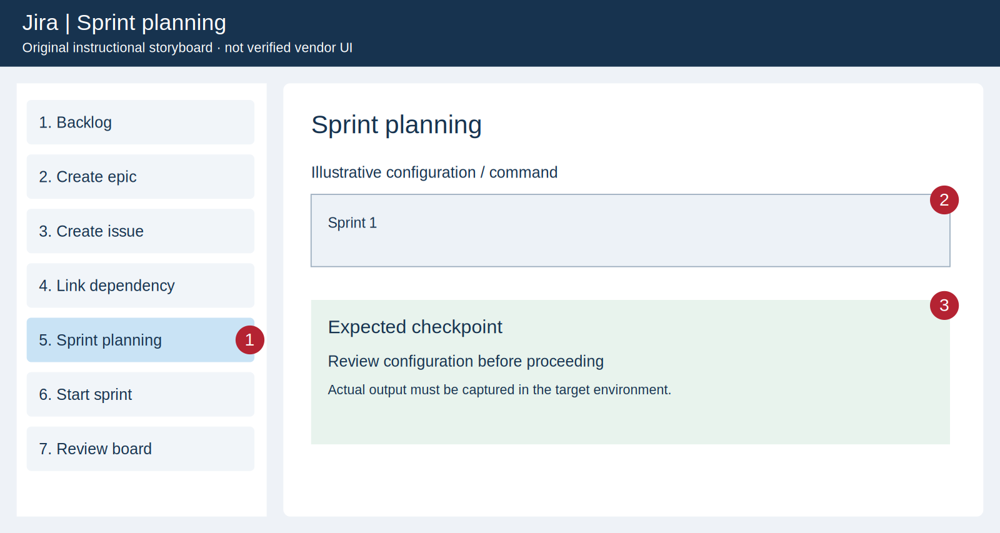
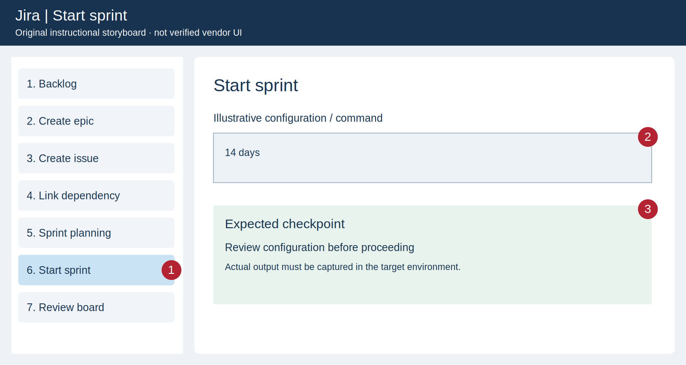
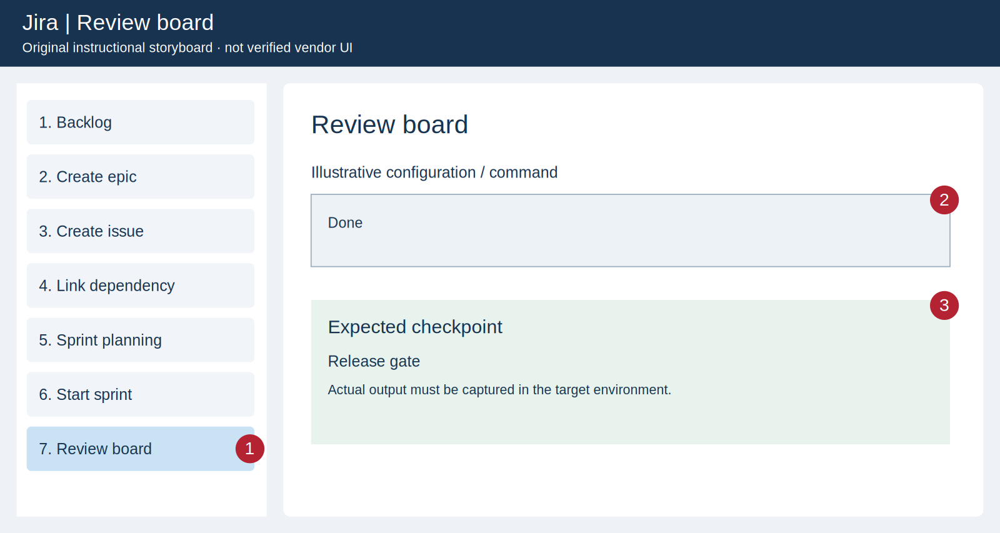

# Jira — numbered implementation walkthrough

Independent instructional storyboard. The navigation labels below are illustrative task stages, not verified vendor menu paths. No vendor deployment is claimed. Use synthetic data only. Prerequisites: browser for local illustrations; actual platform account, permissions and licensing must be established separately.

## Step 1: Backlog
1. In the illustrated Jira workflow, locate callout 1 (Backlog).
2. Inspect callout 2 and the sample value `AI Release`.
3. Review the expected checkpoint at callout 3: configuration reviewed before continuing.
4. In the real environment, verify the equivalent control and capture actual output before proceeding.

## Step 2: Create epic
1. In the illustrated Jira workflow, locate callout 1 (Create epic).
2. Inspect callout 2 and the sample value `Evaluate model`.
3. Review the expected checkpoint at callout 3: configuration reviewed before continuing.
4. In the real environment, verify the equivalent control and capture actual output before proceeding.

## Step 3: Create issue
1. In the illustrated Jira workflow, locate callout 1 (Create issue).
2. Inspect callout 2 and the sample value `QA-01`.
3. Review the expected checkpoint at callout 3: configuration reviewed before continuing.
4. In the real environment, verify the equivalent control and capture actual output before proceeding.

## Step 4: Link dependency
1. In the illustrated Jira workflow, locate callout 1 (Link dependency).
2. Inspect callout 2 and the sample value `blocks QA-02`.
3. Review the expected checkpoint at callout 3: configuration reviewed before continuing.
4. In the real environment, verify the equivalent control and capture actual output before proceeding.

## Step 5: Sprint planning
1. In the illustrated Jira workflow, locate callout 1 (Sprint planning).
2. Inspect callout 2 and the sample value `Sprint 1`.
3. Review the expected checkpoint at callout 3: configuration reviewed before continuing.
4. In the real environment, verify the equivalent control and capture actual output before proceeding.

## Step 6: Start sprint
1. In the illustrated Jira workflow, locate callout 1 (Start sprint).
2. Inspect callout 2 and the sample value `14 days`.
3. Review the expected checkpoint at callout 3: configuration reviewed before continuing.
4. In the real environment, verify the equivalent control and capture actual output before proceeding.

## Step 7: Review board
1. In the illustrated Jira workflow, locate callout 1 (Review board).
2. Inspect callout 2 and the sample value `Done`.
3. Review the expected checkpoint at callout 3: Release gate.
4. In the real environment, verify the equivalent control and capture actual output before proceeding.

## Troubleshooting and executive acceptance
If a control is unavailable, verify role permissions, licensing and product version. If validation fails, stop, preserve the error and correct the input. Executive gate: Release gate. Record actual test output, reviewer and decision; do not claim completion without evidence.
