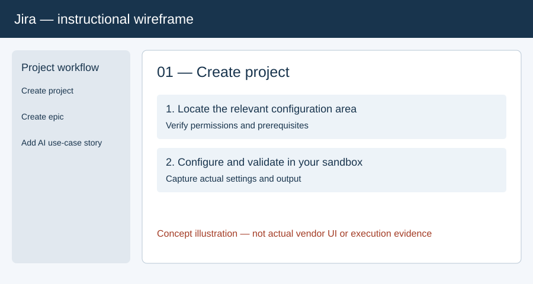
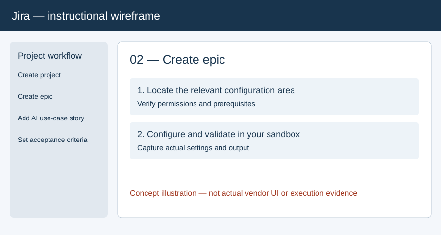
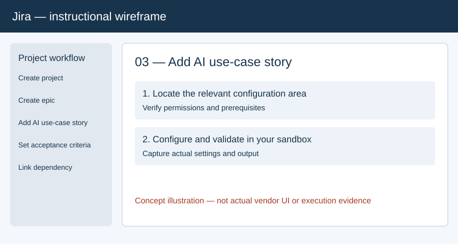
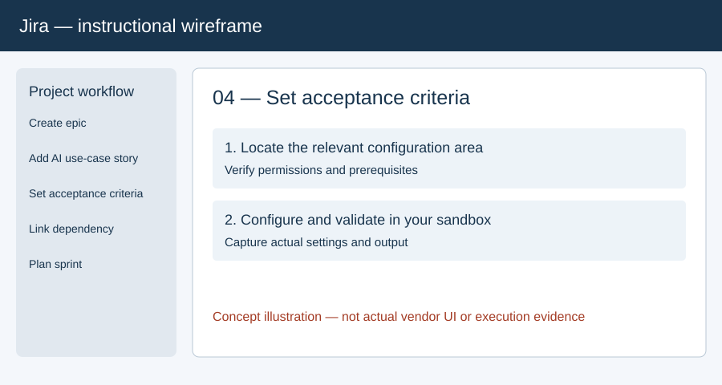
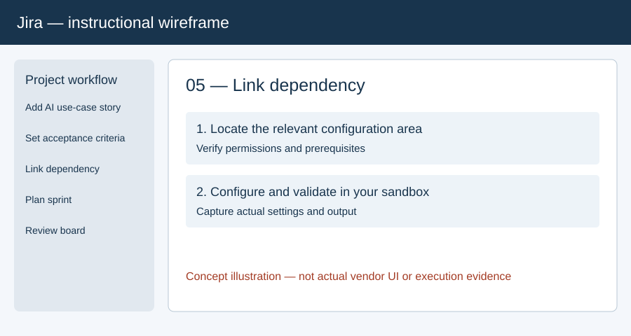
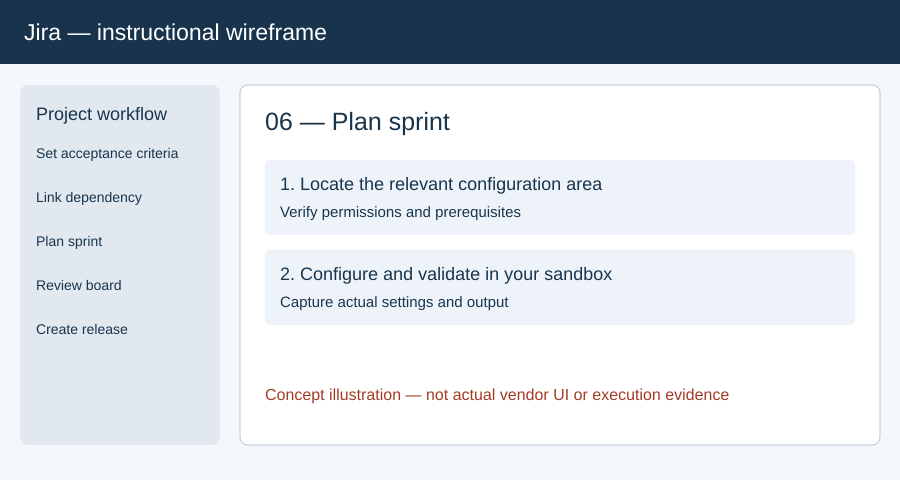
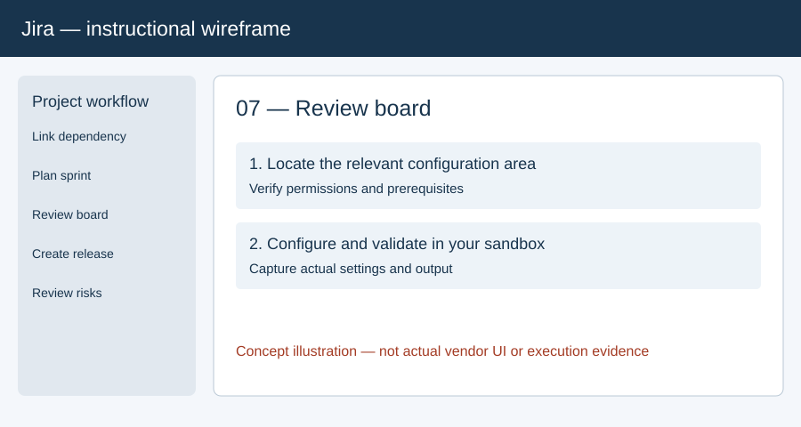
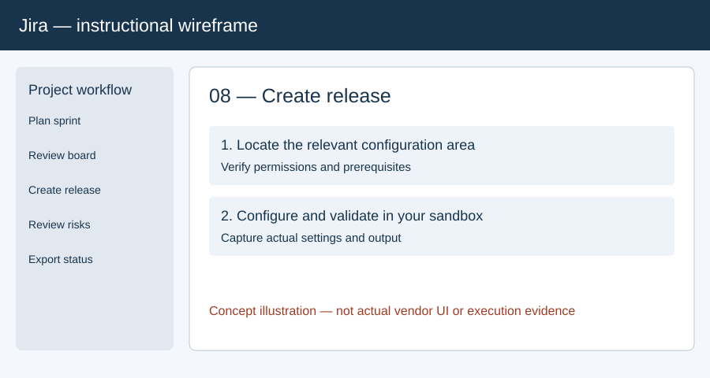
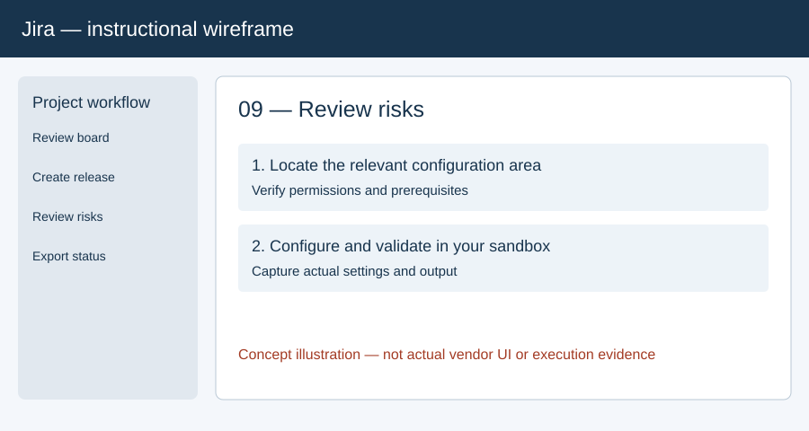
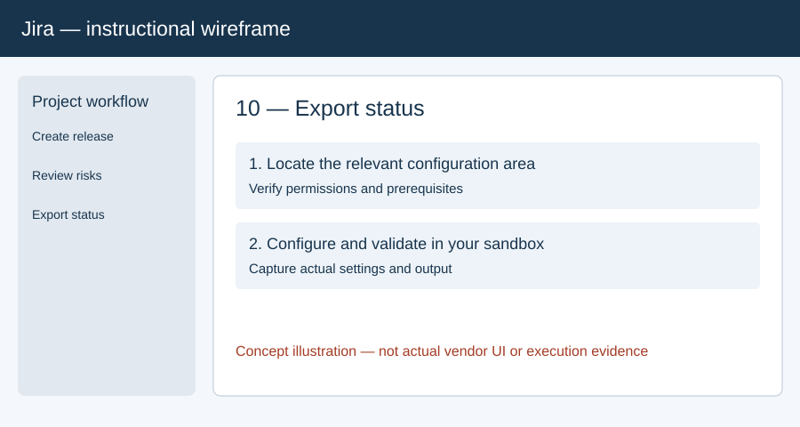

# Jira: visual implementation guide

**Status:** original instructional wireframes, not vendor screenshots. Navigation and licensing must be verified in a live sandbox. Use fictional data; do not publish secrets.

## 01 — Create project

**Action:** In your Jira sandbox, locate the create project capability using the relevant workspace or administration area. Review prerequisites and permissions before changing resources.

**Validation:** Capture the actual configuration and resulting output; record any errors and confirm the change against the project requirements. This step has not been executed in a vendor environment.

## 02 — Create epic

**Action:** In your Jira sandbox, locate the create epic capability using the relevant workspace or administration area. Review prerequisites and permissions before changing resources.

**Validation:** Capture the actual configuration and resulting output; record any errors and confirm the change against the project requirements. This step has not been executed in a vendor environment.

## 03 — Add AI use-case story

**Action:** In your Jira sandbox, locate the add ai use-case story capability using the relevant workspace or administration area. Review prerequisites and permissions before changing resources.

**Validation:** Capture the actual configuration and resulting output; record any errors and confirm the change against the project requirements. This step has not been executed in a vendor environment.

## 04 — Set acceptance criteria

**Action:** In your Jira sandbox, locate the set acceptance criteria capability using the relevant workspace or administration area. Review prerequisites and permissions before changing resources.

**Validation:** Capture the actual configuration and resulting output; record any errors and confirm the change against the project requirements. This step has not been executed in a vendor environment.

## 05 — Link dependency

**Action:** In your Jira sandbox, locate the link dependency capability using the relevant workspace or administration area. Review prerequisites and permissions before changing resources.

**Validation:** Capture the actual configuration and resulting output; record any errors and confirm the change against the project requirements. This step has not been executed in a vendor environment.

## 06 — Plan sprint

**Action:** In your Jira sandbox, locate the plan sprint capability using the relevant workspace or administration area. Review prerequisites and permissions before changing resources.

**Validation:** Capture the actual configuration and resulting output; record any errors and confirm the change against the project requirements. This step has not been executed in a vendor environment.

## 07 — Review board

**Action:** In your Jira sandbox, locate the review board capability using the relevant workspace or administration area. Review prerequisites and permissions before changing resources.

**Validation:** Capture the actual configuration and resulting output; record any errors and confirm the change against the project requirements. This step has not been executed in a vendor environment.

## 08 — Create release

**Action:** In your Jira sandbox, locate the create release capability using the relevant workspace or administration area. Review prerequisites and permissions before changing resources.

**Validation:** Capture the actual configuration and resulting output; record any errors and confirm the change against the project requirements. This step has not been executed in a vendor environment.

## 09 — Review risks

**Action:** In your Jira sandbox, locate the review risks capability using the relevant workspace or administration area. Review prerequisites and permissions before changing resources.

**Validation:** Capture the actual configuration and resulting output; record any errors and confirm the change against the project requirements. This step has not been executed in a vendor environment.

## 10 — Export status

**Action:** In your Jira sandbox, locate the export status capability using the relevant workspace or administration area. Review prerequisites and permissions before changing resources.

**Validation:** Capture the actual configuration and resulting output; record any errors and confirm the change against the project requirements. This step has not been executed in a vendor environment.

