# Click-by-click enterprise case studies

## Common enterprise challenges we should solve

Independent case studies using synthetic data. Existing visual previews are instructional reconstructions; vendor execution is unverified.

| Enterprise challenge | Proposed solution |
|---|---|
| [AI projects repeatedly fail release requirements](#challenge-1) | AI delivery and quality governance command center |
| [AI generates inaccurate answers from enterprise documents](#challenge-2) | Governed RAG and multi-agent architecture |
| [High AI investment with low employee adoption](#challenge-3) | Adoption, automation and ROI management platform |
| [Missed deadlines and cross-team dependencies](#challenge-4) | Integrated delivery and dependency management system |
| [Unauthorized AI usage and fragmented cloud infrastructure](#challenge-5) | Secure enterprise AI architecture |
| [Conflicting financial reports across departments](#challenge-6) | Centralized data platform and governed reporting |
| [Disconnected applications and manual approvals](#challenge-7) | Enterprise integration and automation platform |
| [Cost overruns and competing technology investments](#challenge-8) | Strategic portfolio performance management system |

### Challenge 1

**AI projects repeatedly fail release requirements**

Proposed solution: AI delivery and quality governance command center. Target role: AI Technical Program Manager.

[Local implementation](AI-Technical-Program-Manager/flagship/README.md) · [Executive leadership evidence](AI-Technical-Program-Manager/flagship/evidence/EXECUTIVE-PACKAGE.md)

<table>
<tr>
<td width="33%"><a href="AI-Technical-Program-Manager/simulations/jira/walkthrough/README.md">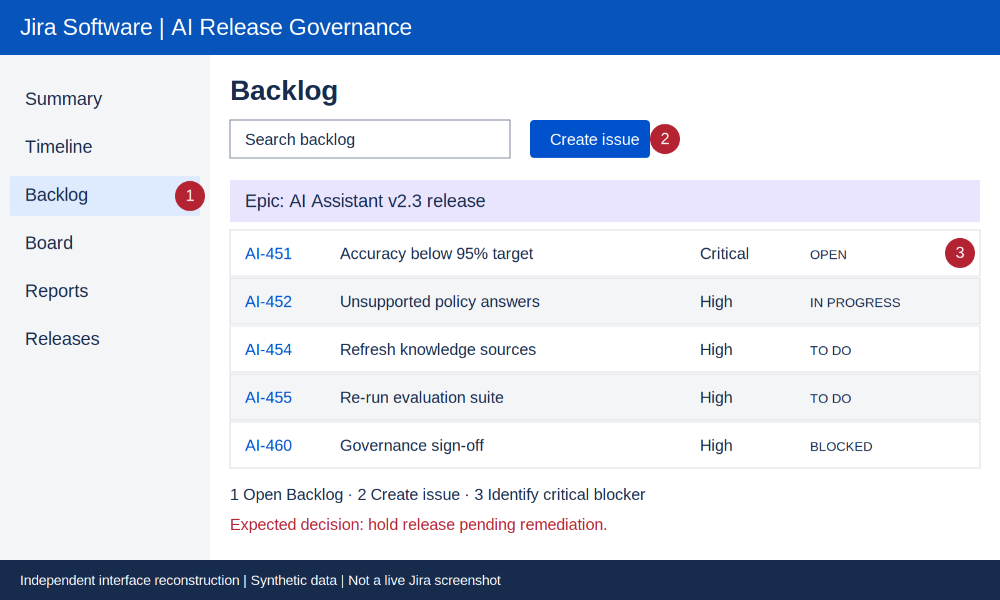</a> <strong>Jira</strong> <a href="AI-Technical-Program-Manager/simulations/jira/walkthrough/README.md">Implementation walkthrough</a></td>
</tr>
</table>

### Challenge 2

**AI generates inaccurate answers from enterprise documents**

Proposed solution: Governed RAG and multi-agent architecture. Target role: Principal AI Solution Architect.

[Local implementation](Principal-AI-Solution-Architect/flagship/README.md) · [Executive leadership evidence](Principal-AI-Solution-Architect/flagship/evidence/EXECUTIVE-PACKAGE.md)

<table>
<tr>
<td width="33%"><a href="Principal-AI-Solution-Architect/simulations/azure-ai-foundry/walkthrough/README.md">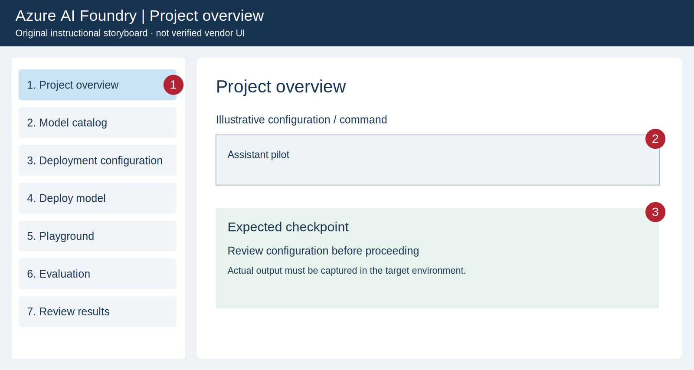</a> <strong>Azure AI Foundry</strong> <a href="Principal-AI-Solution-Architect/simulations/azure-ai-foundry/walkthrough/README.md">Implementation walkthrough</a></td>
<td width="33%"><a href="Principal-AI-Solution-Architect/simulations/langchain/walkthrough/README.md">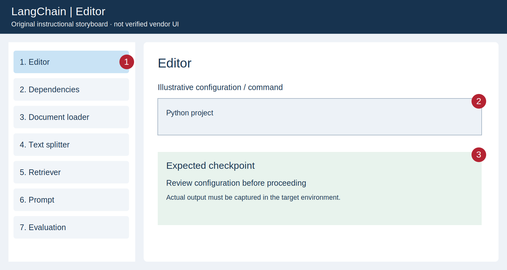</a> <strong>LangChain</strong> <a href="Principal-AI-Solution-Architect/simulations/langchain/walkthrough/README.md">Implementation walkthrough</a></td>
<td width="33%"><a href="Principal-AI-Solution-Architect/simulations/langgraph/walkthrough/README.md">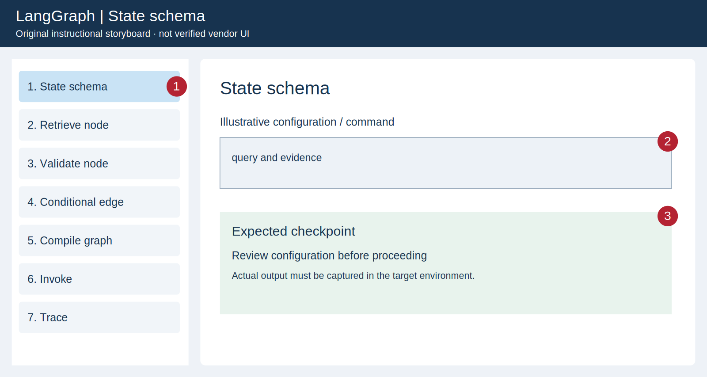</a> <strong>LangGraph</strong> <a href="Principal-AI-Solution-Architect/simulations/langgraph/walkthrough/README.md">Implementation walkthrough</a></td>
</tr>
<tr>
<td width="33%"> <strong>React</strong> <a href="Principal-AI-Solution-Architect/simulations/react/walkthrough/README.md">Implementation walkthrough</a></td>
</tr>
</table>

### Challenge 3

**High AI investment with low employee adoption**

Proposed solution: Adoption, automation and ROI management platform. Target role: Director AI Digital Transformation.

[Local implementation](Director-AI-Digital-Transformation/flagship/README.md) · [Executive leadership evidence](Director-AI-Digital-Transformation/flagship/evidence/EXECUTIVE-PACKAGE.md)

<table>
<tr>
<td width="33%"><a href="Director-AI-Digital-Transformation/simulations/copilot-studio/walkthrough/README.md">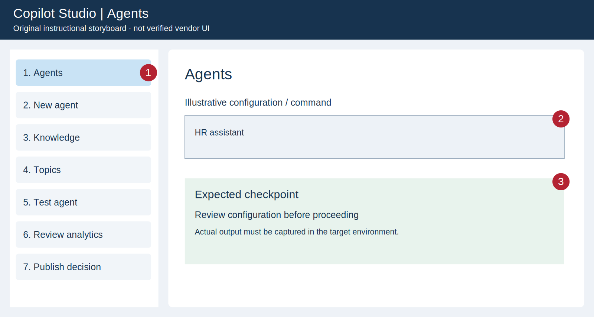</a> <strong>Copilot Studio</strong> <a href="Director-AI-Digital-Transformation/simulations/copilot-studio/walkthrough/README.md">Implementation walkthrough</a></td>
<td width="33%"><a href="Director-AI-Digital-Transformation/simulations/crewai/walkthrough/README.md">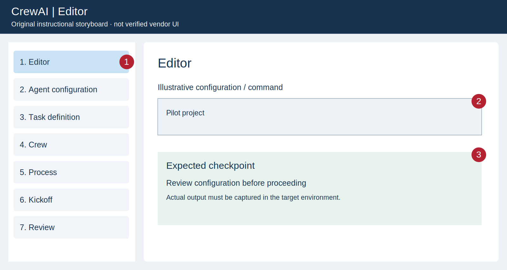</a> <strong>CrewAI</strong> <a href="Director-AI-Digital-Transformation/simulations/crewai/walkthrough/README.md">Implementation walkthrough</a></td>
</tr>
</table>

### Challenge 4

**Missed deadlines and cross-team dependencies**

Proposed solution: Integrated delivery and dependency management system. Target role: Principal Technical Program Manager.

[Local implementation](Principal-Technical-Program-Manager/flagship/README.md) · [Executive leadership evidence](Principal-Technical-Program-Manager/flagship/evidence/EXECUTIVE-PACKAGE.md)

<table>
<tr>
<td width="33%"><a href="Principal-Technical-Program-Manager/simulations/azure-devops/walkthrough/README.md">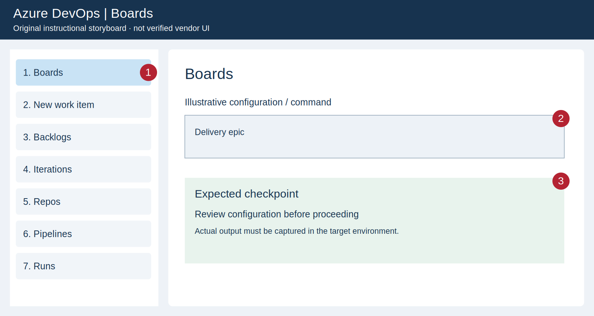</a> <strong>Azure DevOps</strong> <a href="Principal-Technical-Program-Manager/simulations/azure-devops/walkthrough/README.md">Implementation walkthrough</a></td>
<td width="33%"><a href="Principal-Technical-Program-Manager/simulations/github-actions/walkthrough/README.md">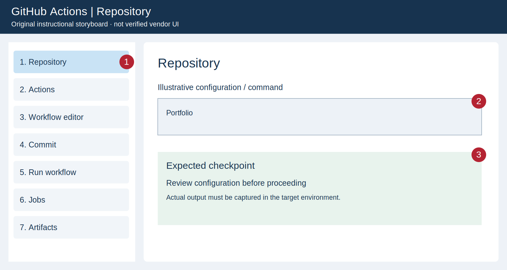</a> <strong>GitHub Actions</strong> <a href="Principal-Technical-Program-Manager/simulations/github-actions/walkthrough/README.md">Implementation walkthrough</a></td>
</tr>
</table>

### Challenge 5

**Unauthorized AI usage and fragmented cloud infrastructure**

Proposed solution: Secure enterprise AI architecture. Target role: Enterprise AI Architect.

[Local implementation](Enterprise-AI-Architect/flagship/README.md) · [Executive leadership evidence](Enterprise-AI-Architect/flagship/evidence/EXECUTIVE-PACKAGE.md)

<table>
<tr>
<td width="33%"><a href="Enterprise-AI-Architect/simulations/aws/walkthrough/README.md">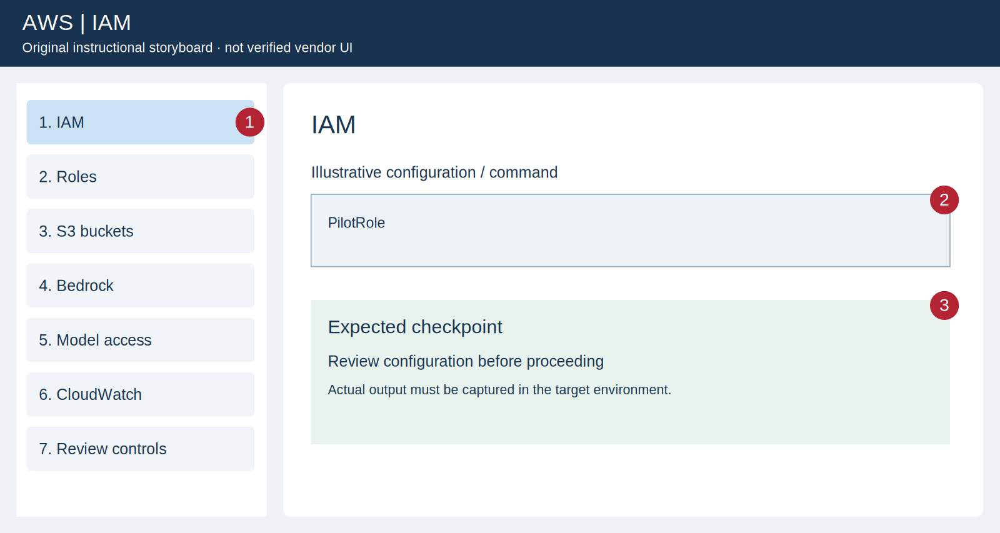</a> <strong>AWS</strong> <a href="Enterprise-AI-Architect/simulations/aws/walkthrough/README.md">Implementation walkthrough</a></td>
<td width="33%"><a href="Enterprise-AI-Architect/simulations/google-cloud/walkthrough/README.md">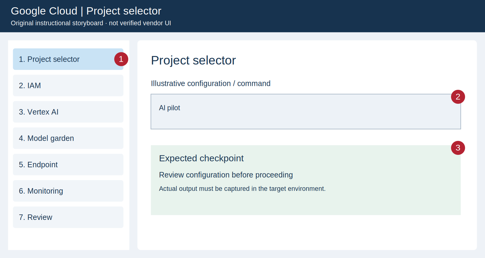</a> <strong>Google Cloud</strong> <a href="Enterprise-AI-Architect/simulations/google-cloud/walkthrough/README.md">Implementation walkthrough</a></td>
<td width="33%"><a href="Enterprise-AI-Architect/simulations/docker/walkthrough/README.md">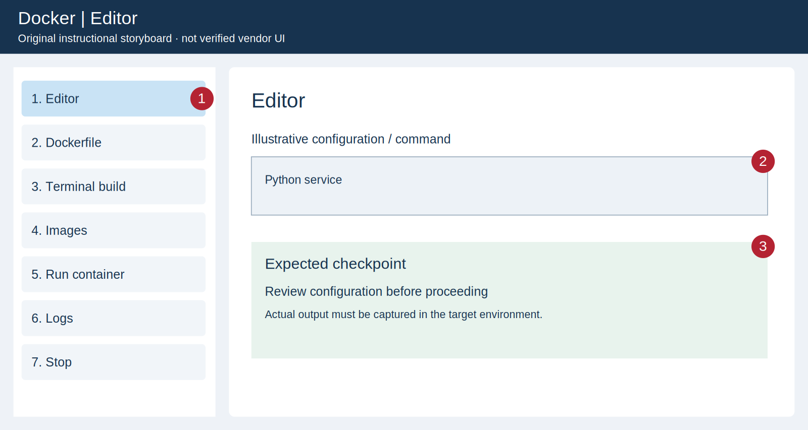</a> <strong>Docker</strong> <a href="Enterprise-AI-Architect/simulations/docker/walkthrough/README.md">Implementation walkthrough</a></td>
</tr>
<tr>
<td width="33%"><a href="Enterprise-AI-Architect/simulations/firebase/walkthrough/README.md">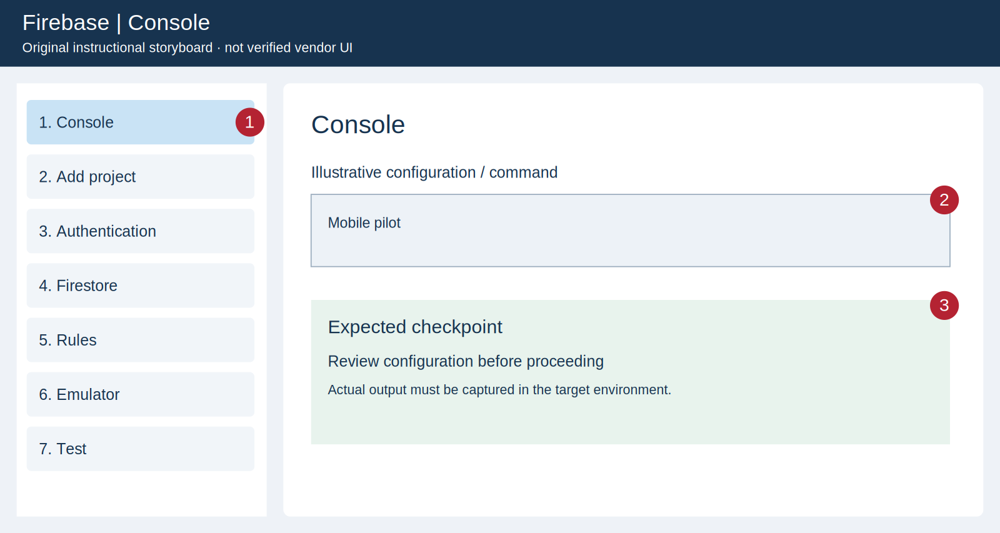</a> <strong>Firebase</strong> <a href="Enterprise-AI-Architect/simulations/firebase/walkthrough/README.md">Implementation walkthrough</a></td>
<td width="33%"><a href="Enterprise-AI-Architect/simulations/c-/walkthrough/README.md">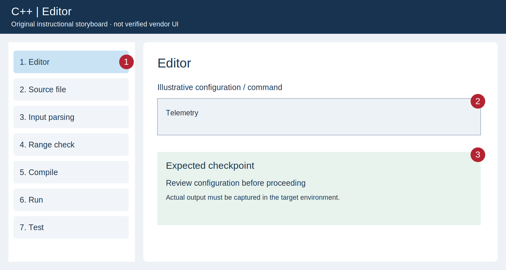</a> <strong>C++</strong> <a href="Enterprise-AI-Architect/simulations/c-/walkthrough/README.md">Implementation walkthrough</a></td>
<td width="33%"><a href="Enterprise-AI-Architect/simulations/terraform/walkthrough/README.md">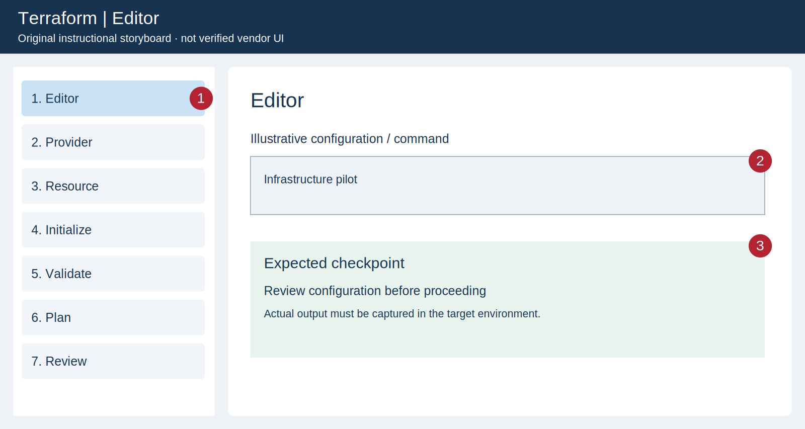</a> <strong>Terraform</strong> <a href="Enterprise-AI-Architect/simulations/terraform/walkthrough/README.md">Implementation walkthrough</a></td>
</tr>
</table>

### Challenge 6

**Conflicting financial reports across departments**

Proposed solution: Centralized data platform and governed reporting. Target role: Director Business Intelligence.

[Local implementation](Director-Business-Intelligence/flagship/README.md) · [Executive leadership evidence](Director-Business-Intelligence/flagship/evidence/EXECUTIVE-PACKAGE.md)

<table>
<tr>
<td width="33%"><a href="Director-Business-Intelligence/simulations/microsoft-fabric/walkthrough/README.md">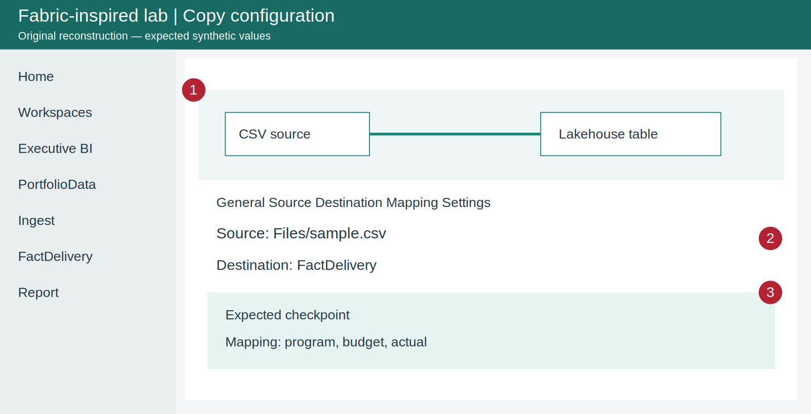</a> <strong>Microsoft Fabric</strong> <a href="Director-Business-Intelligence/simulations/microsoft-fabric/walkthrough/README.md">Implementation walkthrough</a></td>
</tr>
</table>

### Challenge 7

**Disconnected applications and manual approvals**

Proposed solution: Enterprise integration and automation platform. Target role: Director Enterprise Applications.

[Local implementation](Director-Enterprise-Applications/flagship/README.md) · [Executive leadership evidence](Director-Enterprise-Applications/flagship/evidence/EXECUTIVE-PACKAGE.md)

<table>
<tr>
<td width="33%"><a href="Director-Enterprise-Applications/simulations/power-apps/walkthrough/README.md">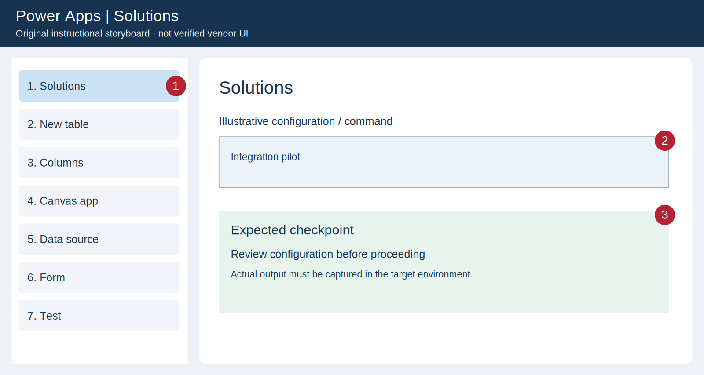</a> <strong>Power Apps</strong> <a href="Director-Enterprise-Applications/simulations/power-apps/walkthrough/README.md">Implementation walkthrough</a></td>
<td width="33%"><a href="Director-Enterprise-Applications/simulations/mulesoft/walkthrough/README.md">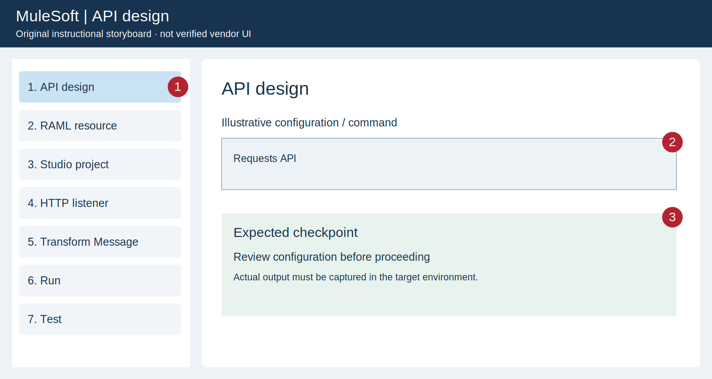</a> <strong>MuleSoft</strong> <a href="Director-Enterprise-Applications/simulations/mulesoft/walkthrough/README.md">Implementation walkthrough</a></td>
<td width="33%"><a href="Director-Enterprise-Applications/simulations/workato/walkthrough/README.md">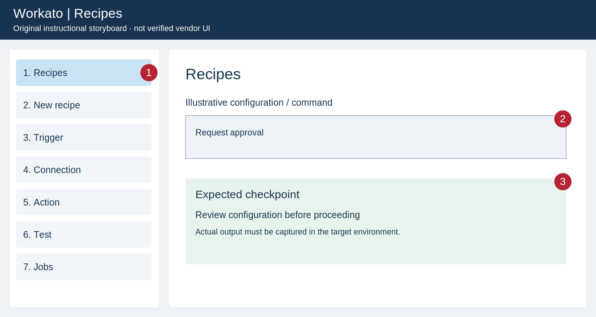</a> <strong>Workato</strong> <a href="Director-Enterprise-Applications/simulations/workato/walkthrough/README.md">Implementation walkthrough</a></td>
</tr>
<tr>
<td width="33%"><a href="Director-Enterprise-Applications/simulations/sap-btp/walkthrough/README.md">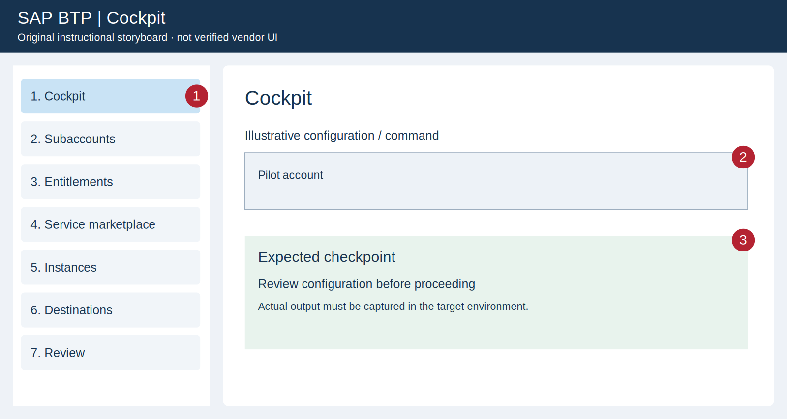</a> <strong>SAP BTP</strong> <a href="Director-Enterprise-Applications/simulations/sap-btp/walkthrough/README.md">Implementation walkthrough</a></td>
<td width="33%"><a href="Director-Enterprise-Applications/simulations/salesforce/walkthrough/README.md">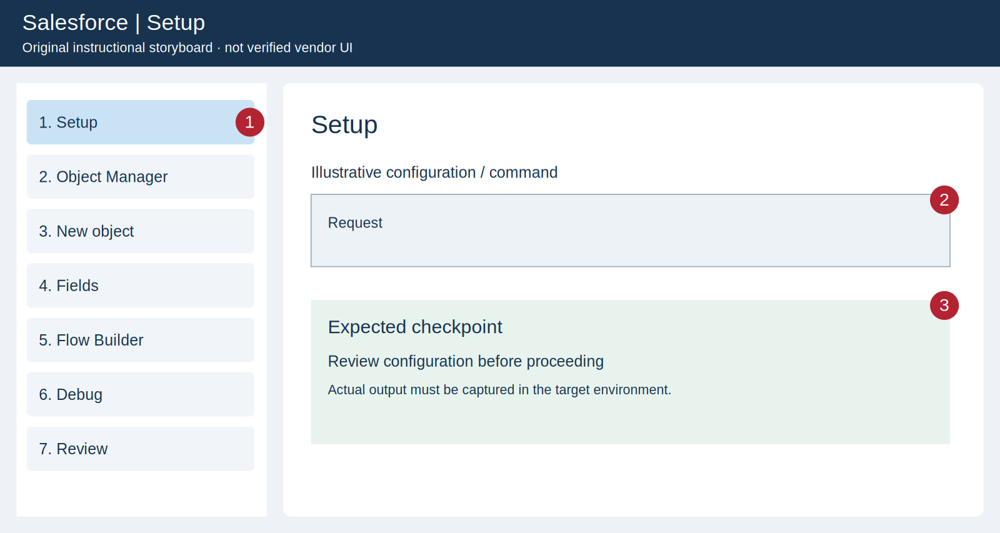</a> <strong>Salesforce</strong> <a href="Director-Enterprise-Applications/simulations/salesforce/walkthrough/README.md">Implementation walkthrough</a></td>
<td width="33%"><a href="Director-Enterprise-Applications/simulations/servicenow/walkthrough/README.md">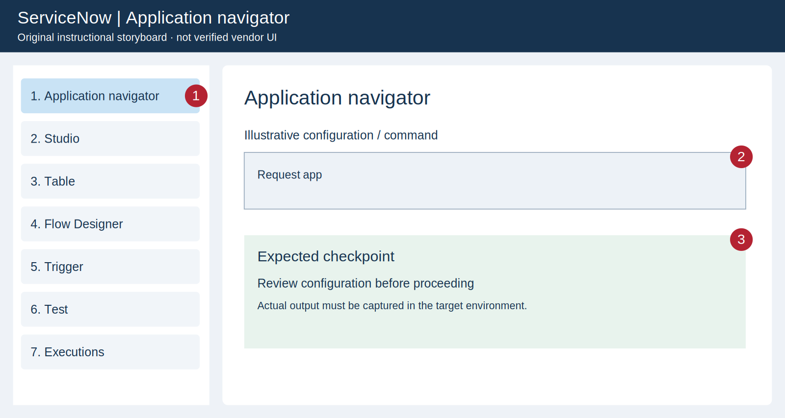</a> <strong>ServiceNow</strong> <a href="Director-Enterprise-Applications/simulations/servicenow/walkthrough/README.md">Implementation walkthrough</a></td>
</tr>
<tr>
<td width="33%"><a href="Director-Enterprise-Applications/simulations/angular/walkthrough/README.md">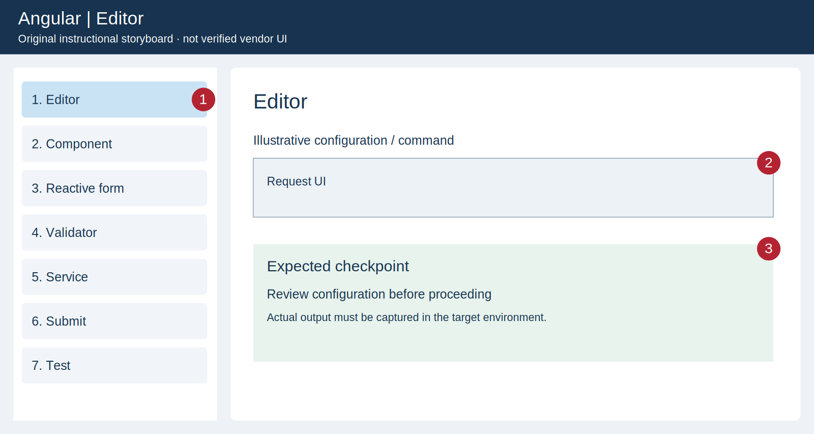</a> <strong>Angular</strong> <a href="Director-Enterprise-Applications/simulations/angular/walkthrough/README.md">Implementation walkthrough</a></td>
<td width="33%"> <strong>Vue</strong> <a href="Director-Enterprise-Applications/simulations/vue/walkthrough/README.md">Implementation walkthrough</a></td>
<td width="33%"><a href="Director-Enterprise-Applications/simulations/meteor/walkthrough/README.md">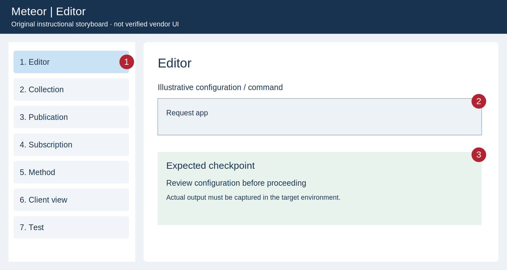</a> <strong>Meteor</strong> <a href="Director-Enterprise-Applications/simulations/meteor/walkthrough/README.md">Implementation walkthrough</a></td>
</tr>
<tr>
<td width="33%"><a href="Director-Enterprise-Applications/simulations/java/walkthrough/README.md">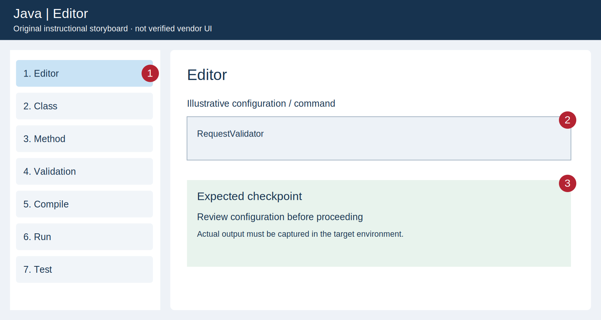</a> <strong>Java</strong> <a href="Director-Enterprise-Applications/simulations/java/walkthrough/README.md">Implementation walkthrough</a></td>
<td width="33%"> <strong>Node.js</strong> <a href="Director-Enterprise-Applications/simulations/node-js/walkthrough/README.md">Implementation walkthrough</a></td>
</tr>
</table>

### Challenge 8

**Cost overruns and competing technology investments**

Proposed solution: Strategic portfolio performance management system. Target role: Director Technology Programs.

[Local implementation](Director-Technology-Programs/flagship/README.md) · [Executive leadership evidence](Director-Technology-Programs/flagship/evidence/EXECUTIVE-PACKAGE.md)

<table>
<tr>
<td width="33%"><a href="Director-Technology-Programs/simulations/power-bi/walkthrough/README.md">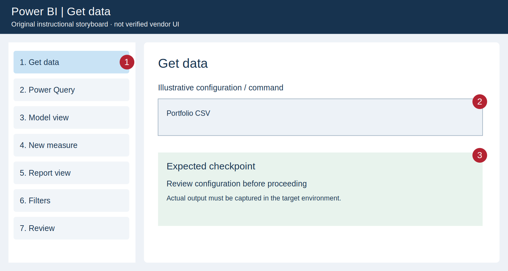</a> <strong>Power BI</strong> <a href="Director-Technology-Programs/simulations/power-bi/walkthrough/README.md">Implementation walkthrough</a></td>
</tr>
</table>

