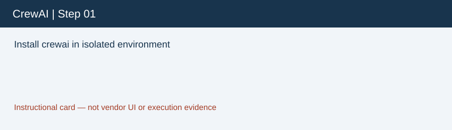
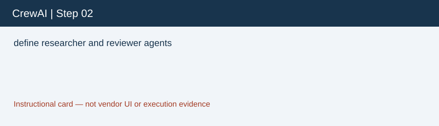
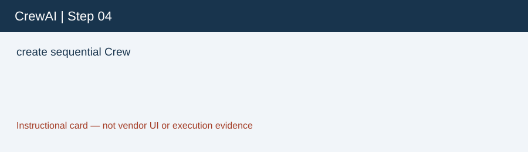
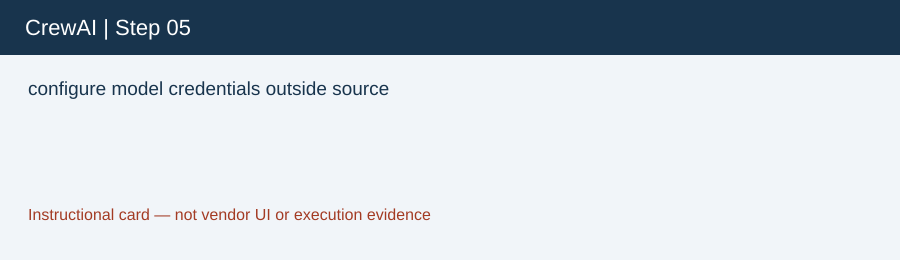
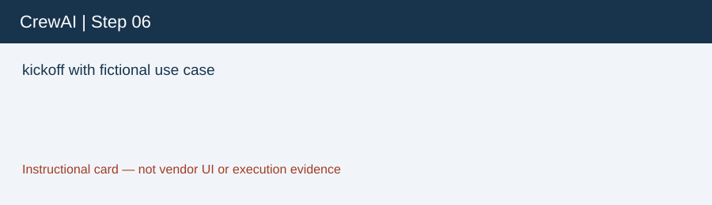
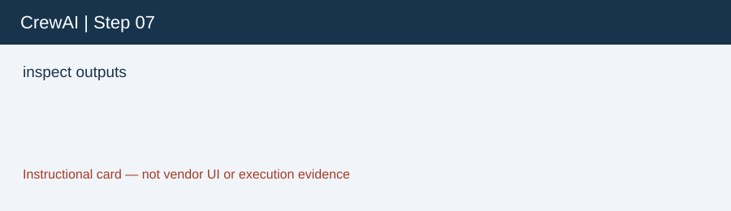
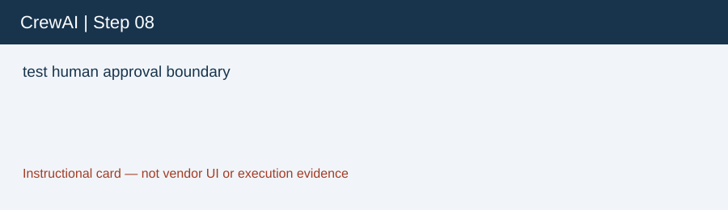

# CrewAI implementation lab

Status: proposed procedure, not executed or verified against current vendor UI. Use synthetic data and authorized sandbox only. Review pricing, permissions and version-specific documentation first.

## 01. Install crewai in isolated environment

**Action:** Install crewai in isolated environment.

**Evidence:** Capture the actual interface or terminal output after completing this action. Record version, settings (redact credentials), result and any error. Do not mark passed until observed.

## 02. define researcher and reviewer agents

**Action:** define researcher and reviewer agents.

**Evidence:** Capture the actual interface or terminal output after completing this action. Record version, settings (redact credentials), result and any error. Do not mark passed until observed.

## 03. define tasks and expected outputs

**Action:** define tasks and expected outputs.

**Evidence:** Capture the actual interface or terminal output after completing this action. Record version, settings (redact credentials), result and any error. Do not mark passed until observed.

## 04. create sequential Crew

**Action:** create sequential Crew.

**Evidence:** Capture the actual interface or terminal output after completing this action. Record version, settings (redact credentials), result and any error. Do not mark passed until observed.

## 05. configure model credentials outside source

**Action:** configure model credentials outside source.

**Evidence:** Capture the actual interface or terminal output after completing this action. Record version, settings (redact credentials), result and any error. Do not mark passed until observed.

## 06. kickoff with fictional use case

**Action:** kickoff with fictional use case.

**Evidence:** Capture the actual interface or terminal output after completing this action. Record version, settings (redact credentials), result and any error. Do not mark passed until observed.

## 07. inspect outputs

**Action:** inspect outputs.

**Evidence:** Capture the actual interface or terminal output after completing this action. Record version, settings (redact credentials), result and any error. Do not mark passed until observed.

## 08. test human approval boundary

**Action:** test human approval boundary.

**Evidence:** Capture the actual interface or terminal output after completing this action. Record version, settings (redact credentials), result and any error. Do not mark passed until observed.

