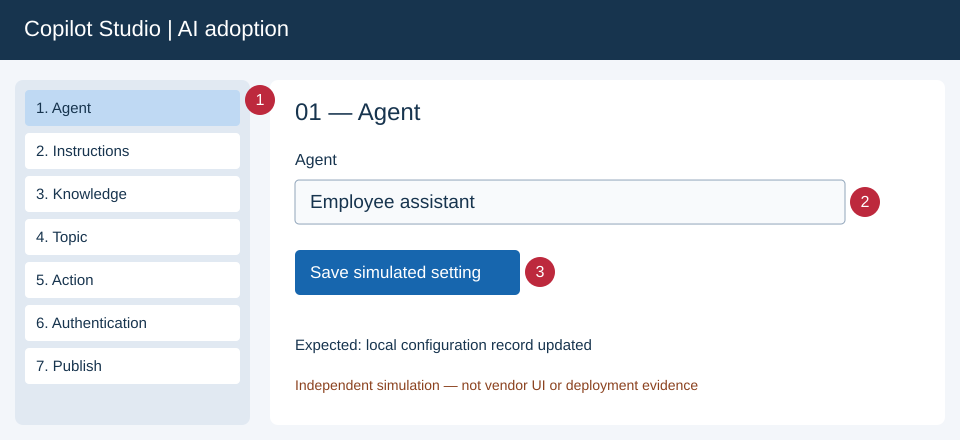
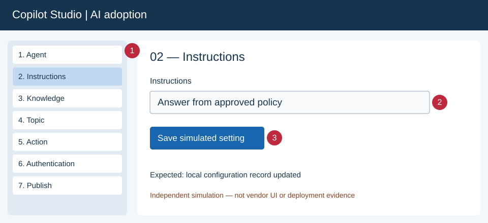
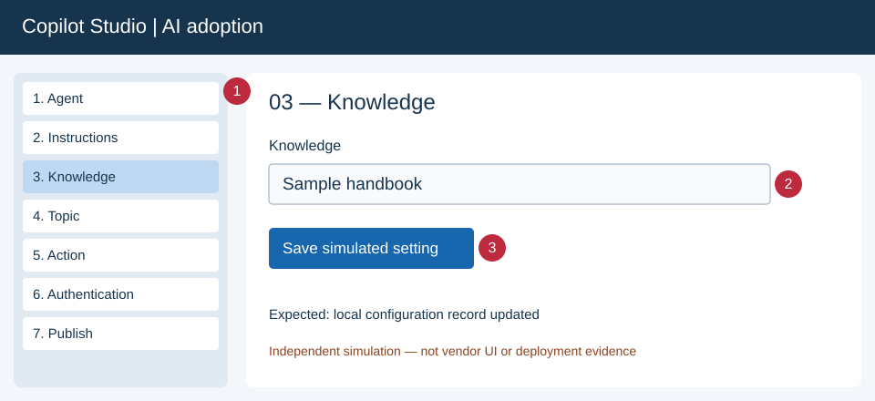
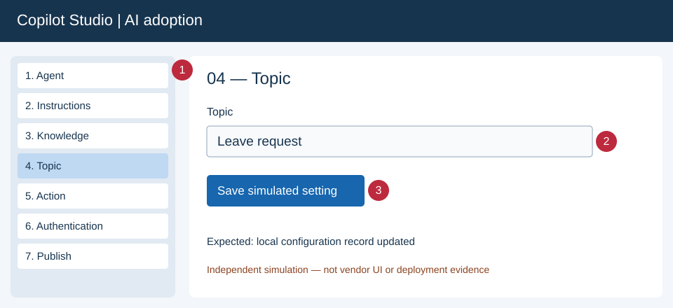
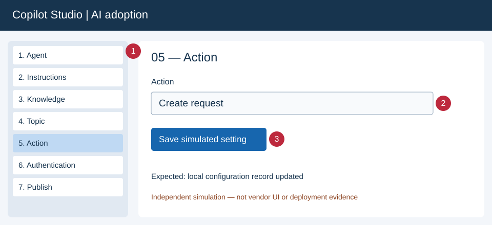
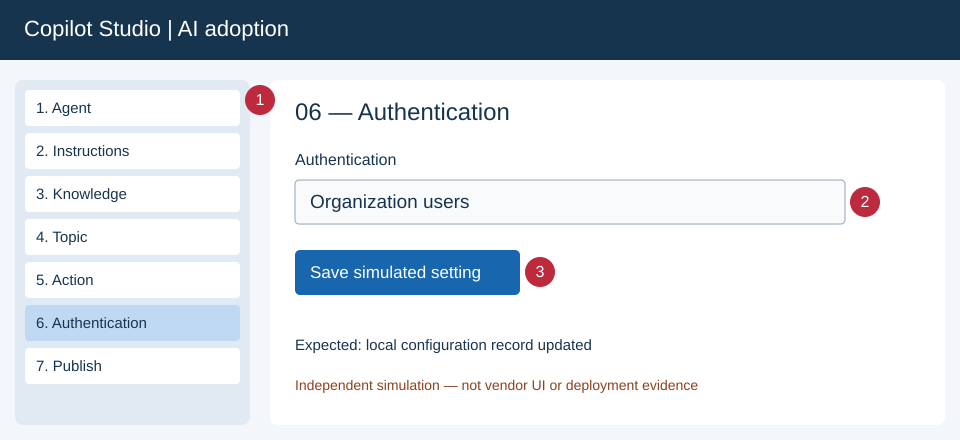
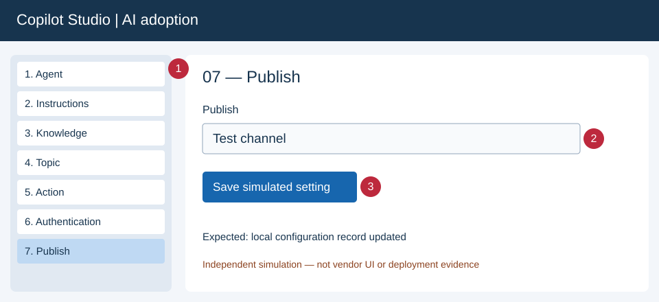

# Copilot Studio — AI adoption

Original interactive configuration simulation. Download index.html and open locally in a browser. GitHub file preview does not execute HTML. This is not a replica of the vendor interface; settings are illustrative and must be verified in a real sandbox.

[Interactive HTML source](index.html)

## 01 — Agent

Select **Agent** in the simulation navigation, enter `Employee assistant`, then select **Save simulated setting**. Confirm the configuration record contains the value before selecting Next step. This verifies local state only.

## 02 — Instructions

Select **Instructions** in the simulation navigation, enter `Answer from approved policy`, then select **Save simulated setting**. Confirm the configuration record contains the value before selecting Next step. This verifies local state only.

## 03 — Knowledge

Select **Knowledge** in the simulation navigation, enter `Sample handbook`, then select **Save simulated setting**. Confirm the configuration record contains the value before selecting Next step. This verifies local state only.

## 04 — Topic

Select **Topic** in the simulation navigation, enter `Leave request`, then select **Save simulated setting**. Confirm the configuration record contains the value before selecting Next step. This verifies local state only.

## 05 — Action

Select **Action** in the simulation navigation, enter `Create request`, then select **Save simulated setting**. Confirm the configuration record contains the value before selecting Next step. This verifies local state only.

## 06 — Authentication

Select **Authentication** in the simulation navigation, enter `Organization users`, then select **Save simulated setting**. Confirm the configuration record contains the value before selecting Next step. This verifies local state only.

## 07 — Publish

Select **Publish** in the simulation navigation, enter `Test channel`, then select **Save simulated setting**. Confirm the configuration record contains the value before selecting Next step. This verifies local state only.

