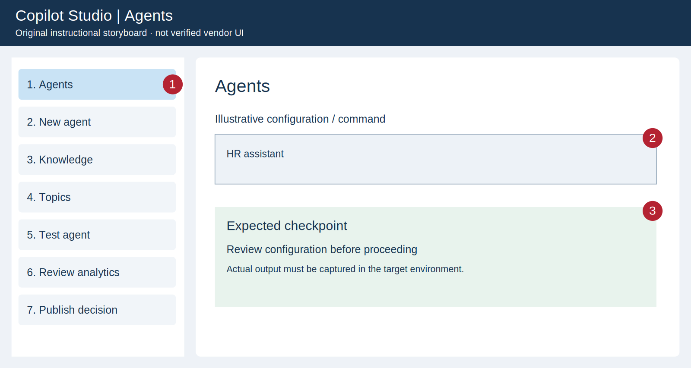
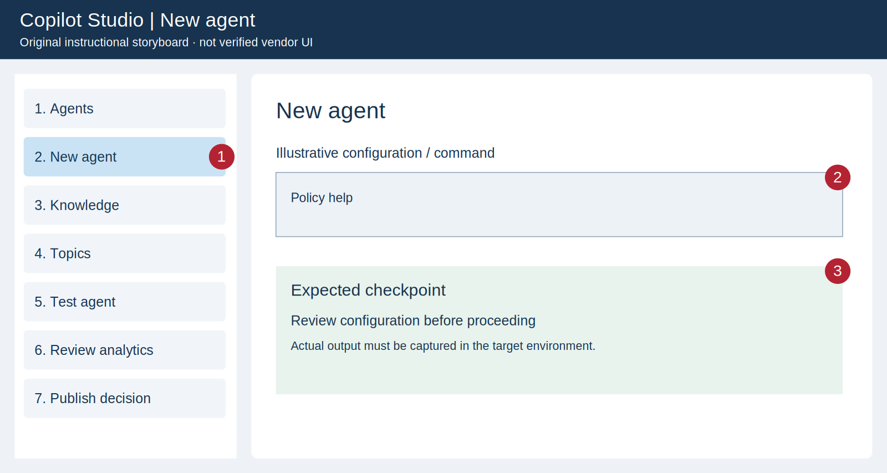
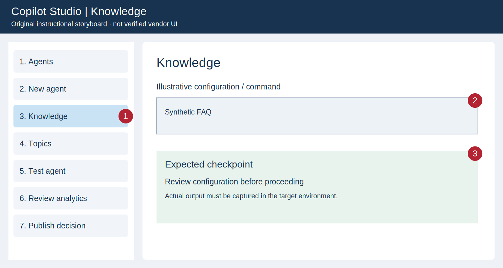
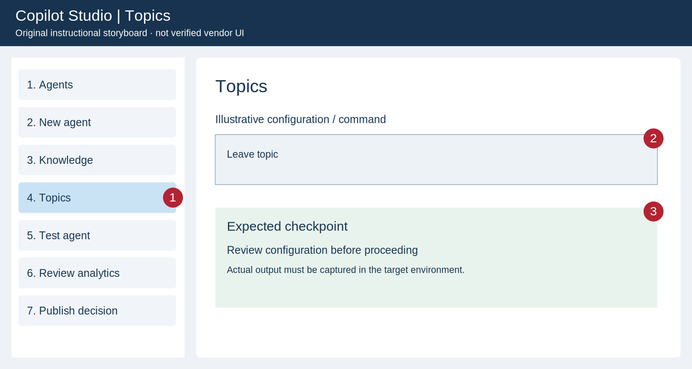
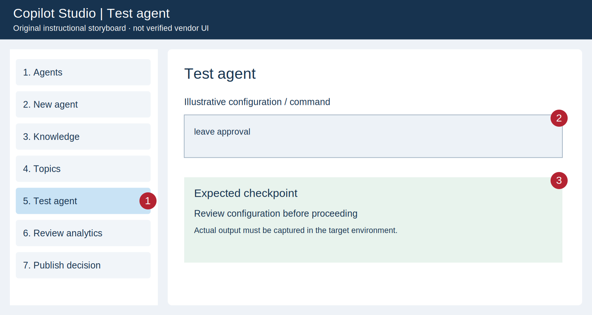
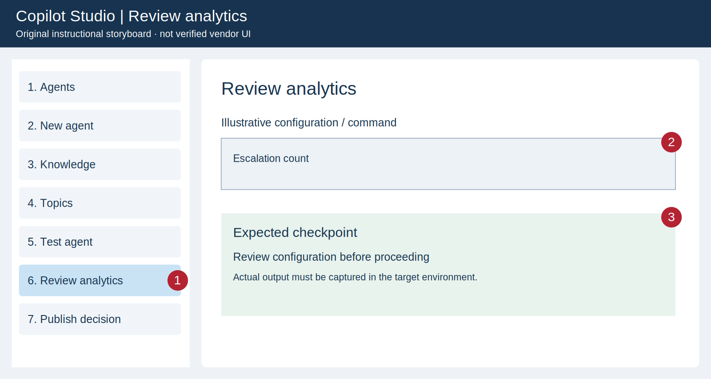
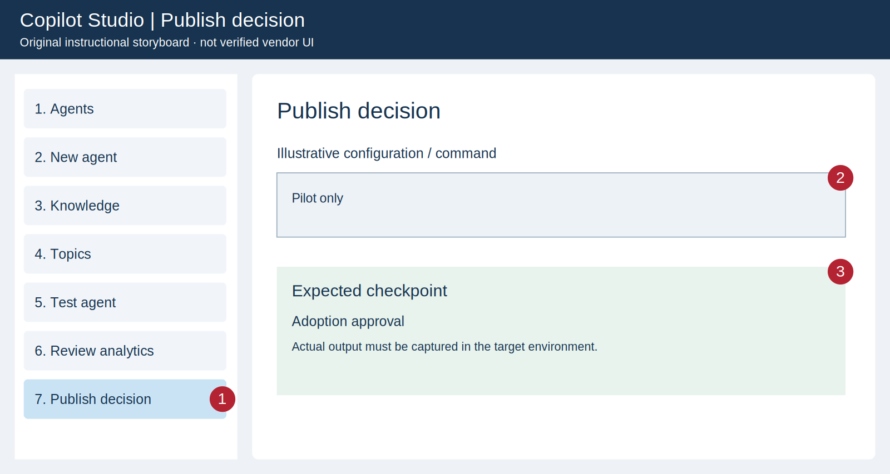

# Copilot Studio — numbered implementation walkthrough

Independent instructional storyboard. The navigation labels below are illustrative task stages, not verified vendor menu paths. No vendor deployment is claimed. Use synthetic data only. Prerequisites: browser for local illustrations; actual platform account, permissions and licensing must be established separately.

## Step 1: Agents
1. In the illustrated Copilot Studio workflow, locate callout 1 (Agents).
2. Inspect callout 2 and the sample value `HR assistant`.
3. Review the expected checkpoint at callout 3: configuration reviewed before continuing.
4. In the real environment, verify the equivalent control and capture actual output before proceeding.

## Step 2: New agent
1. In the illustrated Copilot Studio workflow, locate callout 1 (New agent).
2. Inspect callout 2 and the sample value `Policy help`.
3. Review the expected checkpoint at callout 3: configuration reviewed before continuing.
4. In the real environment, verify the equivalent control and capture actual output before proceeding.

## Step 3: Knowledge
1. In the illustrated Copilot Studio workflow, locate callout 1 (Knowledge).
2. Inspect callout 2 and the sample value `Synthetic FAQ`.
3. Review the expected checkpoint at callout 3: configuration reviewed before continuing.
4. In the real environment, verify the equivalent control and capture actual output before proceeding.

## Step 4: Topics
1. In the illustrated Copilot Studio workflow, locate callout 1 (Topics).
2. Inspect callout 2 and the sample value `Leave topic`.
3. Review the expected checkpoint at callout 3: configuration reviewed before continuing.
4. In the real environment, verify the equivalent control and capture actual output before proceeding.

## Step 5: Test agent
1. In the illustrated Copilot Studio workflow, locate callout 1 (Test agent).
2. Inspect callout 2 and the sample value `leave approval`.
3. Review the expected checkpoint at callout 3: configuration reviewed before continuing.
4. In the real environment, verify the equivalent control and capture actual output before proceeding.

## Step 6: Review analytics
1. In the illustrated Copilot Studio workflow, locate callout 1 (Review analytics).
2. Inspect callout 2 and the sample value `Escalation count`.
3. Review the expected checkpoint at callout 3: configuration reviewed before continuing.
4. In the real environment, verify the equivalent control and capture actual output before proceeding.

## Step 7: Publish decision
1. In the illustrated Copilot Studio workflow, locate callout 1 (Publish decision).
2. Inspect callout 2 and the sample value `Pilot only`.
3. Review the expected checkpoint at callout 3: Adoption approval.
4. In the real environment, verify the equivalent control and capture actual output before proceeding.

## Troubleshooting and executive acceptance
If a control is unavailable, verify role permissions, licensing and product version. If validation fails, stop, preserve the error and correct the input. Executive gate: Adoption approval. Record actual test output, reviewer and decision; do not claim completion without evidence.
