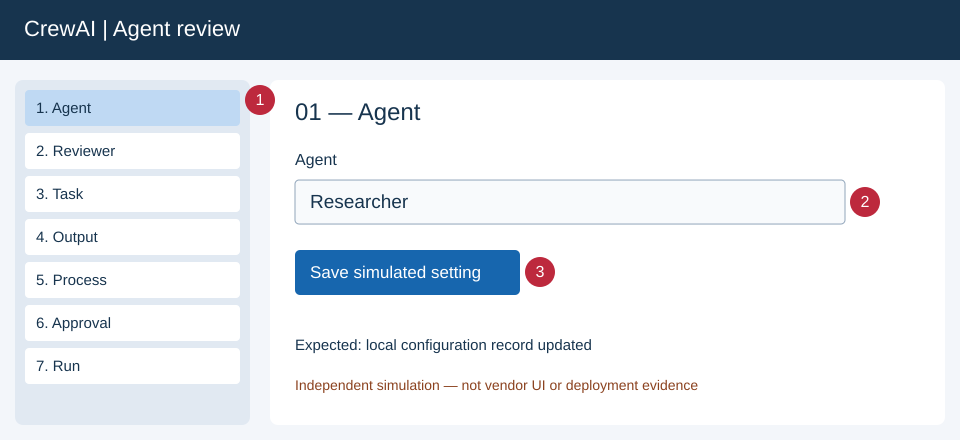
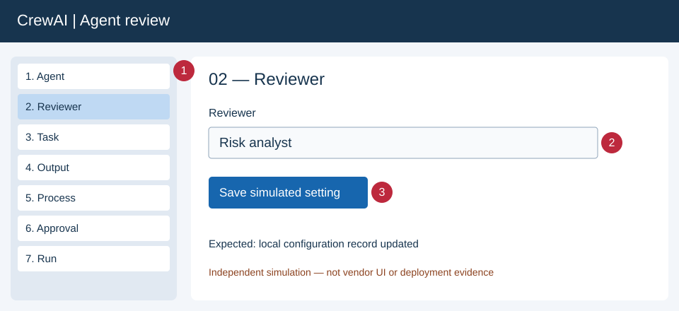
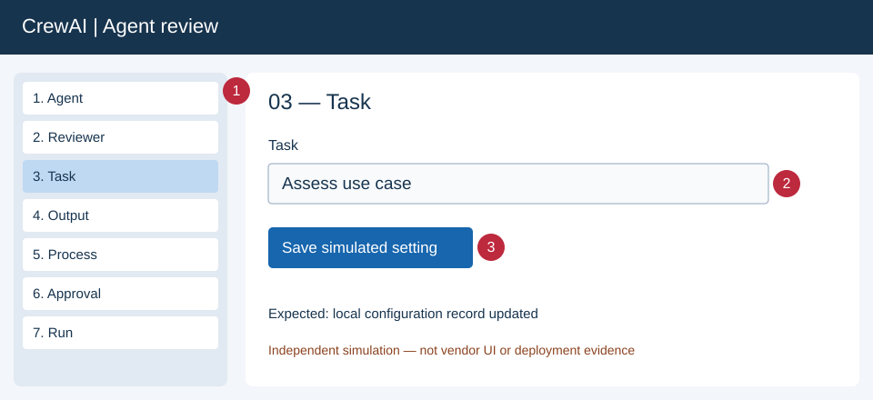
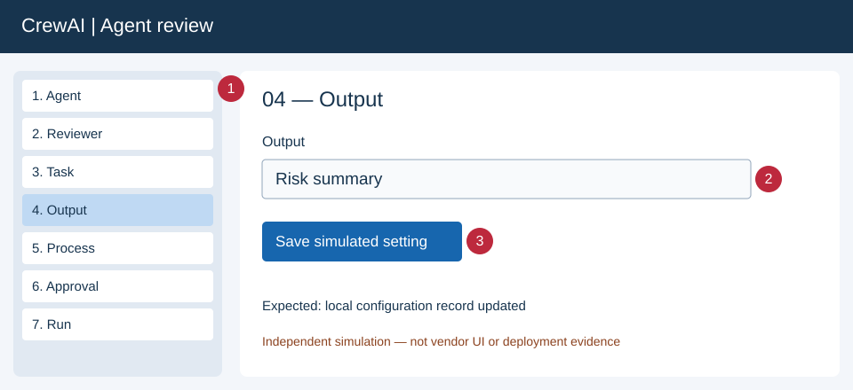
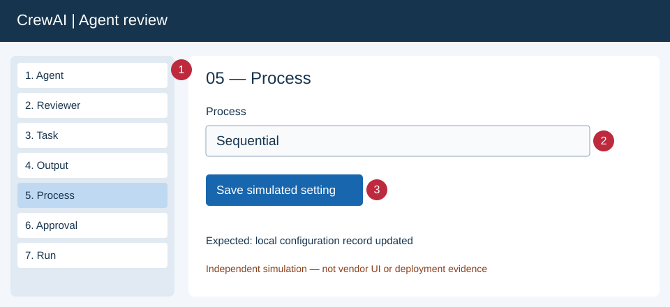
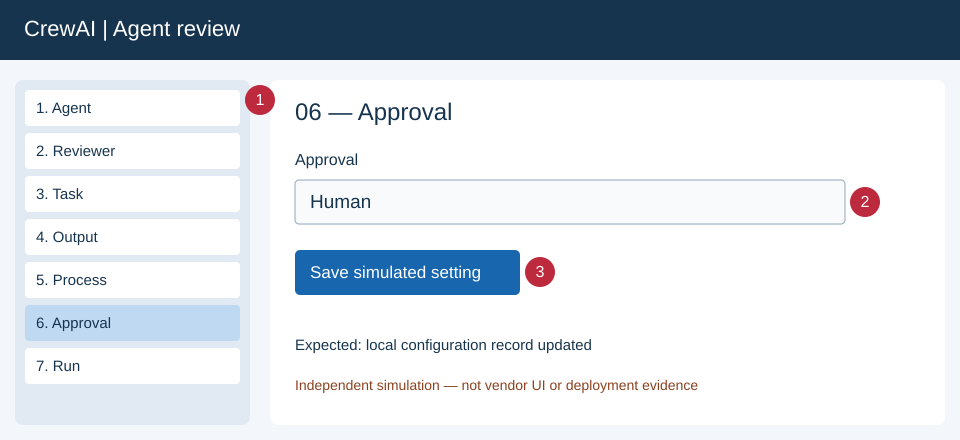
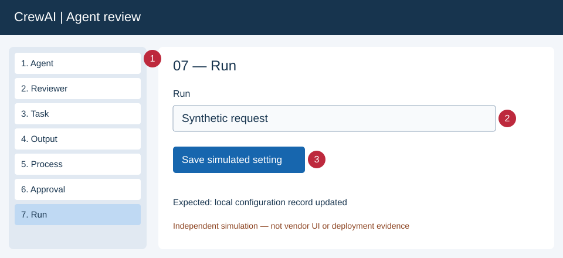

# CrewAI — Agent review

Original interactive configuration simulation. Download index.html and open locally in a browser. GitHub file preview does not execute HTML. This is not a replica of the vendor interface; settings are illustrative and must be verified in a real sandbox.

[Interactive HTML source](index.html)

## 01 — Agent

Select **Agent** in the simulation navigation, enter `Researcher`, then select **Save simulated setting**. Confirm the configuration record contains the value before selecting Next step. This verifies local state only.

## 02 — Reviewer

Select **Reviewer** in the simulation navigation, enter `Risk analyst`, then select **Save simulated setting**. Confirm the configuration record contains the value before selecting Next step. This verifies local state only.

## 03 — Task

Select **Task** in the simulation navigation, enter `Assess use case`, then select **Save simulated setting**. Confirm the configuration record contains the value before selecting Next step. This verifies local state only.

## 04 — Output

Select **Output** in the simulation navigation, enter `Risk summary`, then select **Save simulated setting**. Confirm the configuration record contains the value before selecting Next step. This verifies local state only.

## 05 — Process

Select **Process** in the simulation navigation, enter `Sequential`, then select **Save simulated setting**. Confirm the configuration record contains the value before selecting Next step. This verifies local state only.

## 06 — Approval

Select **Approval** in the simulation navigation, enter `Human`, then select **Save simulated setting**. Confirm the configuration record contains the value before selecting Next step. This verifies local state only.

## 07 — Run

Select **Run** in the simulation navigation, enter `Synthetic request`, then select **Save simulated setting**. Confirm the configuration record contains the value before selecting Next step. This verifies local state only.

