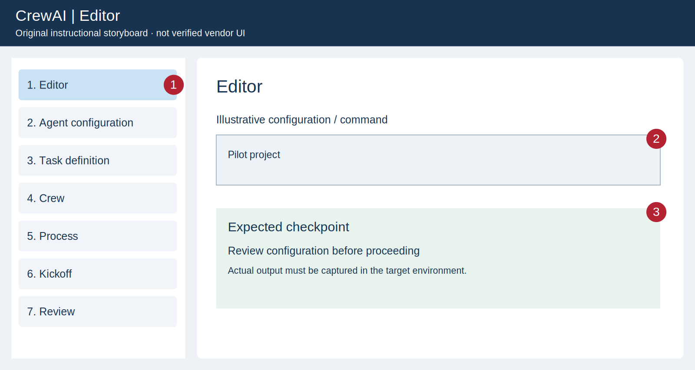
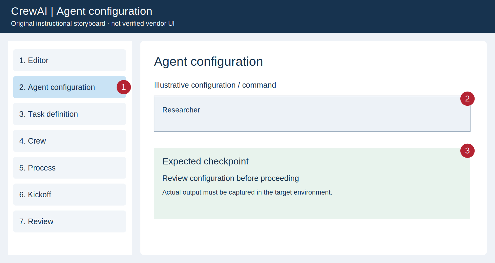
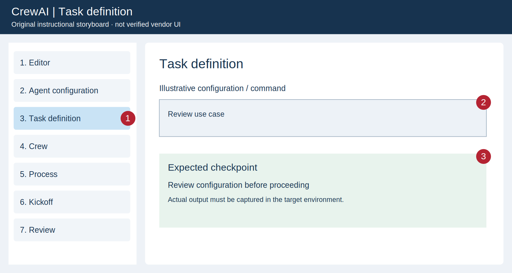
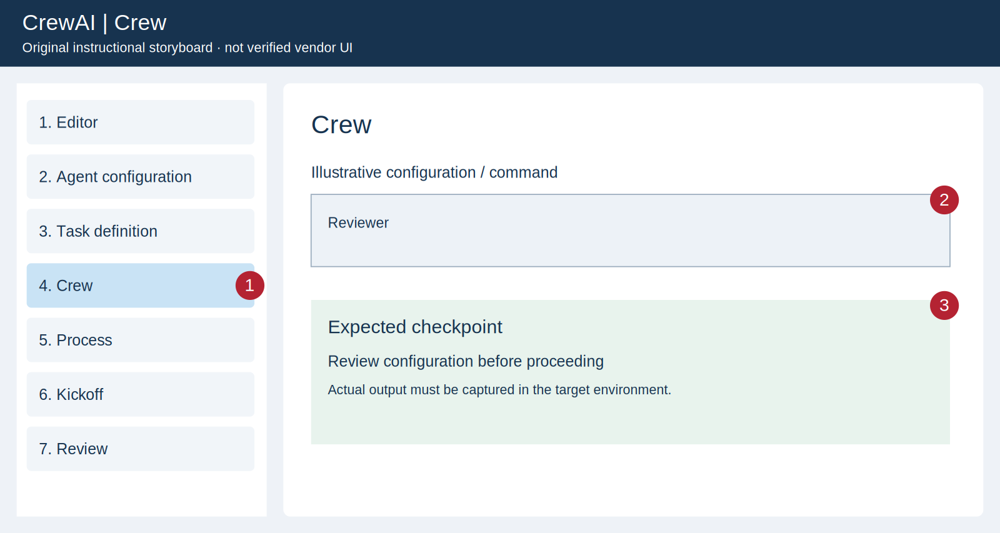
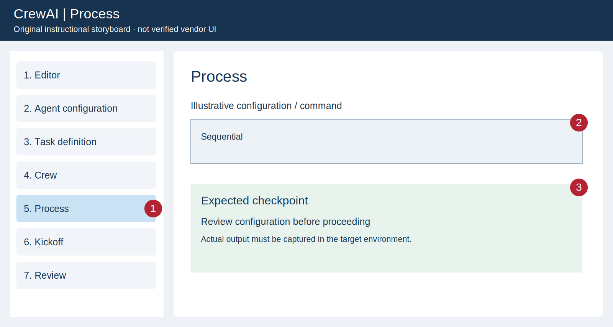
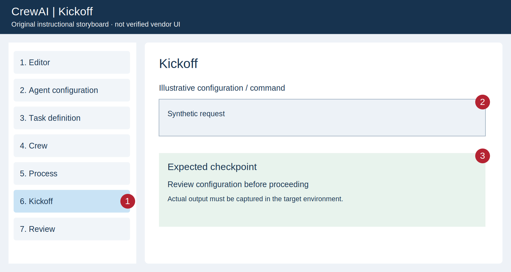
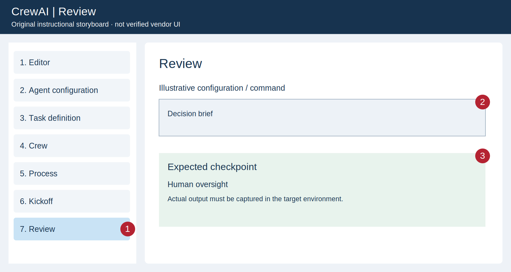

# CrewAI — numbered implementation walkthrough

Independent instructional storyboard. The navigation labels below are illustrative task stages, not verified vendor menu paths. No vendor deployment is claimed. Use synthetic data only. Prerequisites: browser for local illustrations; actual platform account, permissions and licensing must be established separately.

## Step 1: Editor
1. In the illustrated CrewAI workflow, locate callout 1 (Editor).
2. Inspect callout 2 and the sample value `Pilot project`.
3. Review the expected checkpoint at callout 3: configuration reviewed before continuing.
4. In the real environment, verify the equivalent control and capture actual output before proceeding.

## Step 2: Agent configuration
1. In the illustrated CrewAI workflow, locate callout 1 (Agent configuration).
2. Inspect callout 2 and the sample value `Researcher`.
3. Review the expected checkpoint at callout 3: configuration reviewed before continuing.
4. In the real environment, verify the equivalent control and capture actual output before proceeding.

## Step 3: Task definition
1. In the illustrated CrewAI workflow, locate callout 1 (Task definition).
2. Inspect callout 2 and the sample value `Review use case`.
3. Review the expected checkpoint at callout 3: configuration reviewed before continuing.
4. In the real environment, verify the equivalent control and capture actual output before proceeding.

## Step 4: Crew
1. In the illustrated CrewAI workflow, locate callout 1 (Crew).
2. Inspect callout 2 and the sample value `Reviewer`.
3. Review the expected checkpoint at callout 3: configuration reviewed before continuing.
4. In the real environment, verify the equivalent control and capture actual output before proceeding.

## Step 5: Process
1. In the illustrated CrewAI workflow, locate callout 1 (Process).
2. Inspect callout 2 and the sample value `Sequential`.
3. Review the expected checkpoint at callout 3: configuration reviewed before continuing.
4. In the real environment, verify the equivalent control and capture actual output before proceeding.

## Step 6: Kickoff
1. In the illustrated CrewAI workflow, locate callout 1 (Kickoff).
2. Inspect callout 2 and the sample value `Synthetic request`.
3. Review the expected checkpoint at callout 3: configuration reviewed before continuing.
4. In the real environment, verify the equivalent control and capture actual output before proceeding.

## Step 7: Review
1. In the illustrated CrewAI workflow, locate callout 1 (Review).
2. Inspect callout 2 and the sample value `Decision brief`.
3. Review the expected checkpoint at callout 3: Human oversight.
4. In the real environment, verify the equivalent control and capture actual output before proceeding.

## Troubleshooting and executive acceptance
If a control is unavailable, verify role permissions, licensing and product version. If validation fails, stop, preserve the error and correct the input. Executive gate: Human oversight. Record actual test output, reviewer and decision; do not claim completion without evidence.
