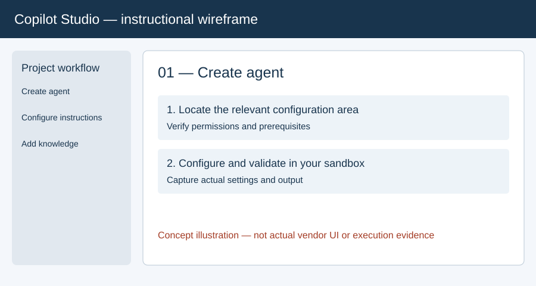
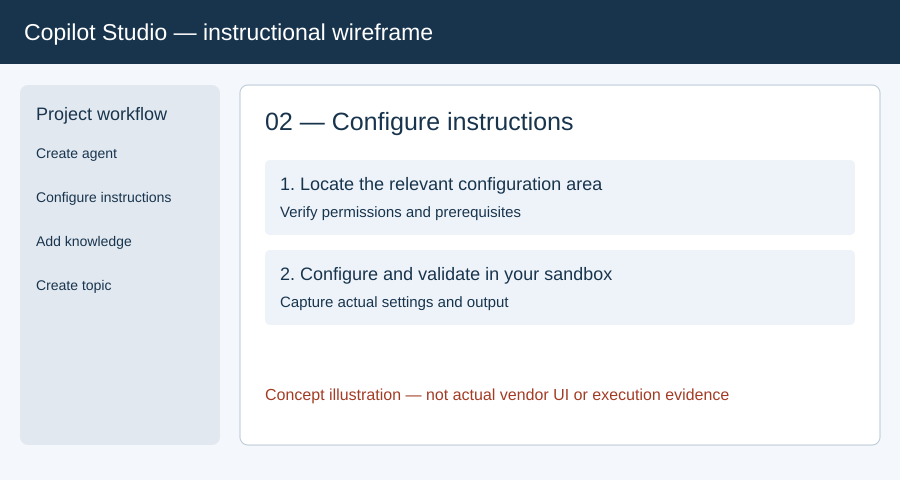
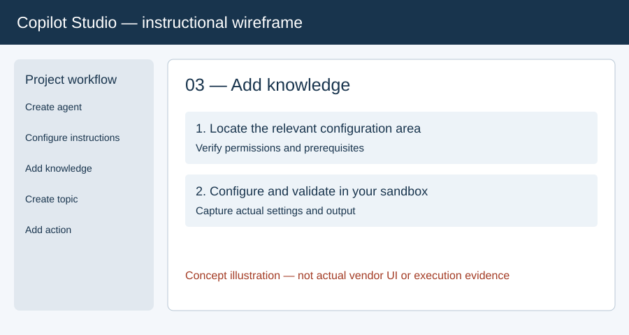
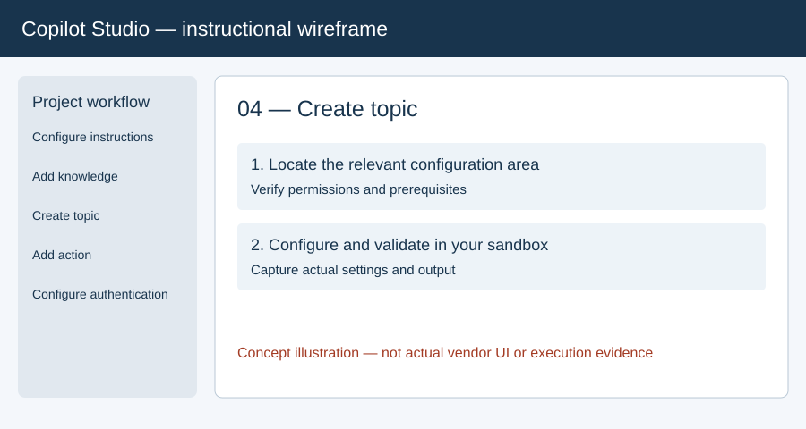
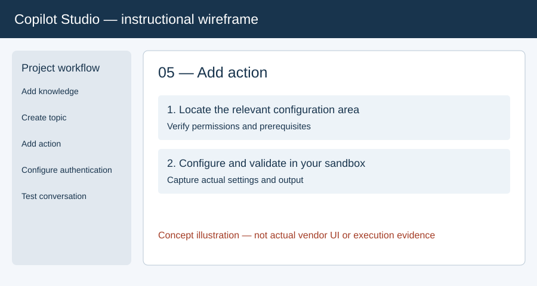
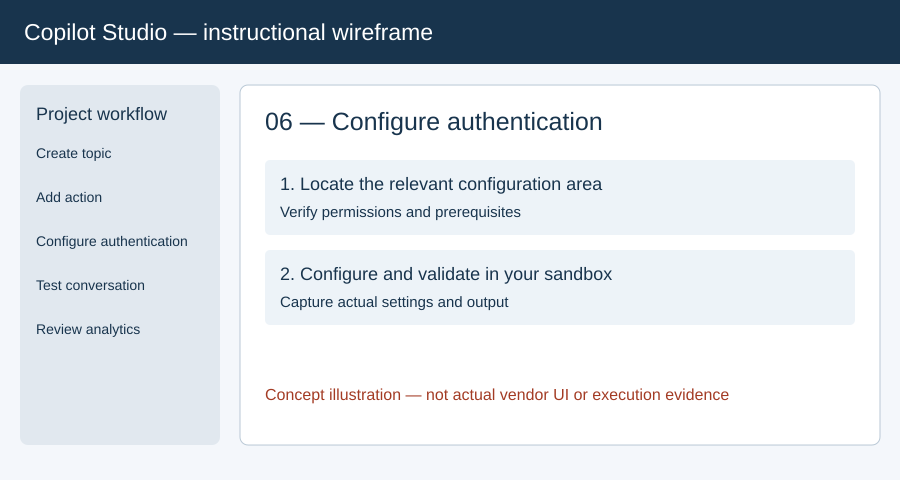
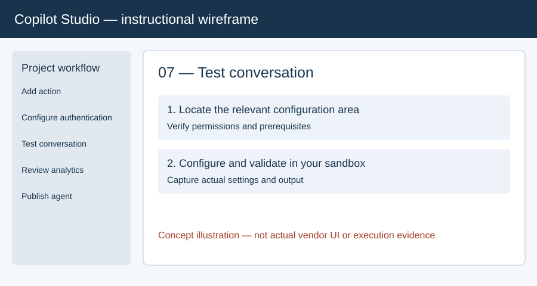
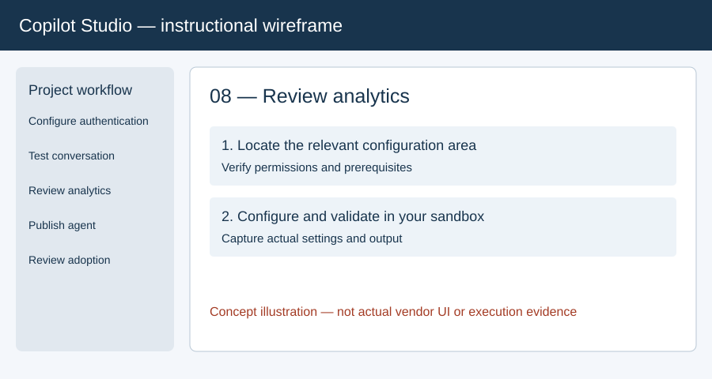
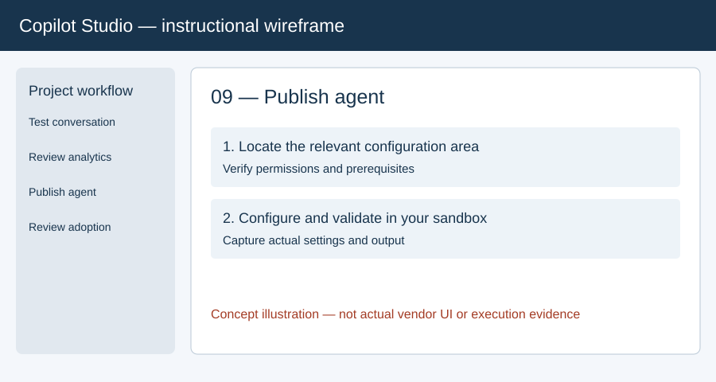
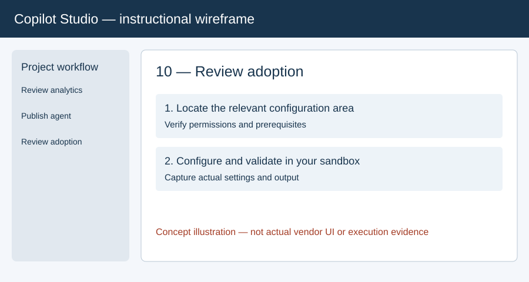

# Copilot Studio: visual implementation guide

**Status:** original instructional wireframes, not vendor screenshots. Navigation and licensing must be verified in a live sandbox. Use fictional data; do not publish secrets.

## 01 — Create agent

**Action:** In your Copilot Studio sandbox, locate the create agent capability using the relevant workspace or administration area. Review prerequisites and permissions before changing resources.

**Validation:** Capture the actual configuration and resulting output; record any errors and confirm the change against the project requirements. This step has not been executed in a vendor environment.

## 02 — Configure instructions

**Action:** In your Copilot Studio sandbox, locate the configure instructions capability using the relevant workspace or administration area. Review prerequisites and permissions before changing resources.

**Validation:** Capture the actual configuration and resulting output; record any errors and confirm the change against the project requirements. This step has not been executed in a vendor environment.

## 03 — Add knowledge

**Action:** In your Copilot Studio sandbox, locate the add knowledge capability using the relevant workspace or administration area. Review prerequisites and permissions before changing resources.

**Validation:** Capture the actual configuration and resulting output; record any errors and confirm the change against the project requirements. This step has not been executed in a vendor environment.

## 04 — Create topic

**Action:** In your Copilot Studio sandbox, locate the create topic capability using the relevant workspace or administration area. Review prerequisites and permissions before changing resources.

**Validation:** Capture the actual configuration and resulting output; record any errors and confirm the change against the project requirements. This step has not been executed in a vendor environment.

## 05 — Add action

**Action:** In your Copilot Studio sandbox, locate the add action capability using the relevant workspace or administration area. Review prerequisites and permissions before changing resources.

**Validation:** Capture the actual configuration and resulting output; record any errors and confirm the change against the project requirements. This step has not been executed in a vendor environment.

## 06 — Configure authentication

**Action:** In your Copilot Studio sandbox, locate the configure authentication capability using the relevant workspace or administration area. Review prerequisites and permissions before changing resources.

**Validation:** Capture the actual configuration and resulting output; record any errors and confirm the change against the project requirements. This step has not been executed in a vendor environment.

## 07 — Test conversation

**Action:** In your Copilot Studio sandbox, locate the test conversation capability using the relevant workspace or administration area. Review prerequisites and permissions before changing resources.

**Validation:** Capture the actual configuration and resulting output; record any errors and confirm the change against the project requirements. This step has not been executed in a vendor environment.

## 08 — Review analytics

**Action:** In your Copilot Studio sandbox, locate the review analytics capability using the relevant workspace or administration area. Review prerequisites and permissions before changing resources.

**Validation:** Capture the actual configuration and resulting output; record any errors and confirm the change against the project requirements. This step has not been executed in a vendor environment.

## 09 — Publish agent

**Action:** In your Copilot Studio sandbox, locate the publish agent capability using the relevant workspace or administration area. Review prerequisites and permissions before changing resources.

**Validation:** Capture the actual configuration and resulting output; record any errors and confirm the change against the project requirements. This step has not been executed in a vendor environment.

## 10 — Review adoption

**Action:** In your Copilot Studio sandbox, locate the review adoption capability using the relevant workspace or administration area. Review prerequisites and permissions before changing resources.

**Validation:** Capture the actual configuration and resulting output; record any errors and confirm the change against the project requirements. This step has not been executed in a vendor environment.

