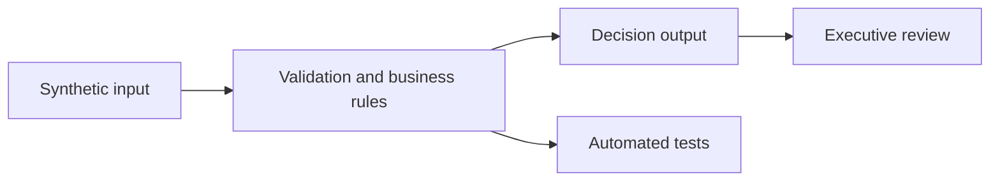

# Executive Intelligence Platform

**Maturity:** local Python reference implementation; tests supplied but not executed in this publication. No vendor integration claimed.

## Business problem
Provide repeatable etl and kpi aggregation for a fictional enterprise.

## Architecture

## Run the walkthrough
1. Download this folder and open it in VS Code.
2. Select Terminal > New Terminal and change to this folder.
3. Run `python app.py` to execute the embedded synthetic example.
4. Install pytest in an isolated environment and run `python -m pytest -q`.
5. Inspect the JSON output and compare against the test assertions.
6. Modify the sample input in app.py and rerun to inspect exception behavior.

[Source](app.py) | [Tests](test_app.py) | [Illustrative CSV](sample.csv)

CSV is an illustrative schema; the current program uses embedded input, not CSV ingestion.

## Executive deliverable
Use the etl and kpi aggregation output as decision support, not as a production approval. Assign a business owner, document assumptions, review exceptions and require sign-off before operational use.

## Limitations
No production authentication, vendor deployment, persistent storage or verified vendor screenshots. Input validation and failure handling require further development.
