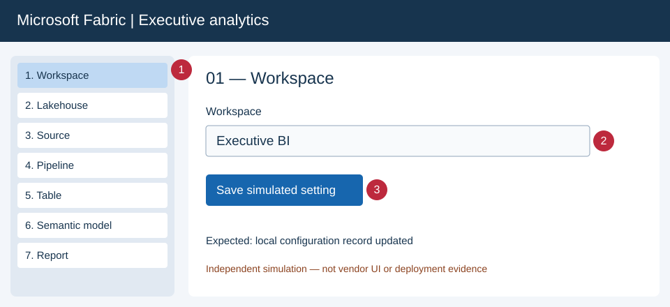
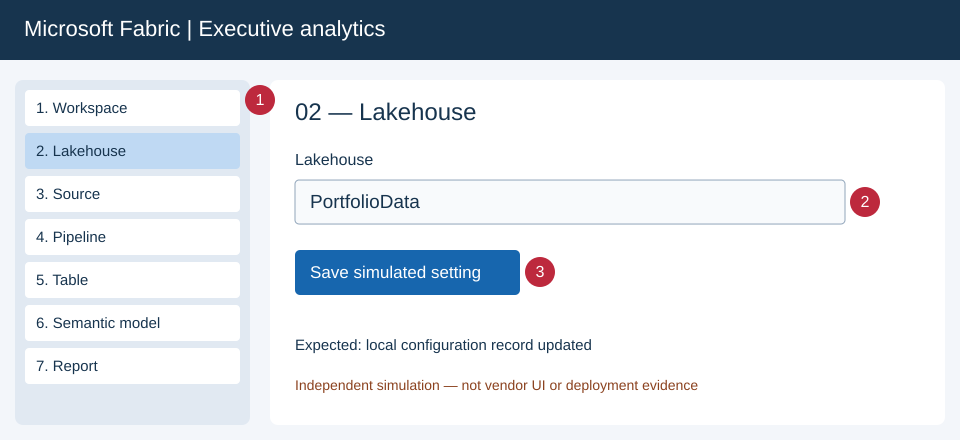
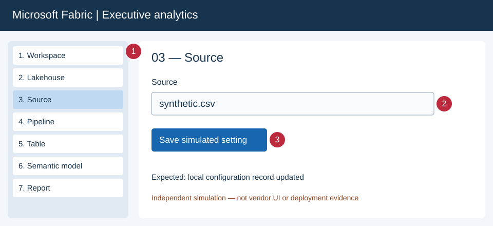
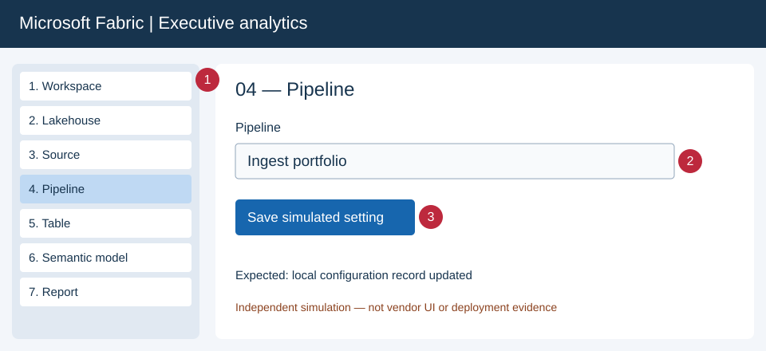
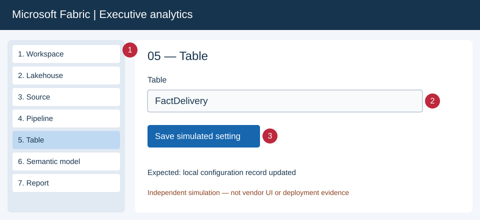
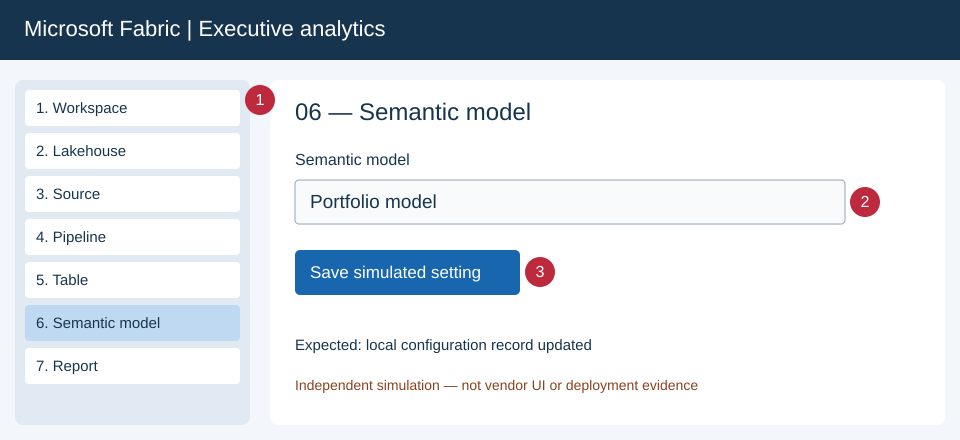
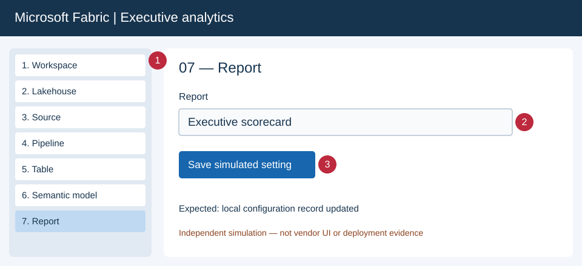

# Microsoft Fabric — Executive analytics

Original interactive configuration simulation. Download index.html and open locally in a browser. GitHub file preview does not execute HTML. This is not a replica of the vendor interface; settings are illustrative and must be verified in a real sandbox.

[Interactive HTML source](index.html)

## 01 — Workspace

Select **Workspace** in the simulation navigation, enter `Executive BI`, then select **Save simulated setting**. Confirm the configuration record contains the value before selecting Next step. This verifies local state only.

## 02 — Lakehouse

Select **Lakehouse** in the simulation navigation, enter `PortfolioData`, then select **Save simulated setting**. Confirm the configuration record contains the value before selecting Next step. This verifies local state only.

## 03 — Source

Select **Source** in the simulation navigation, enter `synthetic.csv`, then select **Save simulated setting**. Confirm the configuration record contains the value before selecting Next step. This verifies local state only.

## 04 — Pipeline

Select **Pipeline** in the simulation navigation, enter `Ingest portfolio`, then select **Save simulated setting**. Confirm the configuration record contains the value before selecting Next step. This verifies local state only.

## 05 — Table

Select **Table** in the simulation navigation, enter `FactDelivery`, then select **Save simulated setting**. Confirm the configuration record contains the value before selecting Next step. This verifies local state only.

## 06 — Semantic model

Select **Semantic model** in the simulation navigation, enter `Portfolio model`, then select **Save simulated setting**. Confirm the configuration record contains the value before selecting Next step. This verifies local state only.

## 07 — Report

Select **Report** in the simulation navigation, enter `Executive scorecard`, then select **Save simulated setting**. Confirm the configuration record contains the value before selecting Next step. This verifies local state only.

