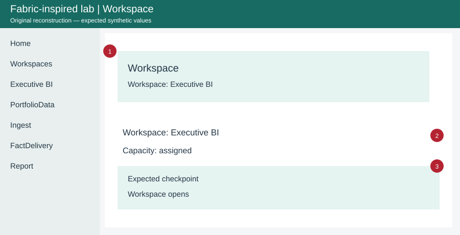
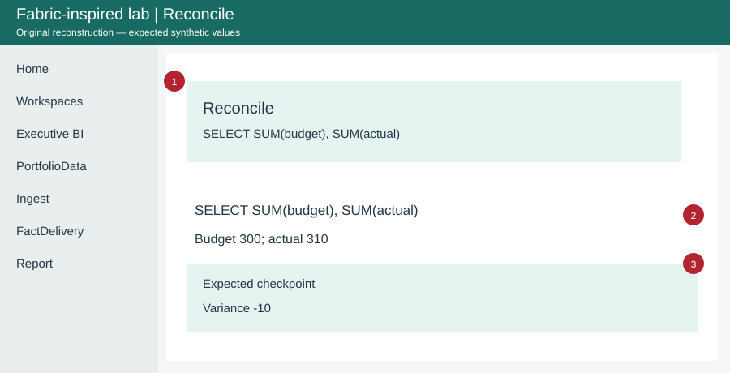
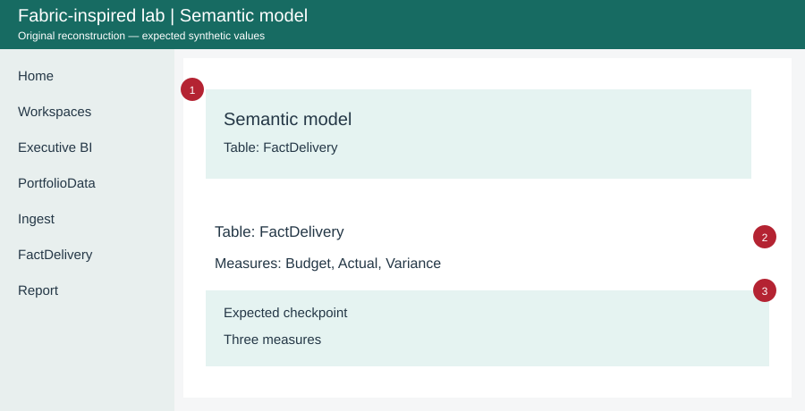
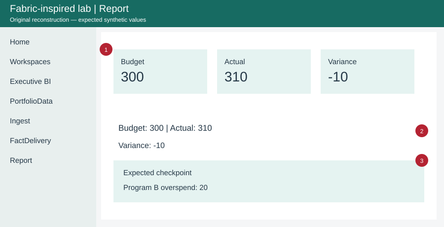
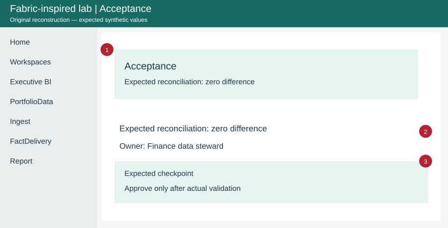

# Microsoft Fabric — ingestion to executive reporting

Original reconstructed screens, not actual Fabric screenshots. Proposed navigation requires validation against the tenant and current product version. Prerequisites: Fabric-enabled workspace, capacity or trial, permission to create items, synthetic CSV. No production data.

[Sample CSV](sample.csv) · [SQL](reconciliation.sql) · [DAX](measures.dax) · [Local reconciliation script](validate.py)

## 1. Workspace
- **1 — Action:** Create a workspace named Executive BI; assign an available Fabric capacity.
- **2 — Configuration:** Workspace: Executive BI; Capacity: assigned.
- **3 — Checkpoint:** Workspace opens. Capture actual evidence before continuing.

## 2. Lakehouse
- **1 — Action:** Create a Lakehouse named PortfolioData in the workspace.
- **2 — Configuration:** Name: PortfolioData; Files / Tables.
- **3 — Checkpoint:** Lakehouse exists. Capture actual evidence before continuing.

## 3. Upload
- **1 — Action:** Upload sample.csv into the lakehouse Files area.
- **2 — Configuration:** Files/sample.csv; Header: program,budget,actual.
- **3 — Checkpoint:** Two data rows. Capture actual evidence before continuing.

## 4. Pipeline
- **1 — Action:** Create a data pipeline named Ingest and add a Copy data activity.
- **2 — Configuration:** Pipeline: Ingest; Activity: Copy data.
- **3 — Checkpoint:** Activity on canvas. Capture actual evidence before continuing.

## 5. Copy configuration
- **1 — Action:** Configure lakehouse Files as source, CSV with header; destination lakehouse table FactDelivery; map program to string, budget and actual to numeric.
- **2 — Configuration:** Source: Files/sample.csv; Destination: FactDelivery.
- **3 — Checkpoint:** Mapping: program, budget, actual. Capture actual evidence before continuing.

## 6. Run and monitor
- **1 — Action:** Save and run the pipeline; inspect activity output and row counts.
- **2 — Configuration:** Run pipeline; Rows read: 2 (expected).
- **3 — Checkpoint:** Rows written: 2 (expected). Capture actual evidence before continuing.

## 7. Reconcile
- **1 — Action:** Open SQL analytics endpoint and execute reconciliation.sql.
- **2 — Configuration:** SELECT SUM(budget), SUM(actual); Budget 300; actual 310.
- **3 — Checkpoint:** Variance -10. Capture actual evidence before continuing.

## 8. Semantic model
- **1 — Action:** Create a semantic model from FactDelivery; add measures from measures.dax.
- **2 — Configuration:** Table: FactDelivery; Measures: Budget, Actual, Variance.
- **3 — Checkpoint:** Three measures. Capture actual evidence before continuing.

## 9. Report
- **1 — Action:** Create a report with three cards and a program-level table.
- **2 — Configuration:** Budget: 300 | Actual: 310; Variance: -10.
- **3 — Checkpoint:** Program B overspend: 20. Capture actual evidence before continuing.

## 10. Acceptance
- **1 — Action:** Compare report totals with source CSV; record run ID, reviewer and decision.
- **2 — Configuration:** Expected reconciliation: zero difference; Owner: Finance data steward.
- **3 — Checkpoint:** Approve only after actual validation. Capture actual evidence before continuing.

## Troubleshooting
If capacity is unavailable, stop and request access. If CSV columns are inferred as text, correct mapping before rerun. If row counts differ, inspect activity errors and destination write mode; avoid duplicate append. If totals differ, withhold executive acceptance. Run `python validate.py` locally to check the source fixture; this does not test Fabric.

## Executive evidence
Finance data steward reconciles totals; BI lead owns remediation; sponsor approves release only with actual run evidence and zero unexplained variance.
