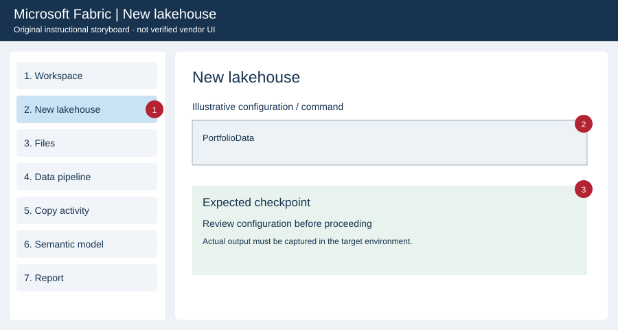
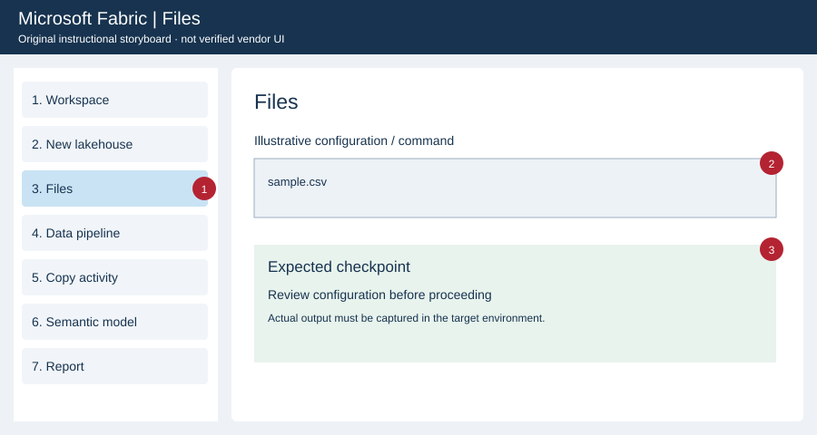
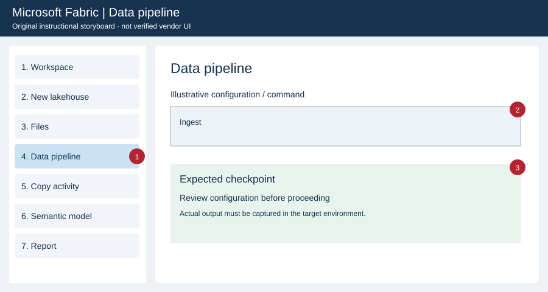
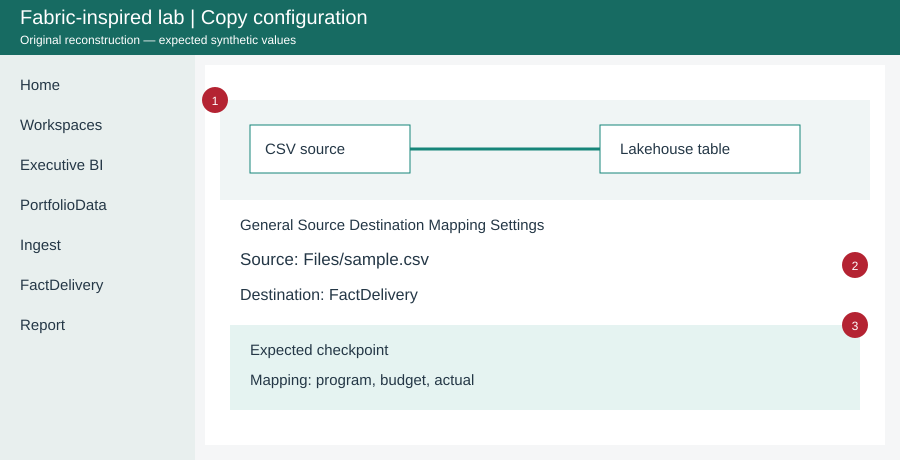
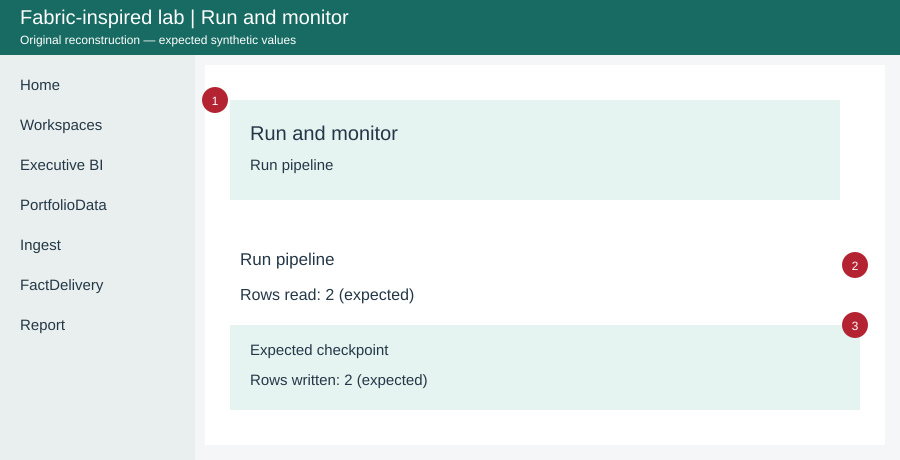

# Microsoft Fabric — numbered implementation walkthrough

Independent instructional storyboard. The navigation labels below are illustrative task stages, not verified vendor menu paths. No vendor deployment is claimed. Use synthetic data only. Prerequisites: browser for local illustrations; actual platform account, permissions and licensing must be established separately.

## Step 1: Workspace
1. In the illustrated Microsoft Fabric workflow, locate callout 1 (Workspace).
2. Inspect callout 2 and the sample value `Executive BI`.
3. Review the expected checkpoint at callout 3: configuration reviewed before continuing.
4. In the real environment, verify the equivalent control and capture actual output before proceeding.

## Step 2: New lakehouse
1. In the illustrated Microsoft Fabric workflow, locate callout 1 (New lakehouse).
2. Inspect callout 2 and the sample value `PortfolioData`.
3. Review the expected checkpoint at callout 3: configuration reviewed before continuing.
4. In the real environment, verify the equivalent control and capture actual output before proceeding.

## Step 3: Files
1. In the illustrated Microsoft Fabric workflow, locate callout 1 (Files).
2. Inspect callout 2 and the sample value `sample.csv`.
3. Review the expected checkpoint at callout 3: configuration reviewed before continuing.
4. In the real environment, verify the equivalent control and capture actual output before proceeding.

## Step 4: Data pipeline
1. In the illustrated Microsoft Fabric workflow, locate callout 1 (Data pipeline).
2. Inspect callout 2 and the sample value `Ingest`.
3. Review the expected checkpoint at callout 3: configuration reviewed before continuing.
4. In the real environment, verify the equivalent control and capture actual output before proceeding.

## Step 5: Copy activity
1. In the illustrated Microsoft Fabric workflow, locate callout 1 (Copy activity).
2. Inspect callout 2 and the sample value `FactDelivery`.
3. Review the expected checkpoint at callout 3: configuration reviewed before continuing.
4. In the real environment, verify the equivalent control and capture actual output before proceeding.

## Step 6: Semantic model
1. In the illustrated Microsoft Fabric workflow, locate callout 1 (Semantic model).
2. Inspect callout 2 and the sample value `Budget model`.
3. Review the expected checkpoint at callout 3: configuration reviewed before continuing.
4. In the real environment, verify the equivalent control and capture actual output before proceeding.

## Step 7: Report
1. In the illustrated Microsoft Fabric workflow, locate callout 1 (Report).
2. Inspect callout 2 and the sample value `Variance`.
3. Review the expected checkpoint at callout 3: Data reconciliation.
4. In the real environment, verify the equivalent control and capture actual output before proceeding.

## Troubleshooting and executive acceptance
If a control is unavailable, verify role permissions, licensing and product version. If validation fails, stop, preserve the error and correct the input. Executive gate: Data reconciliation. Record actual test output, reviewer and decision; do not claim completion without evidence.
