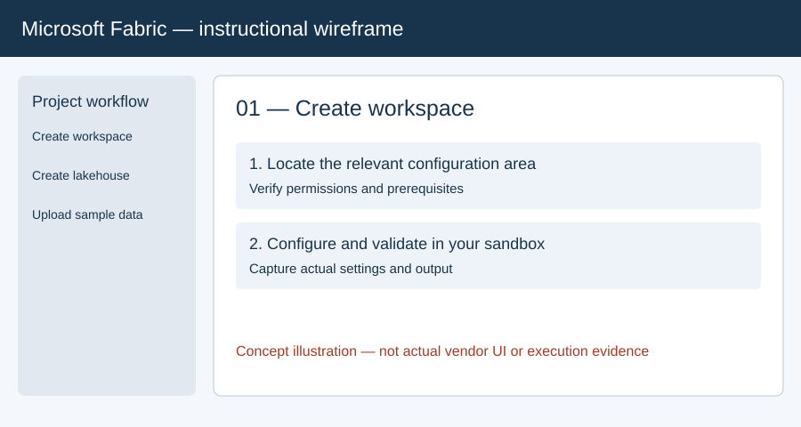
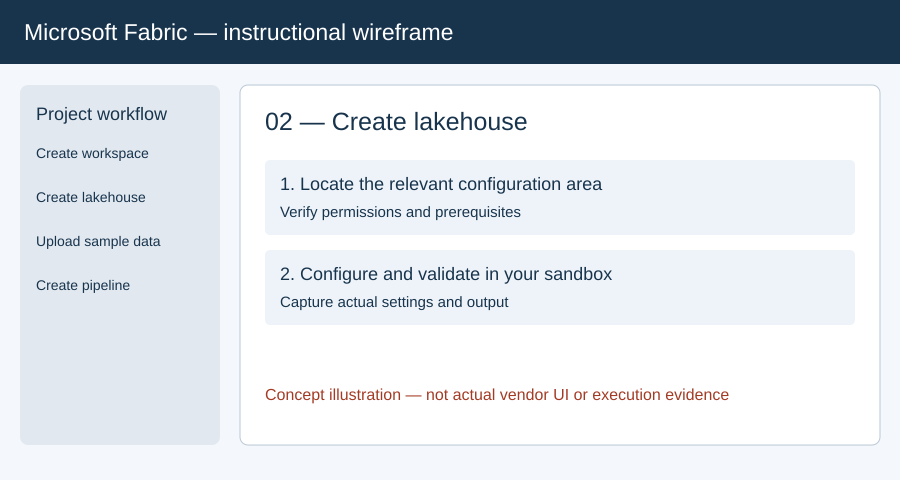
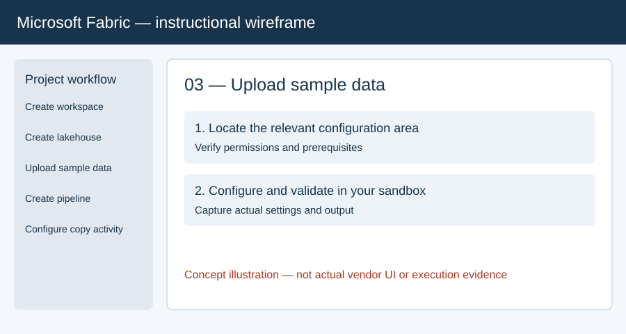
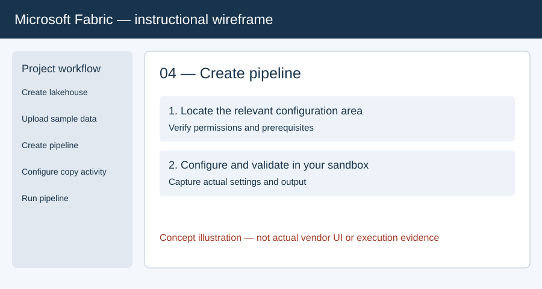
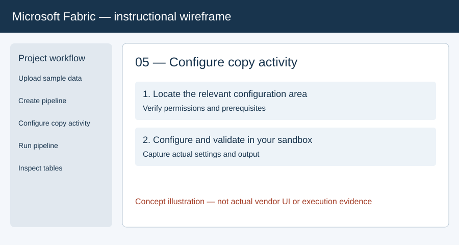
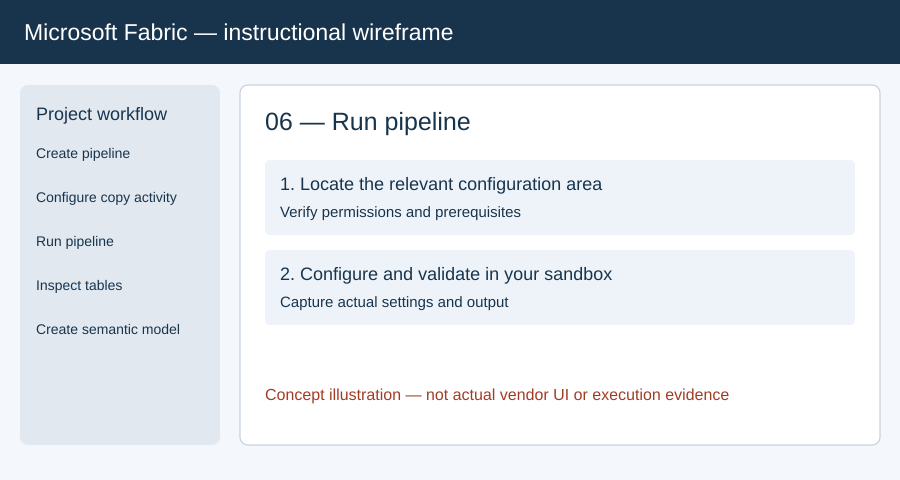
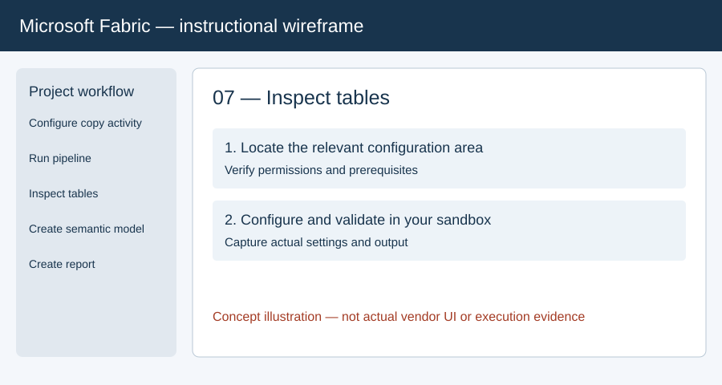
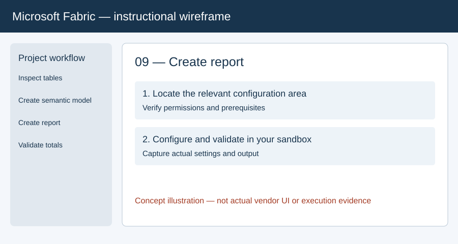
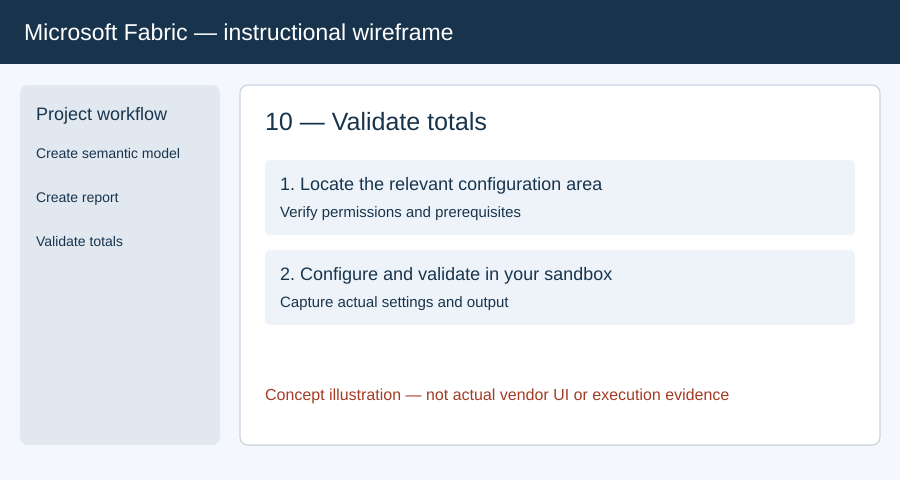

# Microsoft Fabric: visual implementation guide

**Status:** original instructional wireframes, not vendor screenshots. Navigation and licensing must be verified in a live sandbox. Use fictional data; do not publish secrets.

## 01 — Create workspace

**Action:** In your Microsoft Fabric sandbox, locate the create workspace capability using the relevant workspace or administration area. Review prerequisites and permissions before changing resources.

**Validation:** Capture the actual configuration and resulting output; record any errors and confirm the change against the project requirements. This step has not been executed in a vendor environment.

## 02 — Create lakehouse

**Action:** In your Microsoft Fabric sandbox, locate the create lakehouse capability using the relevant workspace or administration area. Review prerequisites and permissions before changing resources.

**Validation:** Capture the actual configuration and resulting output; record any errors and confirm the change against the project requirements. This step has not been executed in a vendor environment.

## 03 — Upload sample data

**Action:** In your Microsoft Fabric sandbox, locate the upload sample data capability using the relevant workspace or administration area. Review prerequisites and permissions before changing resources.

**Validation:** Capture the actual configuration and resulting output; record any errors and confirm the change against the project requirements. This step has not been executed in a vendor environment.

## 04 — Create pipeline

**Action:** In your Microsoft Fabric sandbox, locate the create pipeline capability using the relevant workspace or administration area. Review prerequisites and permissions before changing resources.

**Validation:** Capture the actual configuration and resulting output; record any errors and confirm the change against the project requirements. This step has not been executed in a vendor environment.

## 05 — Configure copy activity

**Action:** In your Microsoft Fabric sandbox, locate the configure copy activity capability using the relevant workspace or administration area. Review prerequisites and permissions before changing resources.

**Validation:** Capture the actual configuration and resulting output; record any errors and confirm the change against the project requirements. This step has not been executed in a vendor environment.

## 06 — Run pipeline

**Action:** In your Microsoft Fabric sandbox, locate the run pipeline capability using the relevant workspace or administration area. Review prerequisites and permissions before changing resources.

**Validation:** Capture the actual configuration and resulting output; record any errors and confirm the change against the project requirements. This step has not been executed in a vendor environment.

## 07 — Inspect tables

**Action:** In your Microsoft Fabric sandbox, locate the inspect tables capability using the relevant workspace or administration area. Review prerequisites and permissions before changing resources.

**Validation:** Capture the actual configuration and resulting output; record any errors and confirm the change against the project requirements. This step has not been executed in a vendor environment.

## 08 — Create semantic model

**Action:** In your Microsoft Fabric sandbox, locate the create semantic model capability using the relevant workspace or administration area. Review prerequisites and permissions before changing resources.

**Validation:** Capture the actual configuration and resulting output; record any errors and confirm the change against the project requirements. This step has not been executed in a vendor environment.

## 09 — Create report

**Action:** In your Microsoft Fabric sandbox, locate the create report capability using the relevant workspace or administration area. Review prerequisites and permissions before changing resources.

**Validation:** Capture the actual configuration and resulting output; record any errors and confirm the change against the project requirements. This step has not been executed in a vendor environment.

## 10 — Validate totals

**Action:** In your Microsoft Fabric sandbox, locate the validate totals capability using the relevant workspace or administration area. Review prerequisites and permissions before changing resources.

**Validation:** Capture the actual configuration and resulting output; record any errors and confirm the change against the project requirements. This step has not been executed in a vendor environment.

