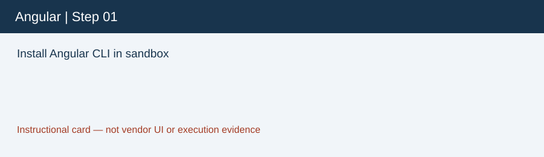
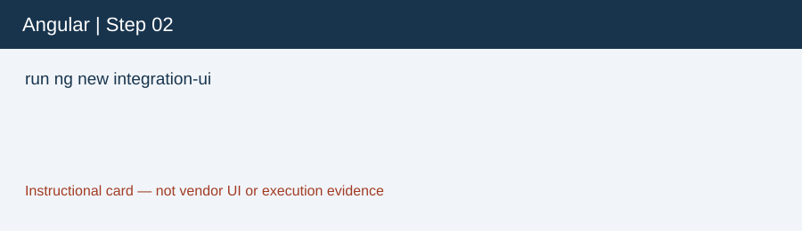
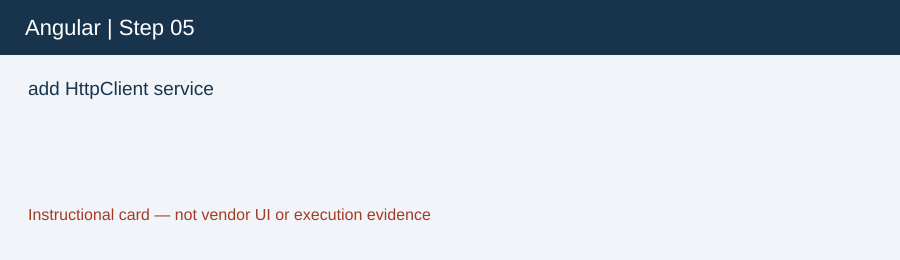
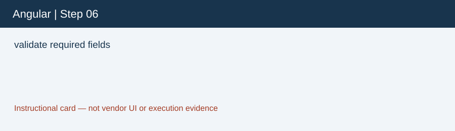
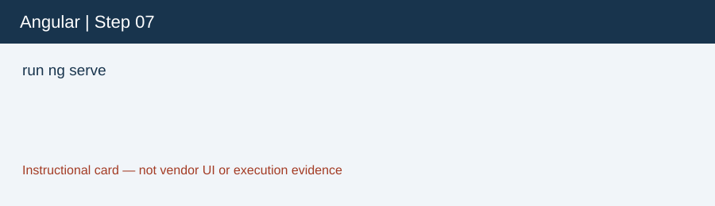
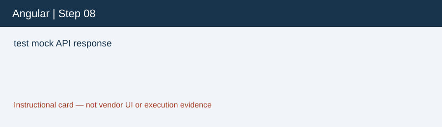
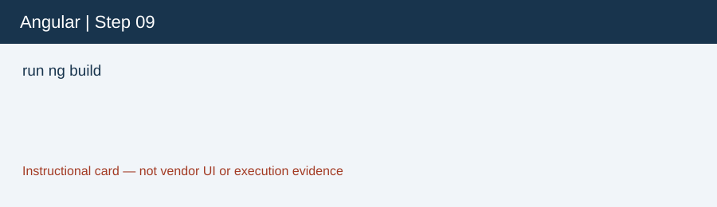

# Angular implementation lab

Status: proposed procedure, not executed or verified against current vendor UI. Use synthetic data and authorized sandbox only. Review pricing, permissions and version-specific documentation first.

## 01. Install Angular CLI in sandbox

**Action:** Install Angular CLI in sandbox.

**Evidence:** Capture the actual interface or terminal output after completing this action. Record version, settings (redact credentials), result and any error. Do not mark passed until observed.

## 02. run ng new integration-ui

**Action:** run ng new integration-ui.

**Evidence:** Capture the actual interface or terminal output after completing this action. Record version, settings (redact credentials), result and any error. Do not mark passed until observed.

## 03. generate request component

**Action:** generate request component.

**Evidence:** Capture the actual interface or terminal output after completing this action. Record version, settings (redact credentials), result and any error. Do not mark passed until observed.

## 04. configure reactive form

**Action:** configure reactive form.

**Evidence:** Capture the actual interface or terminal output after completing this action. Record version, settings (redact credentials), result and any error. Do not mark passed until observed.

## 05. add HttpClient service

**Action:** add HttpClient service.

**Evidence:** Capture the actual interface or terminal output after completing this action. Record version, settings (redact credentials), result and any error. Do not mark passed until observed.

## 06. validate required fields

**Action:** validate required fields.

**Evidence:** Capture the actual interface or terminal output after completing this action. Record version, settings (redact credentials), result and any error. Do not mark passed until observed.

## 07. run ng serve

**Action:** run ng serve.

**Evidence:** Capture the actual interface or terminal output after completing this action. Record version, settings (redact credentials), result and any error. Do not mark passed until observed.

## 08. test mock API response

**Action:** test mock API response.

**Evidence:** Capture the actual interface or terminal output after completing this action. Record version, settings (redact credentials), result and any error. Do not mark passed until observed.

## 09. run ng build

**Action:** run ng build.

**Evidence:** Capture the actual interface or terminal output after completing this action. Record version, settings (redact credentials), result and any error. Do not mark passed until observed.

