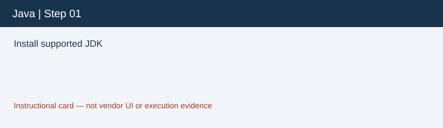
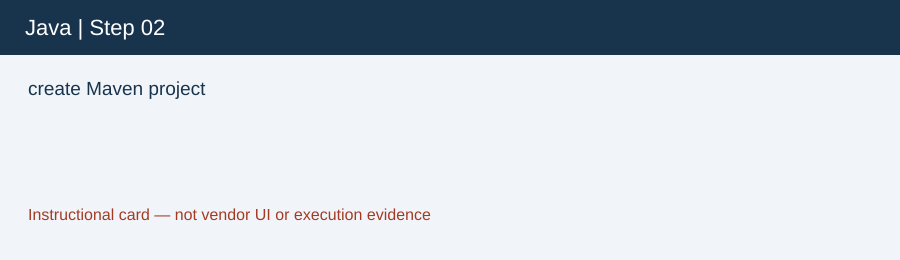
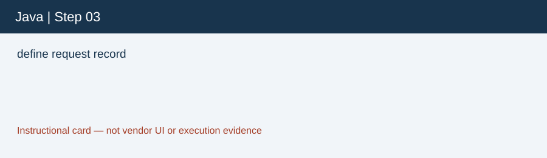
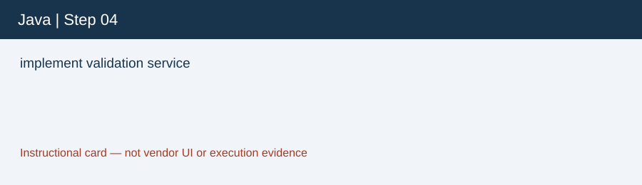
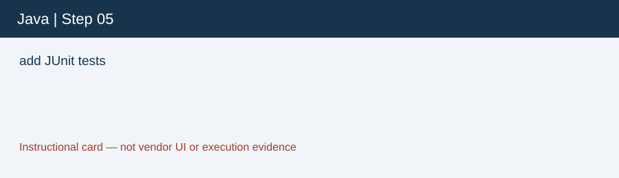
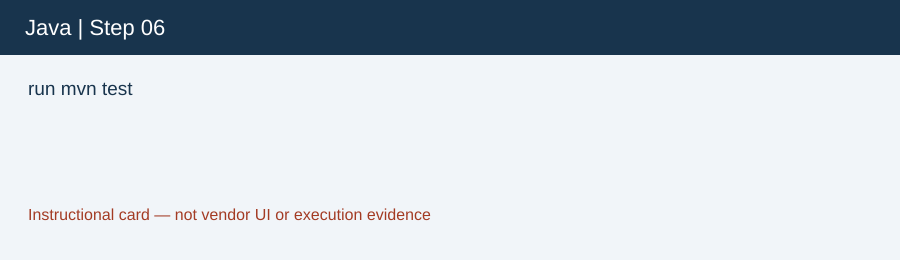
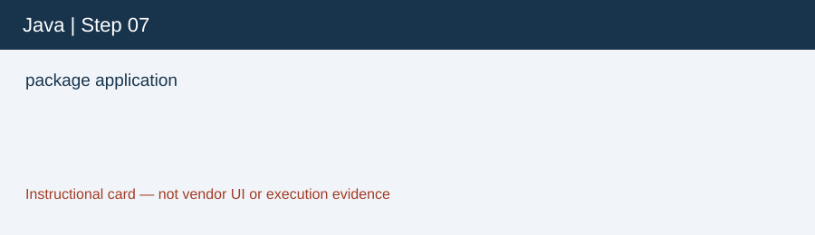

# Java implementation lab

Status: proposed procedure, not executed or verified against current vendor UI. Use synthetic data and authorized sandbox only. Review pricing, permissions and version-specific documentation first.

## 01. Install supported JDK

**Action:** Install supported JDK.

**Evidence:** Capture the actual interface or terminal output after completing this action. Record version, settings (redact credentials), result and any error. Do not mark passed until observed.

## 02. create Maven project

**Action:** create Maven project.

**Evidence:** Capture the actual interface or terminal output after completing this action. Record version, settings (redact credentials), result and any error. Do not mark passed until observed.

## 03. define request record

**Action:** define request record.

**Evidence:** Capture the actual interface or terminal output after completing this action. Record version, settings (redact credentials), result and any error. Do not mark passed until observed.

## 04. implement validation service

**Action:** implement validation service.

**Evidence:** Capture the actual interface or terminal output after completing this action. Record version, settings (redact credentials), result and any error. Do not mark passed until observed.

## 05. add JUnit tests

**Action:** add JUnit tests.

**Evidence:** Capture the actual interface or terminal output after completing this action. Record version, settings (redact credentials), result and any error. Do not mark passed until observed.

## 06. run mvn test

**Action:** run mvn test.

**Evidence:** Capture the actual interface or terminal output after completing this action. Record version, settings (redact credentials), result and any error. Do not mark passed until observed.

## 07. package application

**Action:** package application.

**Evidence:** Capture the actual interface or terminal output after completing this action. Record version, settings (redact credentials), result and any error. Do not mark passed until observed.

## 08. inspect output

**Action:** inspect output.

**Evidence:** Capture the actual interface or terminal output after completing this action. Record version, settings (redact credentials), result and any error. Do not mark passed until observed.

