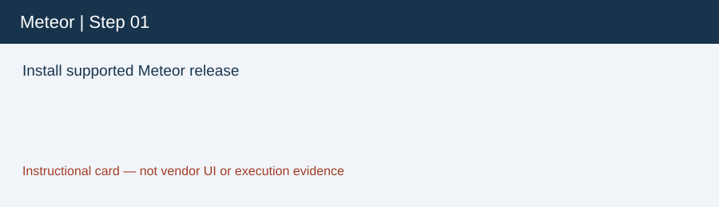
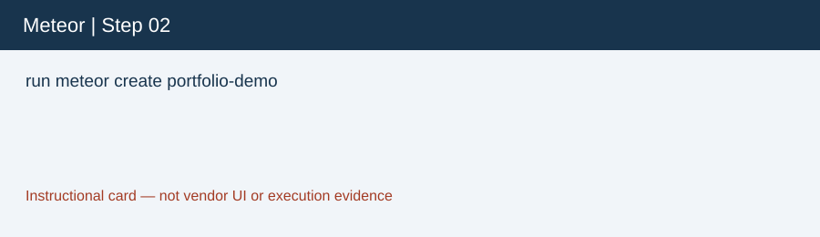
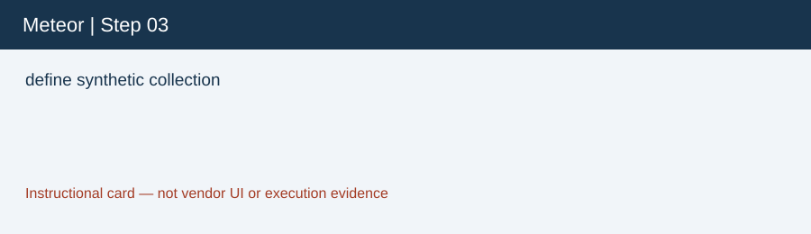
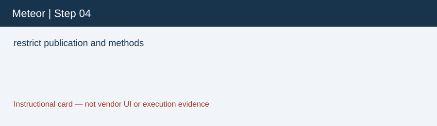
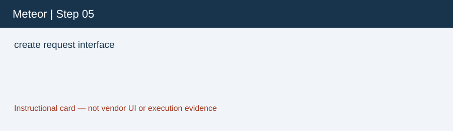
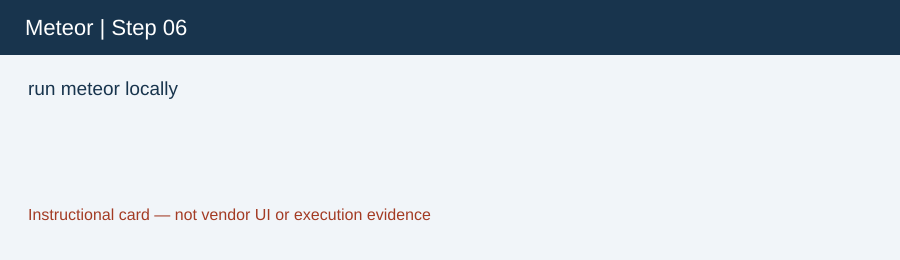
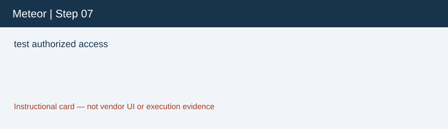
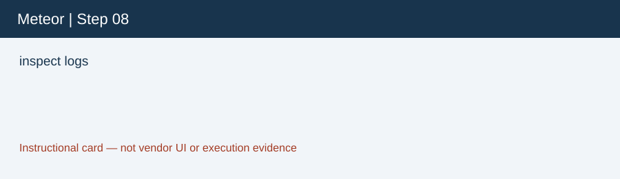

# Meteor implementation lab

Status: proposed procedure, not executed or verified against current vendor UI. Use synthetic data and authorized sandbox only. Review pricing, permissions and version-specific documentation first.

## 01. Install supported Meteor release

**Action:** Install supported Meteor release.

**Evidence:** Capture the actual interface or terminal output after completing this action. Record version, settings (redact credentials), result and any error. Do not mark passed until observed.

## 02. run meteor create portfolio-demo

**Action:** run meteor create portfolio-demo.

**Evidence:** Capture the actual interface or terminal output after completing this action. Record version, settings (redact credentials), result and any error. Do not mark passed until observed.

## 03. define synthetic collection

**Action:** define synthetic collection.

**Evidence:** Capture the actual interface or terminal output after completing this action. Record version, settings (redact credentials), result and any error. Do not mark passed until observed.

## 04. restrict publication and methods

**Action:** restrict publication and methods.

**Evidence:** Capture the actual interface or terminal output after completing this action. Record version, settings (redact credentials), result and any error. Do not mark passed until observed.

## 05. create request interface

**Action:** create request interface.

**Evidence:** Capture the actual interface or terminal output after completing this action. Record version, settings (redact credentials), result and any error. Do not mark passed until observed.

## 06. run meteor locally

**Action:** run meteor locally.

**Evidence:** Capture the actual interface or terminal output after completing this action. Record version, settings (redact credentials), result and any error. Do not mark passed until observed.

## 07. test authorized access

**Action:** test authorized access.

**Evidence:** Capture the actual interface or terminal output after completing this action. Record version, settings (redact credentials), result and any error. Do not mark passed until observed.

## 08. inspect logs

**Action:** inspect logs.

**Evidence:** Capture the actual interface or terminal output after completing this action. Record version, settings (redact credentials), result and any error. Do not mark passed until observed.

