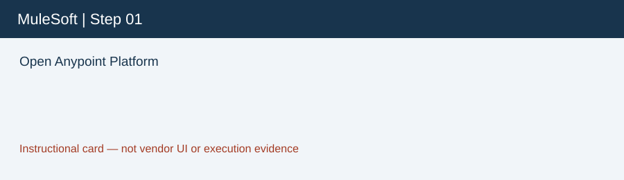
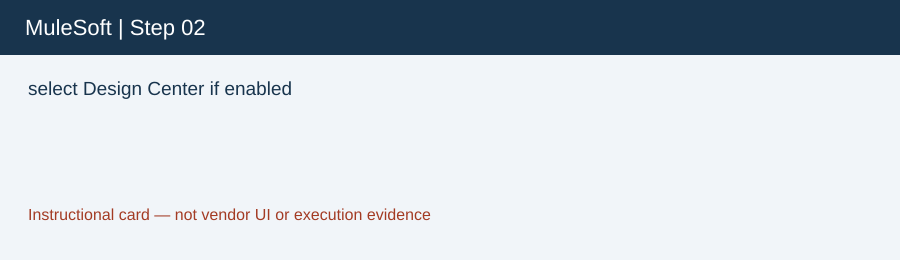
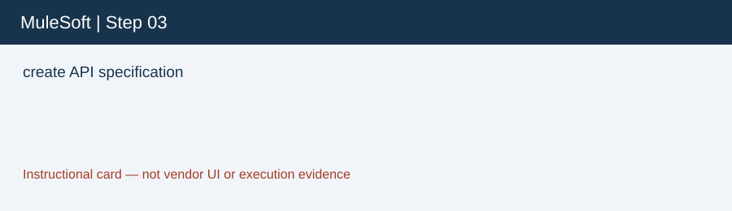
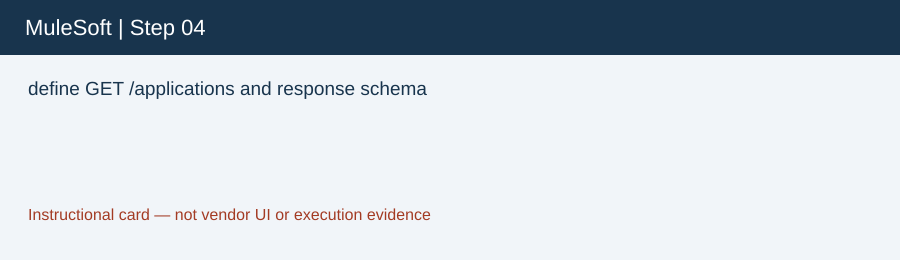
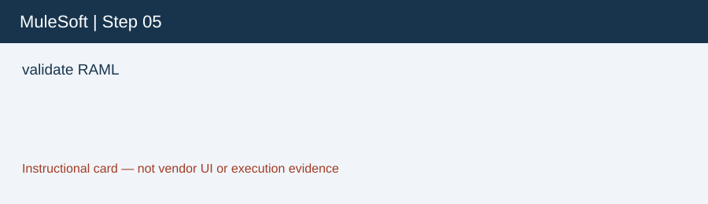
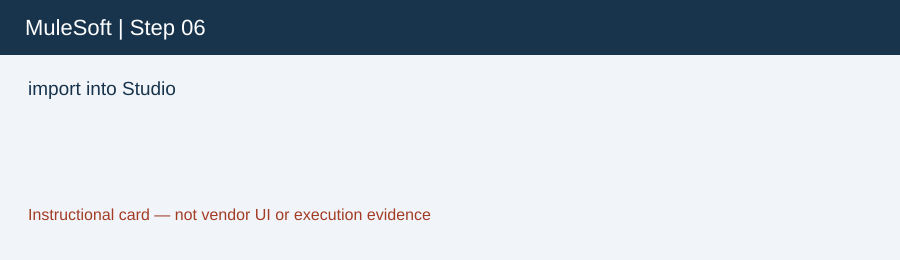
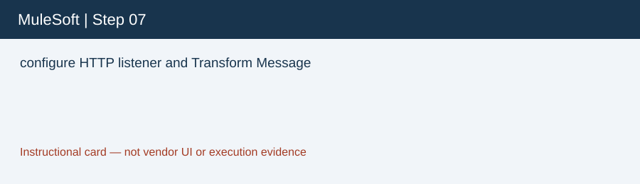
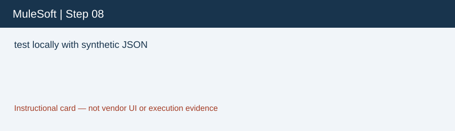

# MuleSoft implementation lab

Status: proposed procedure, not executed or verified against current vendor UI. Use synthetic data and authorized sandbox only. Review pricing, permissions and version-specific documentation first.

## 01. Open Anypoint Platform

**Action:** Open Anypoint Platform.

**Evidence:** Capture the actual interface or terminal output after completing this action. Record version, settings (redact credentials), result and any error. Do not mark passed until observed.

## 02. select Design Center if enabled

**Action:** select Design Center if enabled.

**Evidence:** Capture the actual interface or terminal output after completing this action. Record version, settings (redact credentials), result and any error. Do not mark passed until observed.

## 03. create API specification

**Action:** create API specification.

**Evidence:** Capture the actual interface or terminal output after completing this action. Record version, settings (redact credentials), result and any error. Do not mark passed until observed.

## 04. define GET /applications and response schema

**Action:** define GET /applications and response schema.

**Evidence:** Capture the actual interface or terminal output after completing this action. Record version, settings (redact credentials), result and any error. Do not mark passed until observed.

## 05. validate RAML

**Action:** validate RAML.

**Evidence:** Capture the actual interface or terminal output after completing this action. Record version, settings (redact credentials), result and any error. Do not mark passed until observed.

## 06. import into Studio

**Action:** import into Studio.

**Evidence:** Capture the actual interface or terminal output after completing this action. Record version, settings (redact credentials), result and any error. Do not mark passed until observed.

## 07. configure HTTP listener and Transform Message

**Action:** configure HTTP listener and Transform Message.

**Evidence:** Capture the actual interface or terminal output after completing this action. Record version, settings (redact credentials), result and any error. Do not mark passed until observed.

## 08. test locally with synthetic JSON

**Action:** test locally with synthetic JSON.

**Evidence:** Capture the actual interface or terminal output after completing this action. Record version, settings (redact credentials), result and any error. Do not mark passed until observed.

