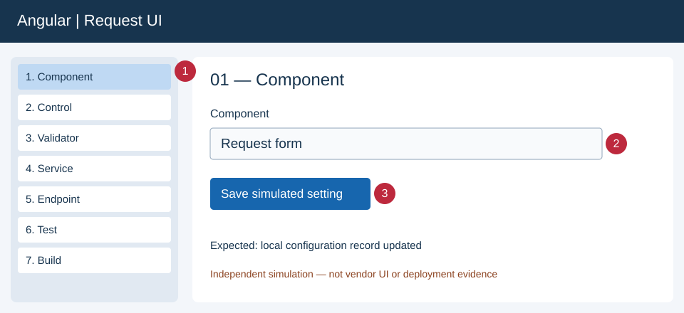
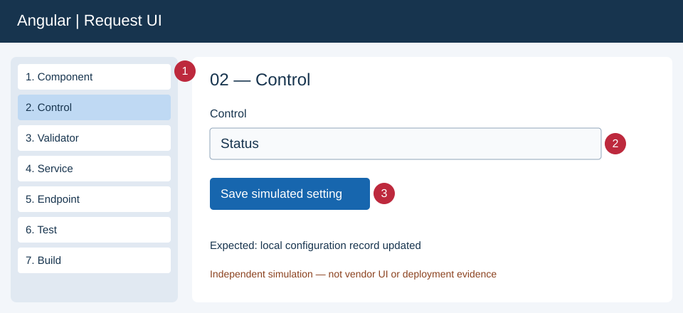
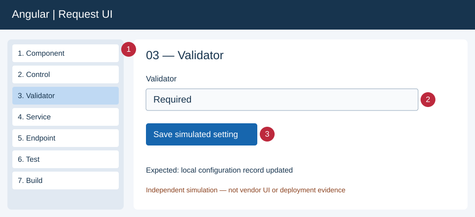
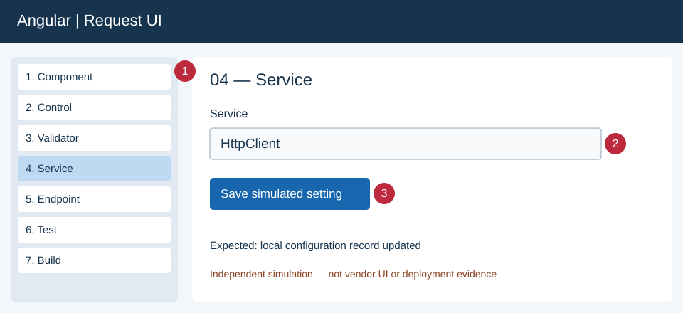
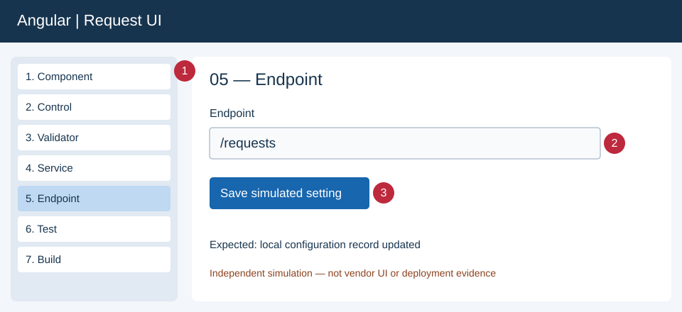
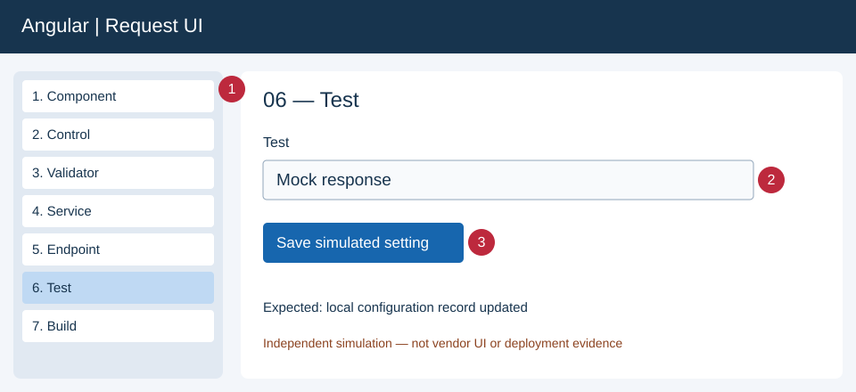
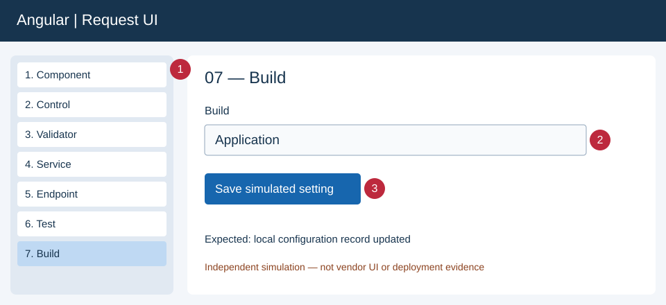

# Angular — Request UI

Original interactive configuration simulation. Download index.html and open locally in a browser. GitHub file preview does not execute HTML. This is not a replica of the vendor interface; settings are illustrative and must be verified in a real sandbox.

[Interactive HTML source](index.html)

## 01 — Component

Select **Component** in the simulation navigation, enter `Request form`, then select **Save simulated setting**. Confirm the configuration record contains the value before selecting Next step. This verifies local state only.

## 02 — Control

Select **Control** in the simulation navigation, enter `Status`, then select **Save simulated setting**. Confirm the configuration record contains the value before selecting Next step. This verifies local state only.

## 03 — Validator

Select **Validator** in the simulation navigation, enter `Required`, then select **Save simulated setting**. Confirm the configuration record contains the value before selecting Next step. This verifies local state only.

## 04 — Service

Select **Service** in the simulation navigation, enter `HttpClient`, then select **Save simulated setting**. Confirm the configuration record contains the value before selecting Next step. This verifies local state only.

## 05 — Endpoint

Select **Endpoint** in the simulation navigation, enter `/requests`, then select **Save simulated setting**. Confirm the configuration record contains the value before selecting Next step. This verifies local state only.

## 06 — Test

Select **Test** in the simulation navigation, enter `Mock response`, then select **Save simulated setting**. Confirm the configuration record contains the value before selecting Next step. This verifies local state only.

## 07 — Build

Select **Build** in the simulation navigation, enter `Application`, then select **Save simulated setting**. Confirm the configuration record contains the value before selecting Next step. This verifies local state only.

