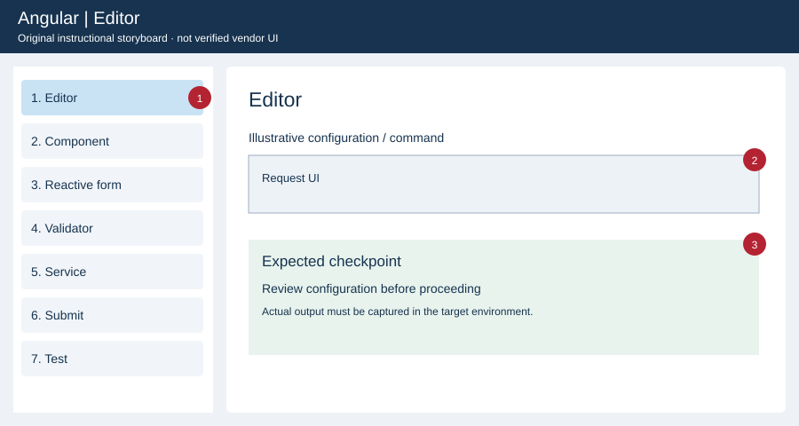
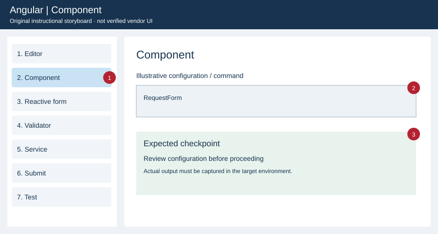
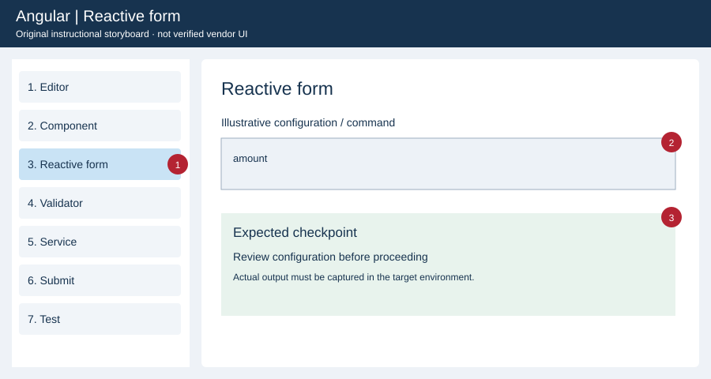
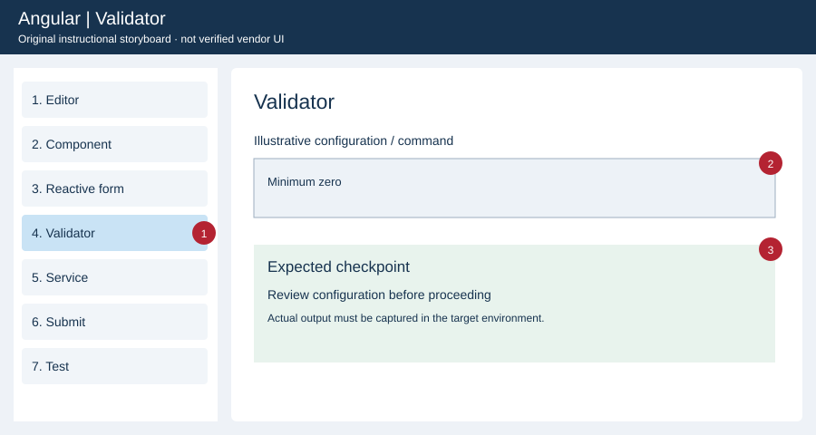
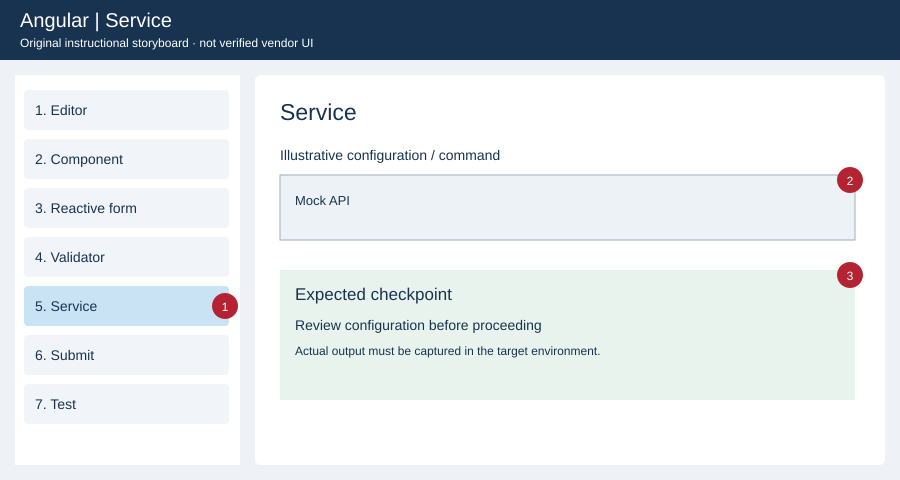
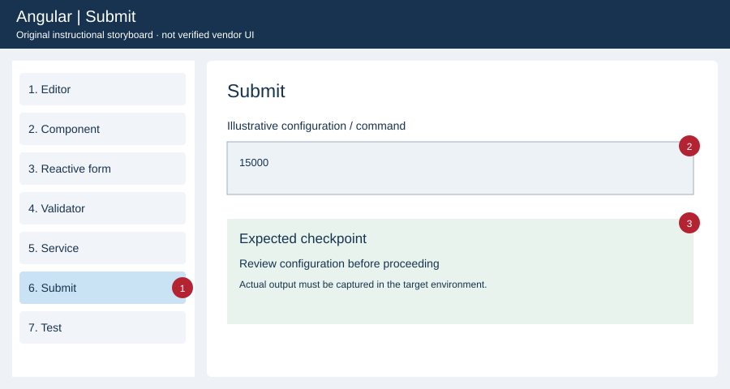
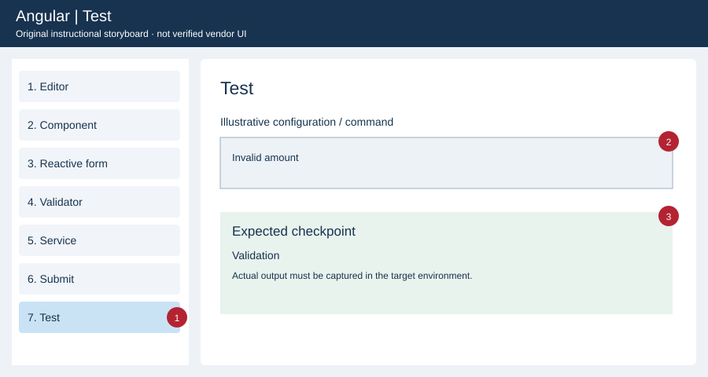

# Angular — numbered implementation walkthrough

Independent instructional storyboard. The navigation labels below are illustrative task stages, not verified vendor menu paths. No vendor deployment is claimed. Use synthetic data only. Prerequisites: browser for local illustrations; actual platform account, permissions and licensing must be established separately.

## Step 1: Editor
1. In the illustrated Angular workflow, locate callout 1 (Editor).
2. Inspect callout 2 and the sample value `Request UI`.
3. Review the expected checkpoint at callout 3: configuration reviewed before continuing.
4. In the real environment, verify the equivalent control and capture actual output before proceeding.

## Step 2: Component
1. In the illustrated Angular workflow, locate callout 1 (Component).
2. Inspect callout 2 and the sample value `RequestForm`.
3. Review the expected checkpoint at callout 3: configuration reviewed before continuing.
4. In the real environment, verify the equivalent control and capture actual output before proceeding.

## Step 3: Reactive form
1. In the illustrated Angular workflow, locate callout 1 (Reactive form).
2. Inspect callout 2 and the sample value `amount`.
3. Review the expected checkpoint at callout 3: configuration reviewed before continuing.
4. In the real environment, verify the equivalent control and capture actual output before proceeding.

## Step 4: Validator
1. In the illustrated Angular workflow, locate callout 1 (Validator).
2. Inspect callout 2 and the sample value `Minimum zero`.
3. Review the expected checkpoint at callout 3: configuration reviewed before continuing.
4. In the real environment, verify the equivalent control and capture actual output before proceeding.

## Step 5: Service
1. In the illustrated Angular workflow, locate callout 1 (Service).
2. Inspect callout 2 and the sample value `Mock API`.
3. Review the expected checkpoint at callout 3: configuration reviewed before continuing.
4. In the real environment, verify the equivalent control and capture actual output before proceeding.

## Step 6: Submit
1. In the illustrated Angular workflow, locate callout 1 (Submit).
2. Inspect callout 2 and the sample value `15000`.
3. Review the expected checkpoint at callout 3: configuration reviewed before continuing.
4. In the real environment, verify the equivalent control and capture actual output before proceeding.

## Step 7: Test
1. In the illustrated Angular workflow, locate callout 1 (Test).
2. Inspect callout 2 and the sample value `Invalid amount`.
3. Review the expected checkpoint at callout 3: Validation.
4. In the real environment, verify the equivalent control and capture actual output before proceeding.

## Troubleshooting and executive acceptance
If a control is unavailable, verify role permissions, licensing and product version. If validation fails, stop, preserve the error and correct the input. Executive gate: Validation. Record actual test output, reviewer and decision; do not claim completion without evidence.
