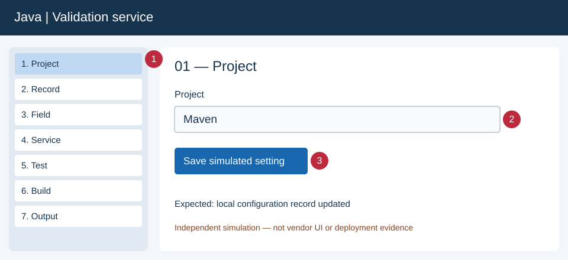
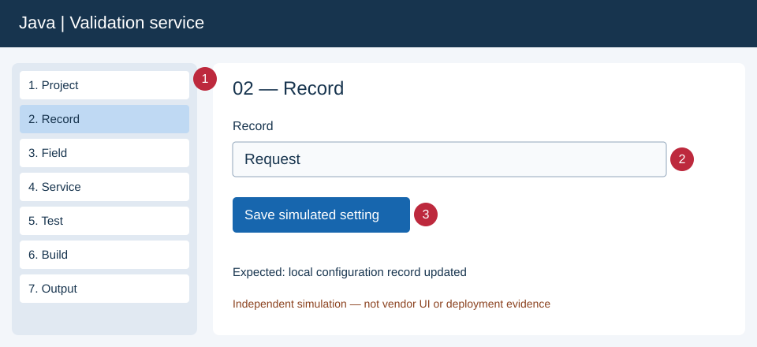
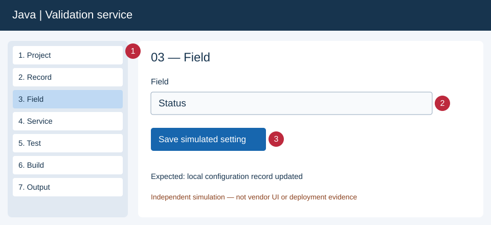
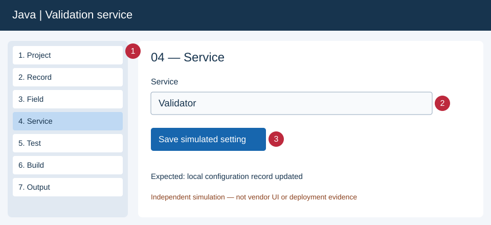
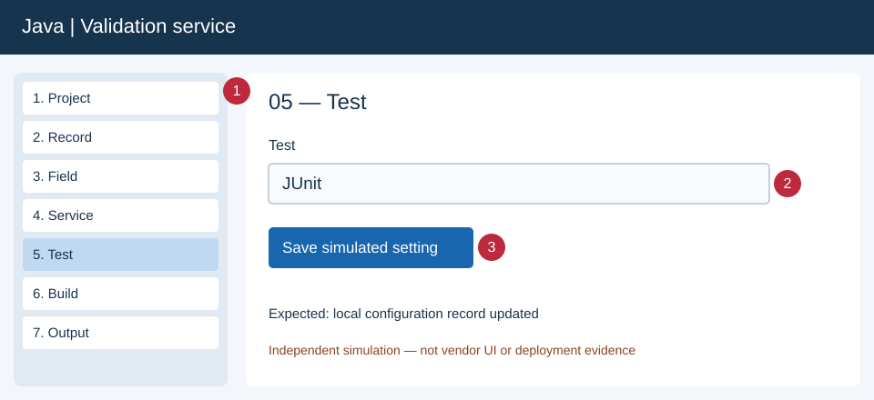
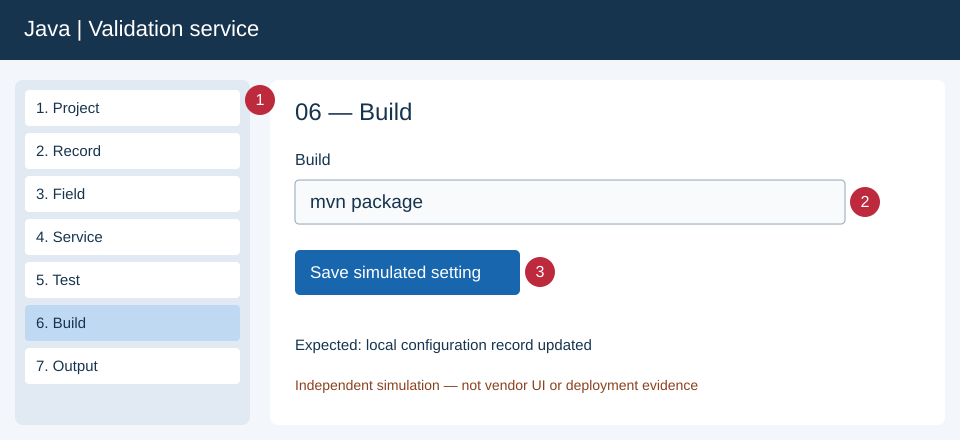
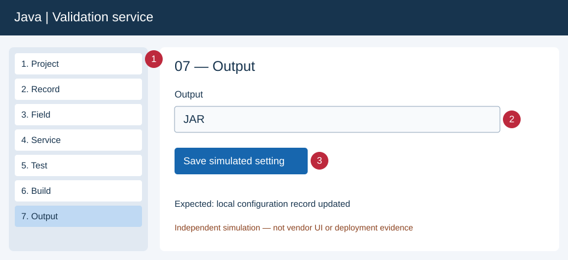

# Java — Validation service

Original interactive configuration simulation. Download index.html and open locally in a browser. GitHub file preview does not execute HTML. This is not a replica of the vendor interface; settings are illustrative and must be verified in a real sandbox.

[Interactive HTML source](index.html)

## 01 — Project

Select **Project** in the simulation navigation, enter `Maven`, then select **Save simulated setting**. Confirm the configuration record contains the value before selecting Next step. This verifies local state only.

## 02 — Record

Select **Record** in the simulation navigation, enter `Request`, then select **Save simulated setting**. Confirm the configuration record contains the value before selecting Next step. This verifies local state only.

## 03 — Field

Select **Field** in the simulation navigation, enter `Status`, then select **Save simulated setting**. Confirm the configuration record contains the value before selecting Next step. This verifies local state only.

## 04 — Service

Select **Service** in the simulation navigation, enter `Validator`, then select **Save simulated setting**. Confirm the configuration record contains the value before selecting Next step. This verifies local state only.

## 05 — Test

Select **Test** in the simulation navigation, enter `JUnit`, then select **Save simulated setting**. Confirm the configuration record contains the value before selecting Next step. This verifies local state only.

## 06 — Build

Select **Build** in the simulation navigation, enter `mvn package`, then select **Save simulated setting**. Confirm the configuration record contains the value before selecting Next step. This verifies local state only.

## 07 — Output

Select **Output** in the simulation navigation, enter `JAR`, then select **Save simulated setting**. Confirm the configuration record contains the value before selecting Next step. This verifies local state only.

