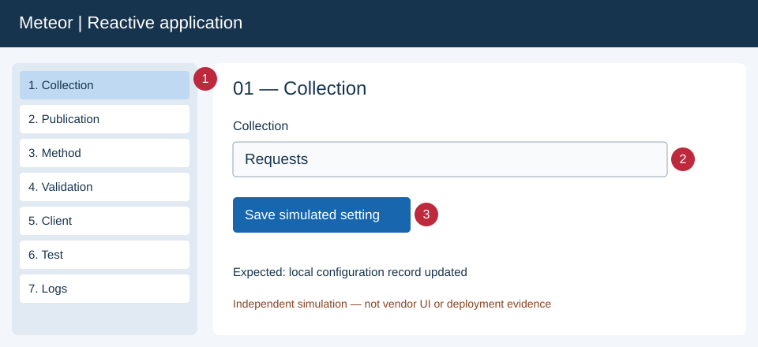
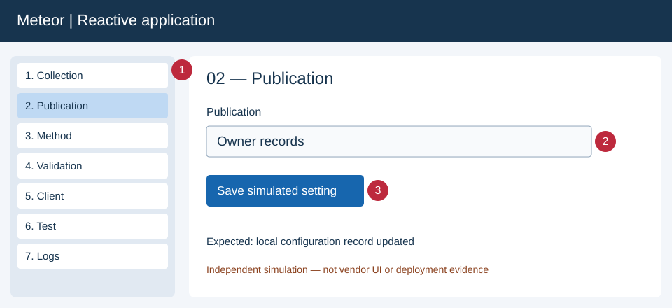
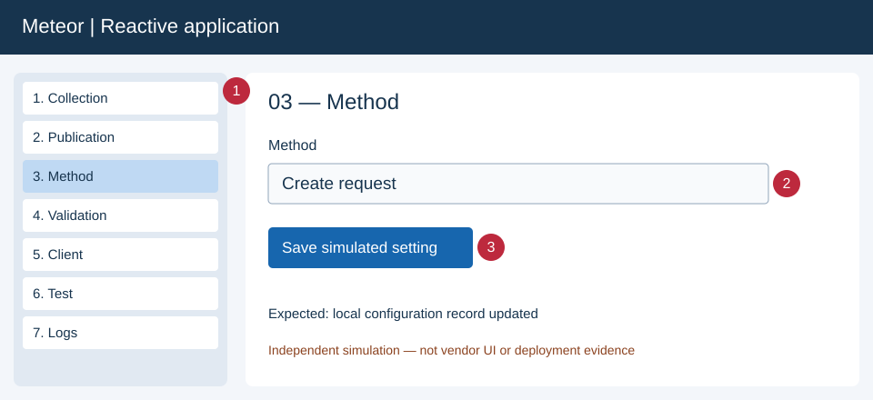
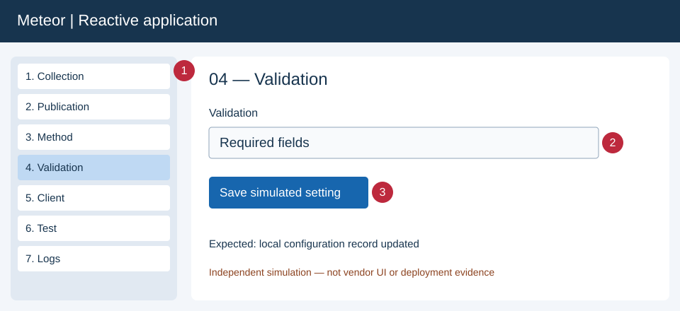
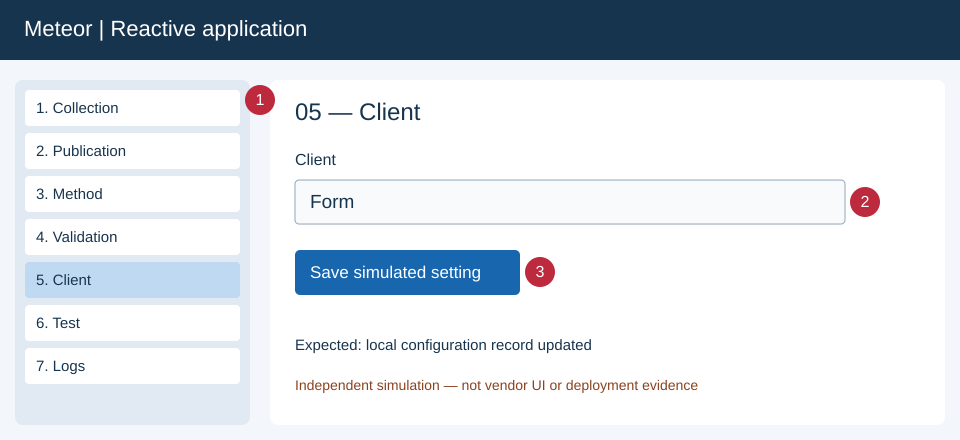
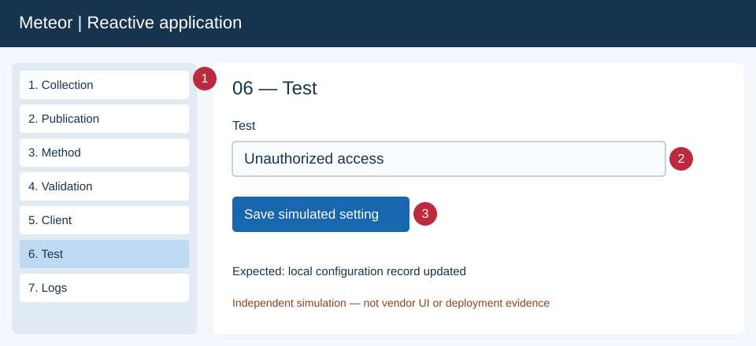
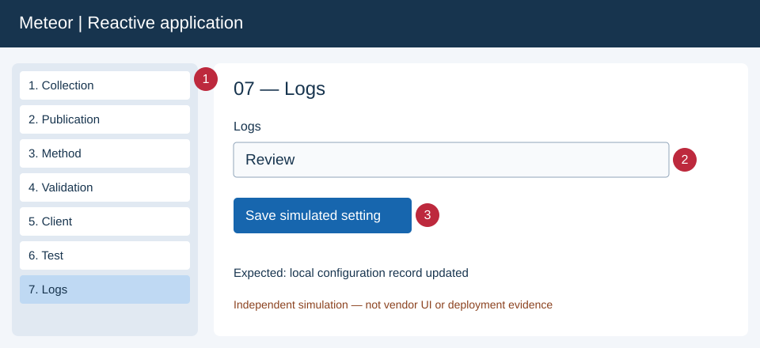

# Meteor — Reactive application

Original interactive configuration simulation. Download index.html and open locally in a browser. GitHub file preview does not execute HTML. This is not a replica of the vendor interface; settings are illustrative and must be verified in a real sandbox.

[Interactive HTML source](index.html)

## 01 — Collection

Select **Collection** in the simulation navigation, enter `Requests`, then select **Save simulated setting**. Confirm the configuration record contains the value before selecting Next step. This verifies local state only.

## 02 — Publication

Select **Publication** in the simulation navigation, enter `Owner records`, then select **Save simulated setting**. Confirm the configuration record contains the value before selecting Next step. This verifies local state only.

## 03 — Method

Select **Method** in the simulation navigation, enter `Create request`, then select **Save simulated setting**. Confirm the configuration record contains the value before selecting Next step. This verifies local state only.

## 04 — Validation

Select **Validation** in the simulation navigation, enter `Required fields`, then select **Save simulated setting**. Confirm the configuration record contains the value before selecting Next step. This verifies local state only.

## 05 — Client

Select **Client** in the simulation navigation, enter `Form`, then select **Save simulated setting**. Confirm the configuration record contains the value before selecting Next step. This verifies local state only.

## 06 — Test

Select **Test** in the simulation navigation, enter `Unauthorized access`, then select **Save simulated setting**. Confirm the configuration record contains the value before selecting Next step. This verifies local state only.

## 07 — Logs

Select **Logs** in the simulation navigation, enter `Review`, then select **Save simulated setting**. Confirm the configuration record contains the value before selecting Next step. This verifies local state only.

