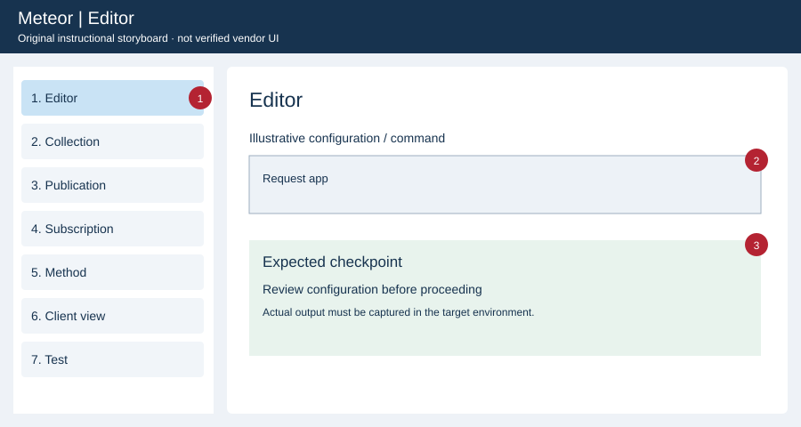
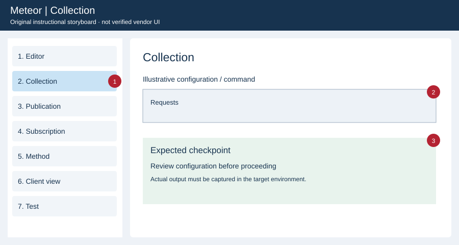
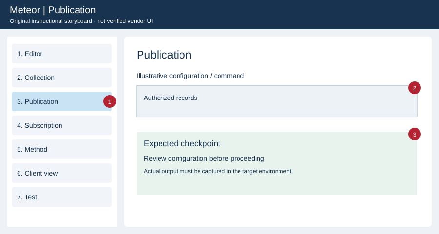
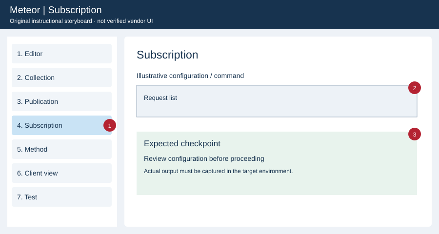
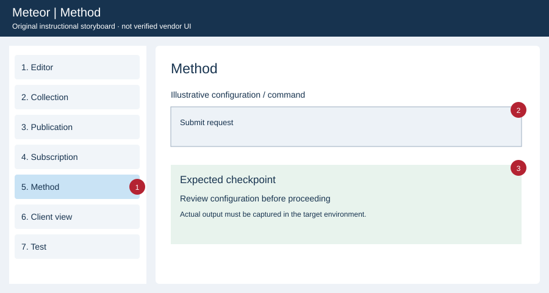
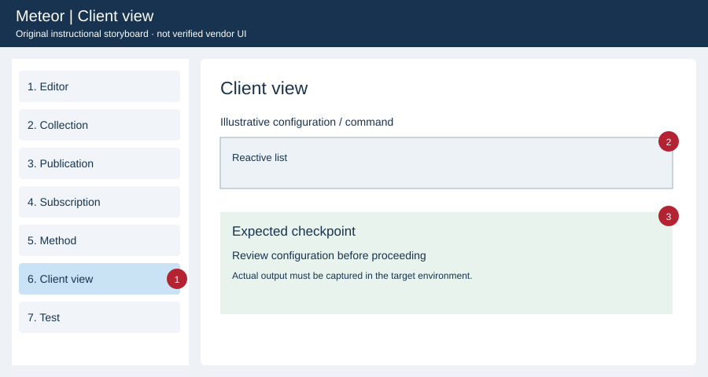
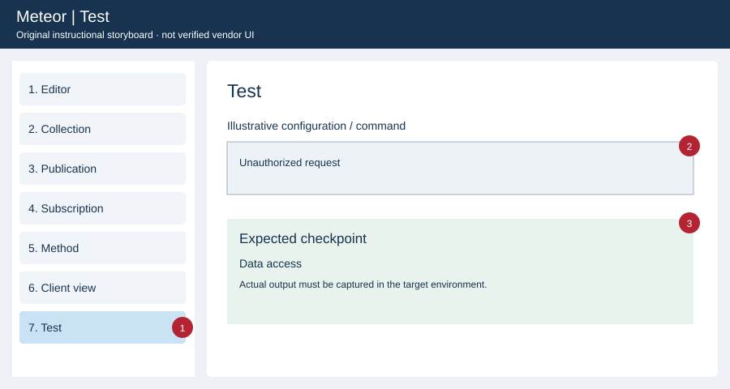

# Meteor — numbered implementation walkthrough

Independent instructional storyboard. The navigation labels below are illustrative task stages, not verified vendor menu paths. No vendor deployment is claimed. Use synthetic data only. Prerequisites: browser for local illustrations; actual platform account, permissions and licensing must be established separately.

## Step 1: Editor
1. In the illustrated Meteor workflow, locate callout 1 (Editor).
2. Inspect callout 2 and the sample value `Request app`.
3. Review the expected checkpoint at callout 3: configuration reviewed before continuing.
4. In the real environment, verify the equivalent control and capture actual output before proceeding.

## Step 2: Collection
1. In the illustrated Meteor workflow, locate callout 1 (Collection).
2. Inspect callout 2 and the sample value `Requests`.
3. Review the expected checkpoint at callout 3: configuration reviewed before continuing.
4. In the real environment, verify the equivalent control and capture actual output before proceeding.

## Step 3: Publication
1. In the illustrated Meteor workflow, locate callout 1 (Publication).
2. Inspect callout 2 and the sample value `Authorized records`.
3. Review the expected checkpoint at callout 3: configuration reviewed before continuing.
4. In the real environment, verify the equivalent control and capture actual output before proceeding.

## Step 4: Subscription
1. In the illustrated Meteor workflow, locate callout 1 (Subscription).
2. Inspect callout 2 and the sample value `Request list`.
3. Review the expected checkpoint at callout 3: configuration reviewed before continuing.
4. In the real environment, verify the equivalent control and capture actual output before proceeding.

## Step 5: Method
1. In the illustrated Meteor workflow, locate callout 1 (Method).
2. Inspect callout 2 and the sample value `Submit request`.
3. Review the expected checkpoint at callout 3: configuration reviewed before continuing.
4. In the real environment, verify the equivalent control and capture actual output before proceeding.

## Step 6: Client view
1. In the illustrated Meteor workflow, locate callout 1 (Client view).
2. Inspect callout 2 and the sample value `Reactive list`.
3. Review the expected checkpoint at callout 3: configuration reviewed before continuing.
4. In the real environment, verify the equivalent control and capture actual output before proceeding.

## Step 7: Test
1. In the illustrated Meteor workflow, locate callout 1 (Test).
2. Inspect callout 2 and the sample value `Unauthorized request`.
3. Review the expected checkpoint at callout 3: Data access.
4. In the real environment, verify the equivalent control and capture actual output before proceeding.

## Troubleshooting and executive acceptance
If a control is unavailable, verify role permissions, licensing and product version. If validation fails, stop, preserve the error and correct the input. Executive gate: Data access. Record actual test output, reviewer and decision; do not claim completion without evidence.
