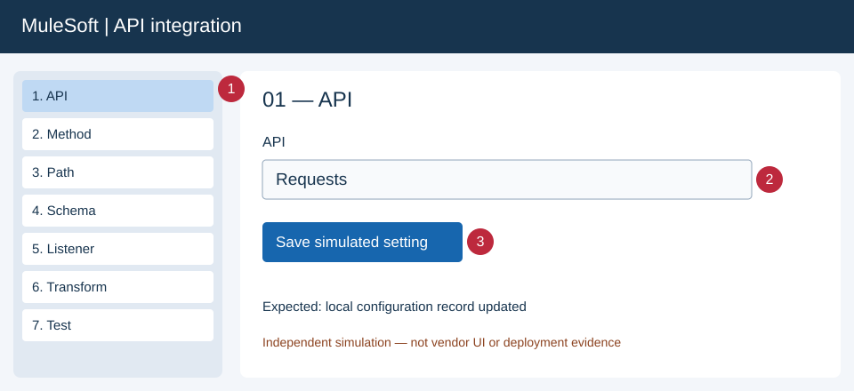
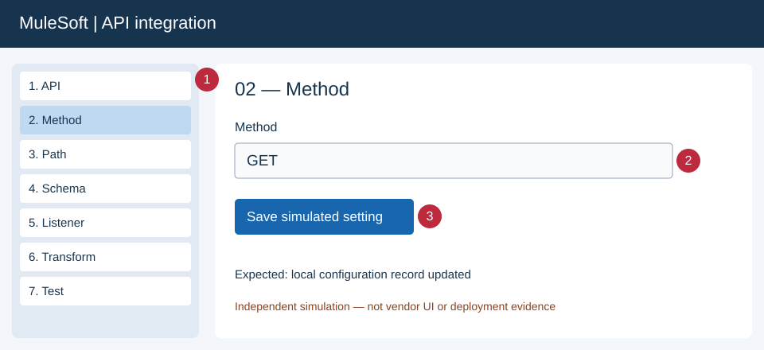
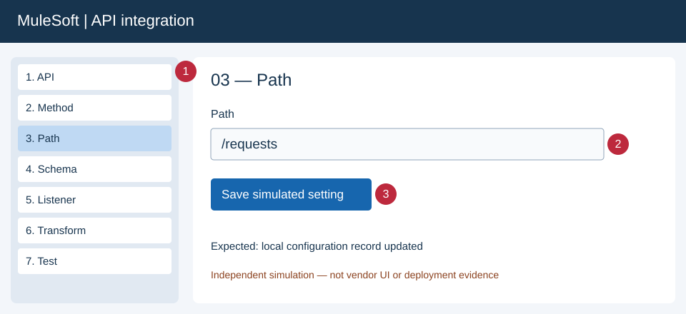
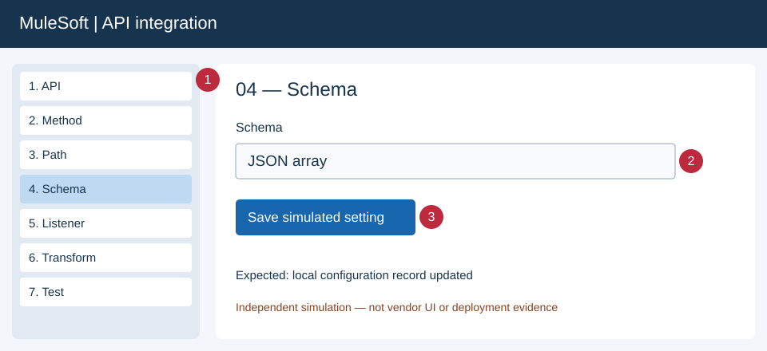
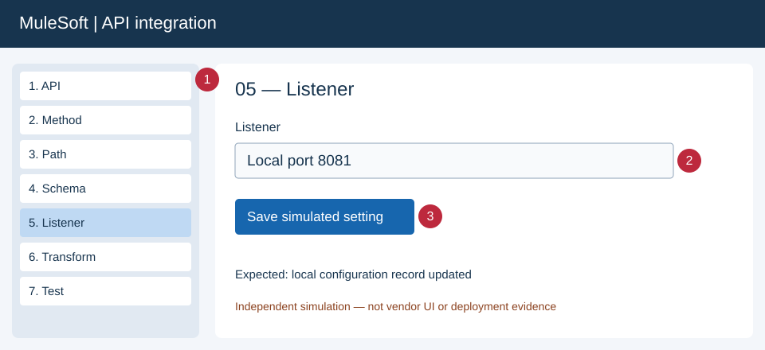
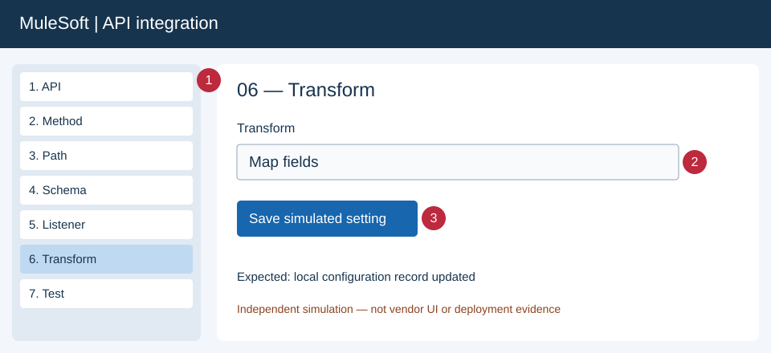
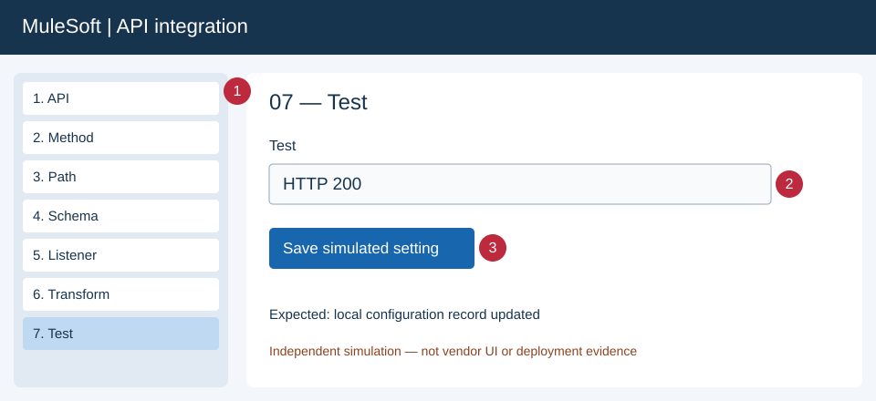

# MuleSoft — API integration

Original interactive configuration simulation. Download index.html and open locally in a browser. GitHub file preview does not execute HTML. This is not a replica of the vendor interface; settings are illustrative and must be verified in a real sandbox.

[Interactive HTML source](index.html)

## 01 — API

Select **API** in the simulation navigation, enter `Requests`, then select **Save simulated setting**. Confirm the configuration record contains the value before selecting Next step. This verifies local state only.

## 02 — Method

Select **Method** in the simulation navigation, enter `GET`, then select **Save simulated setting**. Confirm the configuration record contains the value before selecting Next step. This verifies local state only.

## 03 — Path

Select **Path** in the simulation navigation, enter `/requests`, then select **Save simulated setting**. Confirm the configuration record contains the value before selecting Next step. This verifies local state only.

## 04 — Schema

Select **Schema** in the simulation navigation, enter `JSON array`, then select **Save simulated setting**. Confirm the configuration record contains the value before selecting Next step. This verifies local state only.

## 05 — Listener

Select **Listener** in the simulation navigation, enter `Local port 8081`, then select **Save simulated setting**. Confirm the configuration record contains the value before selecting Next step. This verifies local state only.

## 06 — Transform

Select **Transform** in the simulation navigation, enter `Map fields`, then select **Save simulated setting**. Confirm the configuration record contains the value before selecting Next step. This verifies local state only.

## 07 — Test

Select **Test** in the simulation navigation, enter `HTTP 200`, then select **Save simulated setting**. Confirm the configuration record contains the value before selecting Next step. This verifies local state only.

