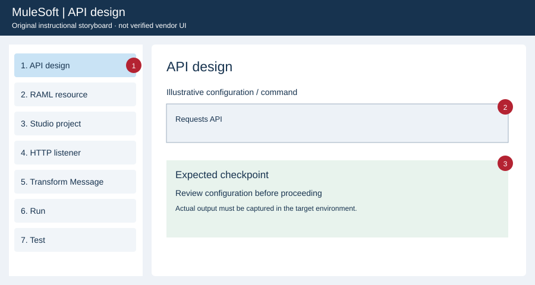
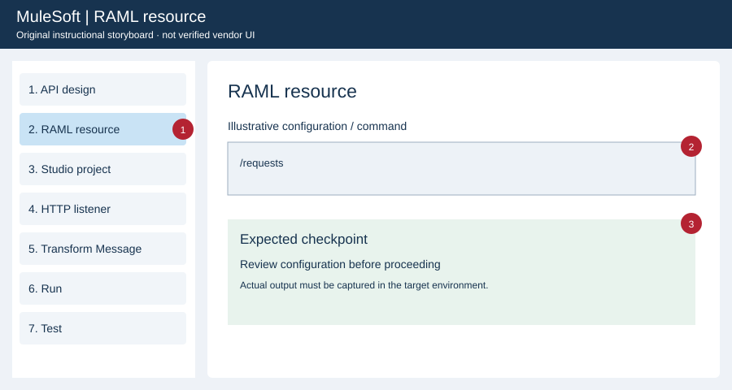
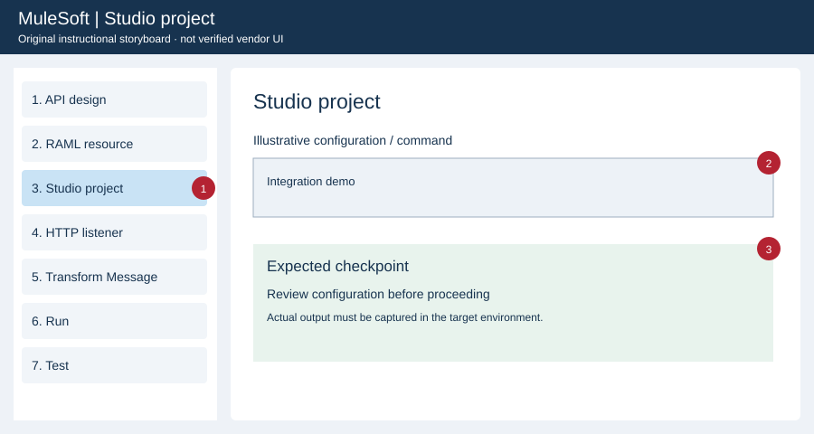
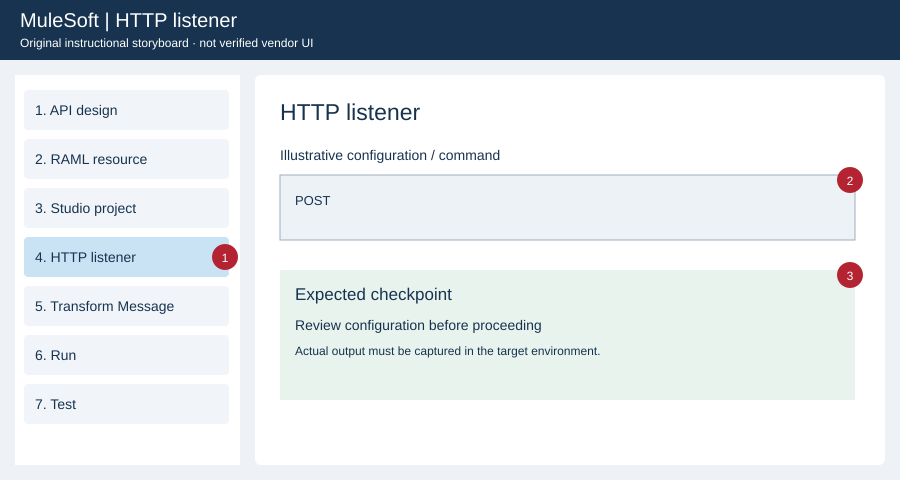
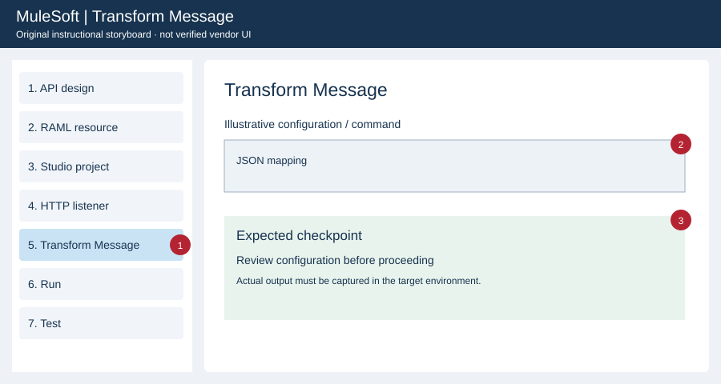
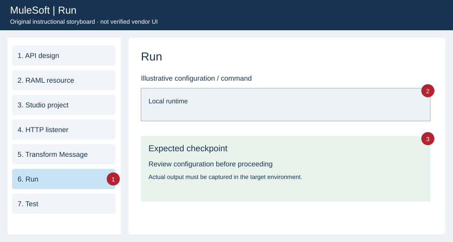
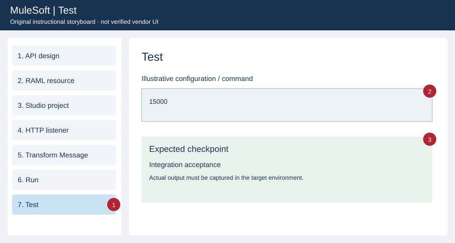

# MuleSoft — numbered implementation walkthrough

Independent instructional storyboard. The navigation labels below are illustrative task stages, not verified vendor menu paths. No vendor deployment is claimed. Use synthetic data only. Prerequisites: browser for local illustrations; actual platform account, permissions and licensing must be established separately.

## Step 1: API design
1. In the illustrated MuleSoft workflow, locate callout 1 (API design).
2. Inspect callout 2 and the sample value `Requests API`.
3. Review the expected checkpoint at callout 3: configuration reviewed before continuing.
4. In the real environment, verify the equivalent control and capture actual output before proceeding.

## Step 2: RAML resource
1. In the illustrated MuleSoft workflow, locate callout 1 (RAML resource).
2. Inspect callout 2 and the sample value `/requests`.
3. Review the expected checkpoint at callout 3: configuration reviewed before continuing.
4. In the real environment, verify the equivalent control and capture actual output before proceeding.

## Step 3: Studio project
1. In the illustrated MuleSoft workflow, locate callout 1 (Studio project).
2. Inspect callout 2 and the sample value `Integration demo`.
3. Review the expected checkpoint at callout 3: configuration reviewed before continuing.
4. In the real environment, verify the equivalent control and capture actual output before proceeding.

## Step 4: HTTP listener
1. In the illustrated MuleSoft workflow, locate callout 1 (HTTP listener).
2. Inspect callout 2 and the sample value `POST`.
3. Review the expected checkpoint at callout 3: configuration reviewed before continuing.
4. In the real environment, verify the equivalent control and capture actual output before proceeding.

## Step 5: Transform Message
1. In the illustrated MuleSoft workflow, locate callout 1 (Transform Message).
2. Inspect callout 2 and the sample value `JSON mapping`.
3. Review the expected checkpoint at callout 3: configuration reviewed before continuing.
4. In the real environment, verify the equivalent control and capture actual output before proceeding.

## Step 6: Run
1. In the illustrated MuleSoft workflow, locate callout 1 (Run).
2. Inspect callout 2 and the sample value `Local runtime`.
3. Review the expected checkpoint at callout 3: configuration reviewed before continuing.
4. In the real environment, verify the equivalent control and capture actual output before proceeding.

## Step 7: Test
1. In the illustrated MuleSoft workflow, locate callout 1 (Test).
2. Inspect callout 2 and the sample value `15000`.
3. Review the expected checkpoint at callout 3: Integration acceptance.
4. In the real environment, verify the equivalent control and capture actual output before proceeding.

## Troubleshooting and executive acceptance
If a control is unavailable, verify role permissions, licensing and product version. If validation fails, stop, preserve the error and correct the input. Executive gate: Integration acceptance. Record actual test output, reviewer and decision; do not claim completion without evidence.
