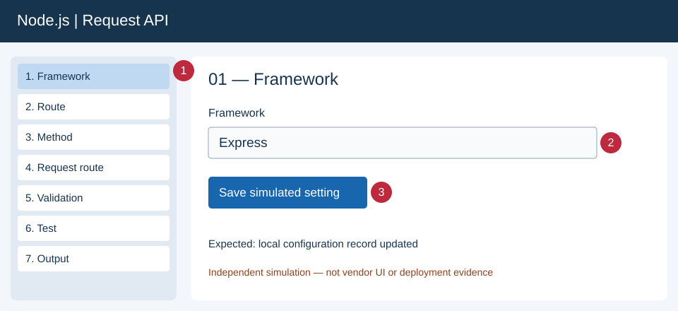
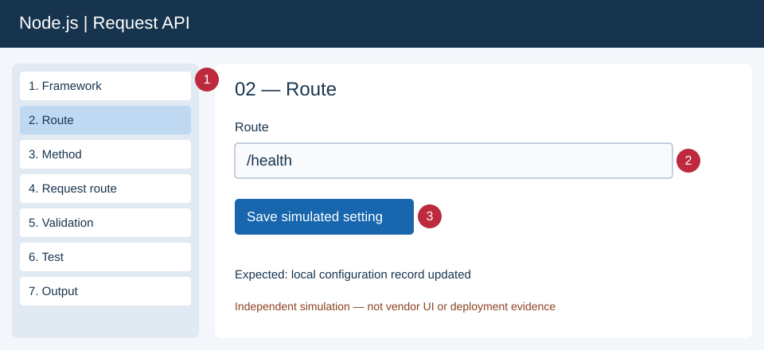
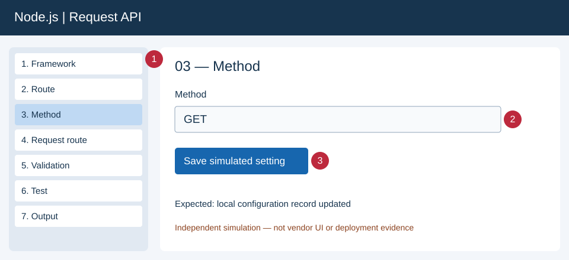
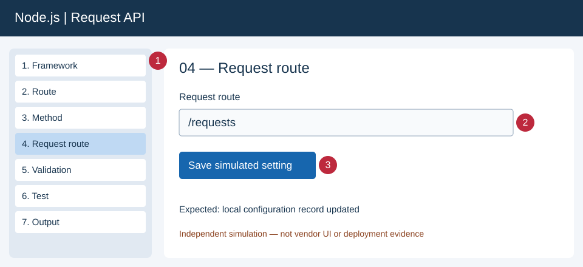
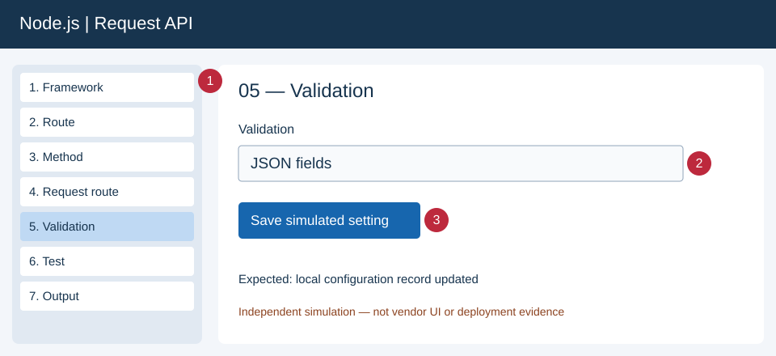
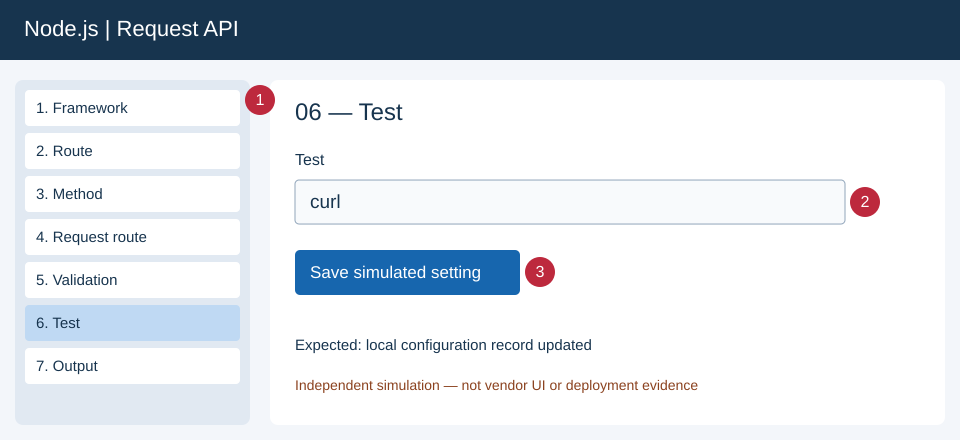
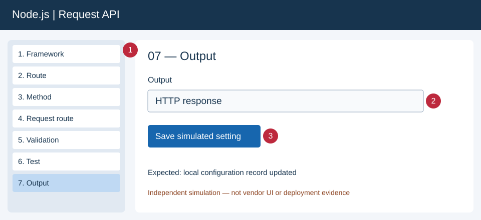

# Node.js — Request API

Original interactive configuration simulation. Download index.html and open locally in a browser. GitHub file preview does not execute HTML. This is not a replica of the vendor interface; settings are illustrative and must be verified in a real sandbox.

[Interactive HTML source](index.html)

## 01 — Framework

Select **Framework** in the simulation navigation, enter `Express`, then select **Save simulated setting**. Confirm the configuration record contains the value before selecting Next step. This verifies local state only.

## 02 — Route

Select **Route** in the simulation navigation, enter `/health`, then select **Save simulated setting**. Confirm the configuration record contains the value before selecting Next step. This verifies local state only.

## 03 — Method

Select **Method** in the simulation navigation, enter `GET`, then select **Save simulated setting**. Confirm the configuration record contains the value before selecting Next step. This verifies local state only.

## 04 — Request route

Select **Request route** in the simulation navigation, enter `/requests`, then select **Save simulated setting**. Confirm the configuration record contains the value before selecting Next step. This verifies local state only.

## 05 — Validation

Select **Validation** in the simulation navigation, enter `JSON fields`, then select **Save simulated setting**. Confirm the configuration record contains the value before selecting Next step. This verifies local state only.

## 06 — Test

Select **Test** in the simulation navigation, enter `curl`, then select **Save simulated setting**. Confirm the configuration record contains the value before selecting Next step. This verifies local state only.

## 07 — Output

Select **Output** in the simulation navigation, enter `HTTP response`, then select **Save simulated setting**. Confirm the configuration record contains the value before selecting Next step. This verifies local state only.

