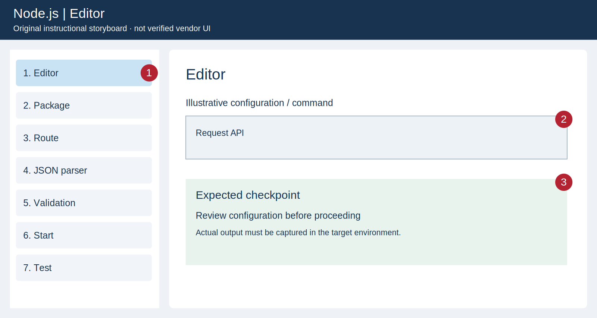
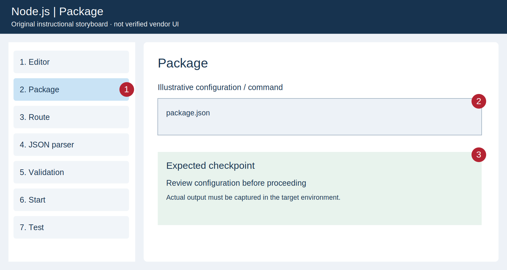
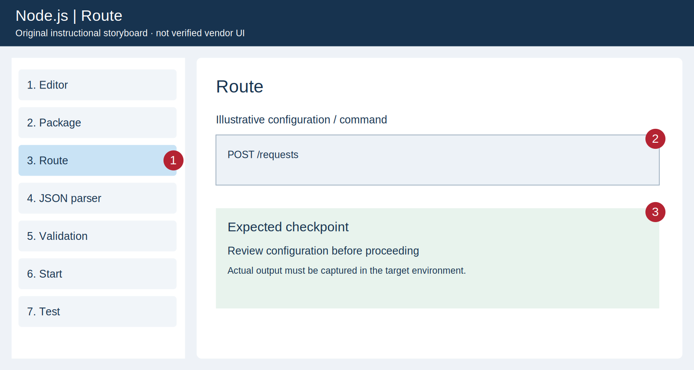
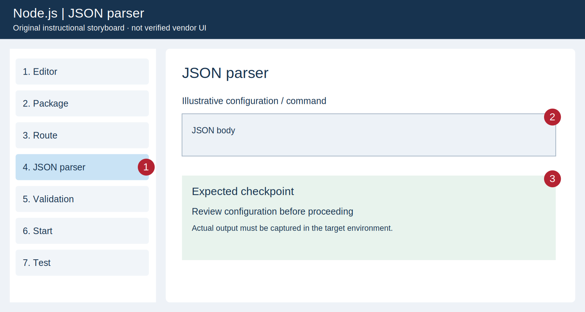
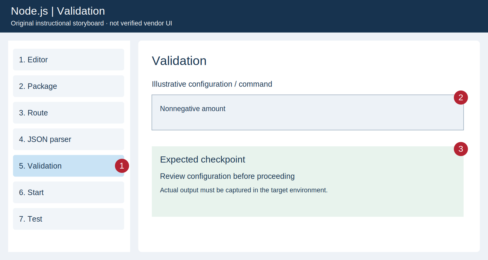
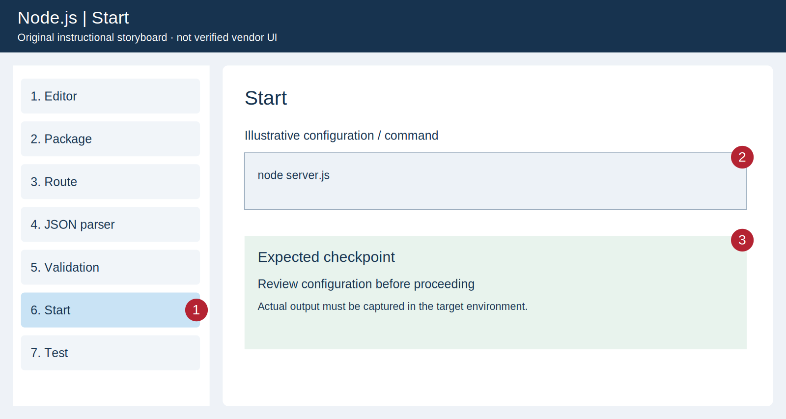
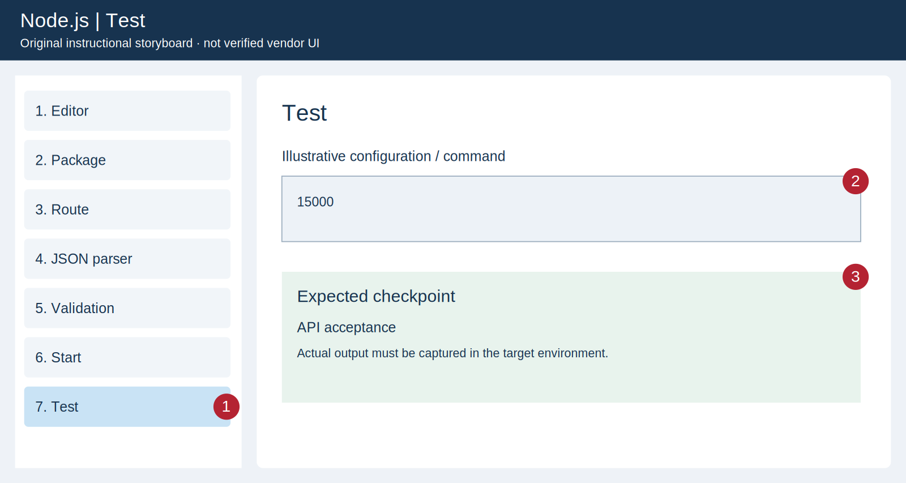

# Node.js — numbered implementation walkthrough

Independent instructional storyboard. The navigation labels below are illustrative task stages, not verified vendor menu paths. No vendor deployment is claimed. Use synthetic data only. Prerequisites: browser for local illustrations; actual platform account, permissions and licensing must be established separately.

## Step 1: Editor
1. In the illustrated Node.js workflow, locate callout 1 (Editor).
2. Inspect callout 2 and the sample value `Request API`.
3. Review the expected checkpoint at callout 3: configuration reviewed before continuing.
4. In the real environment, verify the equivalent control and capture actual output before proceeding.

## Step 2: Package
1. In the illustrated Node.js workflow, locate callout 1 (Package).
2. Inspect callout 2 and the sample value `package.json`.
3. Review the expected checkpoint at callout 3: configuration reviewed before continuing.
4. In the real environment, verify the equivalent control and capture actual output before proceeding.

## Step 3: Route
1. In the illustrated Node.js workflow, locate callout 1 (Route).
2. Inspect callout 2 and the sample value `POST /requests`.
3. Review the expected checkpoint at callout 3: configuration reviewed before continuing.
4. In the real environment, verify the equivalent control and capture actual output before proceeding.

## Step 4: JSON parser
1. In the illustrated Node.js workflow, locate callout 1 (JSON parser).
2. Inspect callout 2 and the sample value `JSON body`.
3. Review the expected checkpoint at callout 3: configuration reviewed before continuing.
4. In the real environment, verify the equivalent control and capture actual output before proceeding.

## Step 5: Validation
1. In the illustrated Node.js workflow, locate callout 1 (Validation).
2. Inspect callout 2 and the sample value `Nonnegative amount`.
3. Review the expected checkpoint at callout 3: configuration reviewed before continuing.
4. In the real environment, verify the equivalent control and capture actual output before proceeding.

## Step 6: Start
1. In the illustrated Node.js workflow, locate callout 1 (Start).
2. Inspect callout 2 and the sample value `node server.js`.
3. Review the expected checkpoint at callout 3: configuration reviewed before continuing.
4. In the real environment, verify the equivalent control and capture actual output before proceeding.

## Step 7: Test
1. In the illustrated Node.js workflow, locate callout 1 (Test).
2. Inspect callout 2 and the sample value `15000`.
3. Review the expected checkpoint at callout 3: API acceptance.
4. In the real environment, verify the equivalent control and capture actual output before proceeding.

## Troubleshooting and executive acceptance
If a control is unavailable, verify role permissions, licensing and product version. If validation fails, stop, preserve the error and correct the input. Executive gate: API acceptance. Record actual test output, reviewer and decision; do not claim completion without evidence.
