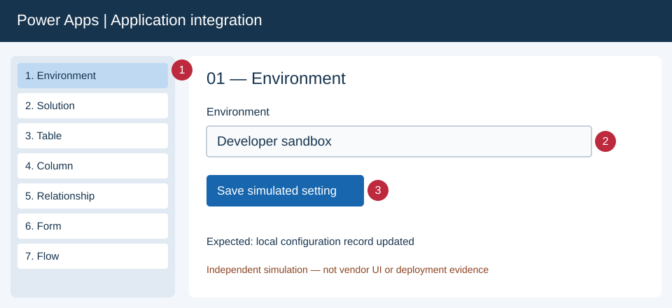
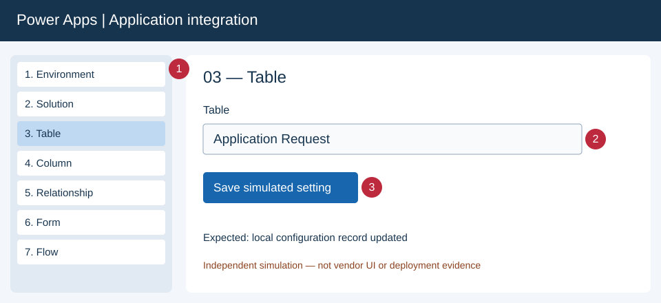
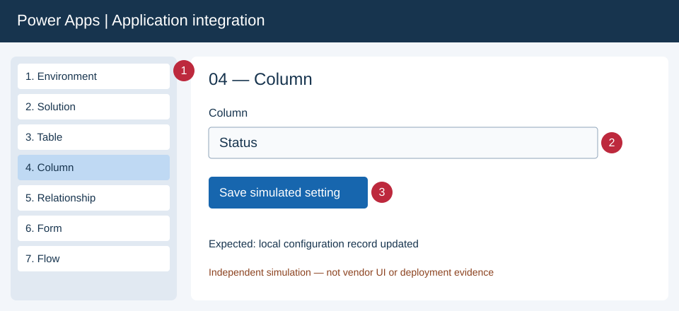
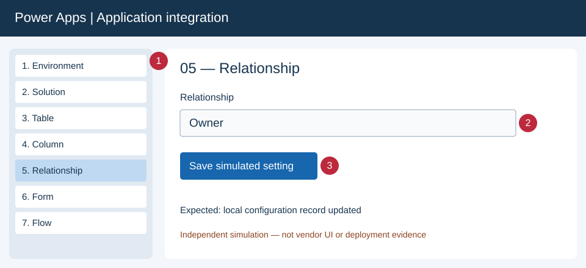
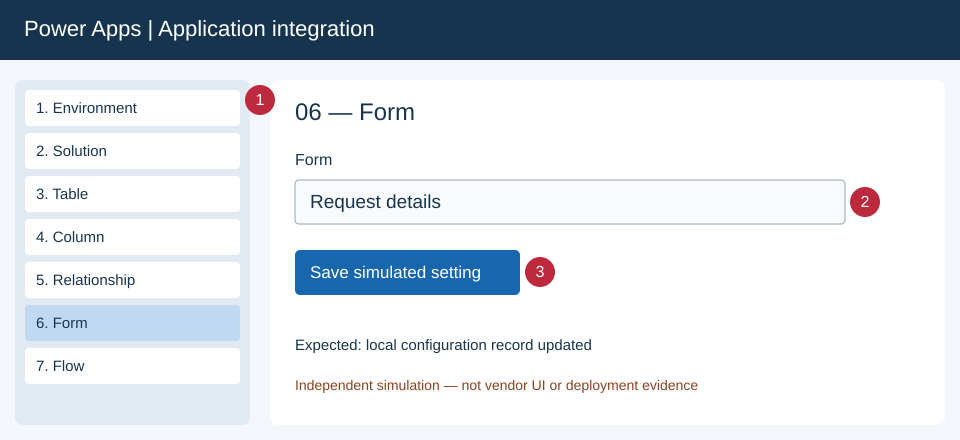
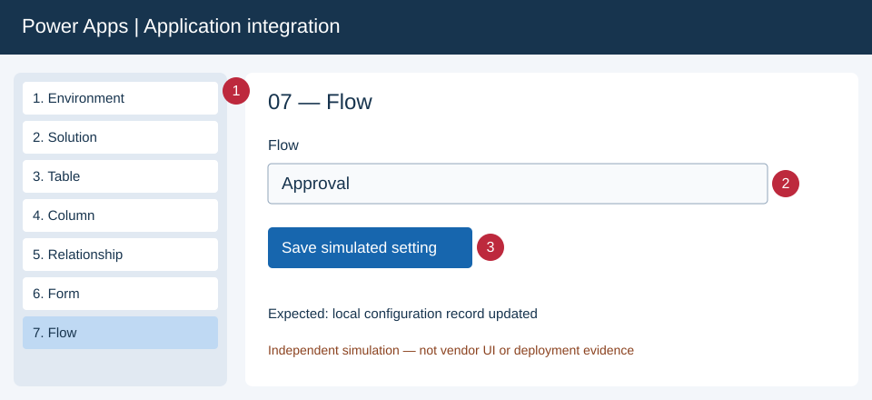

# Power Apps — Application integration

Original interactive configuration simulation. Download index.html and open locally in a browser. GitHub file preview does not execute HTML. This is not a replica of the vendor interface; settings are illustrative and must be verified in a real sandbox.

[Interactive HTML source](index.html)

## 01 — Environment

Select **Environment** in the simulation navigation, enter `Developer sandbox`, then select **Save simulated setting**. Confirm the configuration record contains the value before selecting Next step. This verifies local state only.

## 02 — Solution

Select **Solution** in the simulation navigation, enter `Integration Hub`, then select **Save simulated setting**. Confirm the configuration record contains the value before selecting Next step. This verifies local state only.

## 03 — Table

Select **Table** in the simulation navigation, enter `Application Request`, then select **Save simulated setting**. Confirm the configuration record contains the value before selecting Next step. This verifies local state only.

## 04 — Column

Select **Column** in the simulation navigation, enter `Status`, then select **Save simulated setting**. Confirm the configuration record contains the value before selecting Next step. This verifies local state only.

## 05 — Relationship

Select **Relationship** in the simulation navigation, enter `Owner`, then select **Save simulated setting**. Confirm the configuration record contains the value before selecting Next step. This verifies local state only.

## 06 — Form

Select **Form** in the simulation navigation, enter `Request details`, then select **Save simulated setting**. Confirm the configuration record contains the value before selecting Next step. This verifies local state only.

## 07 — Flow

Select **Flow** in the simulation navigation, enter `Approval`, then select **Save simulated setting**. Confirm the configuration record contains the value before selecting Next step. This verifies local state only.

