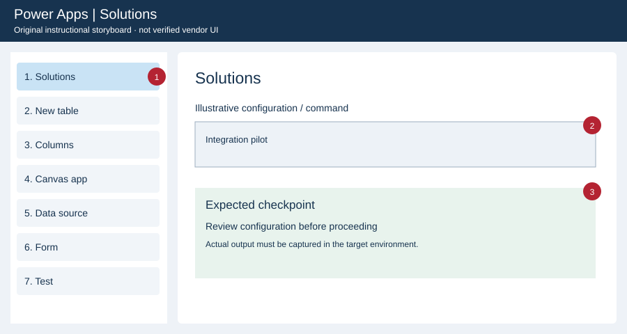
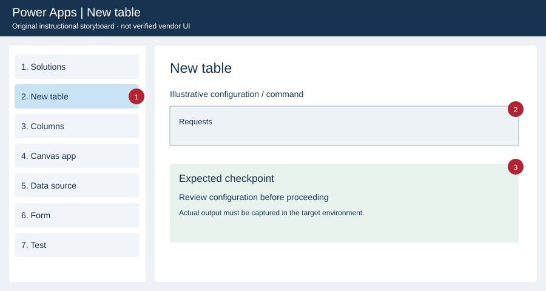
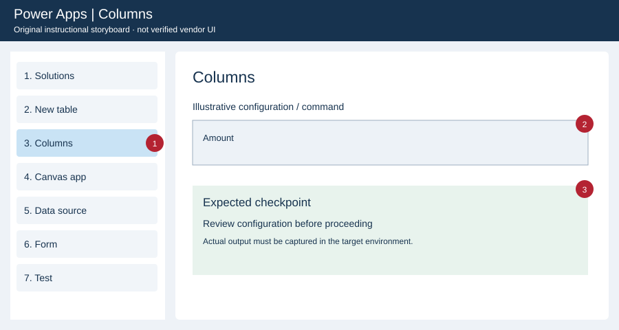
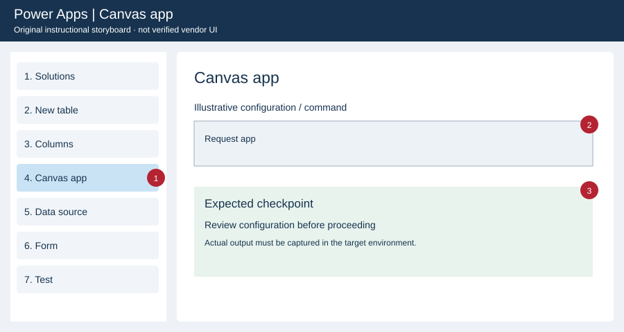
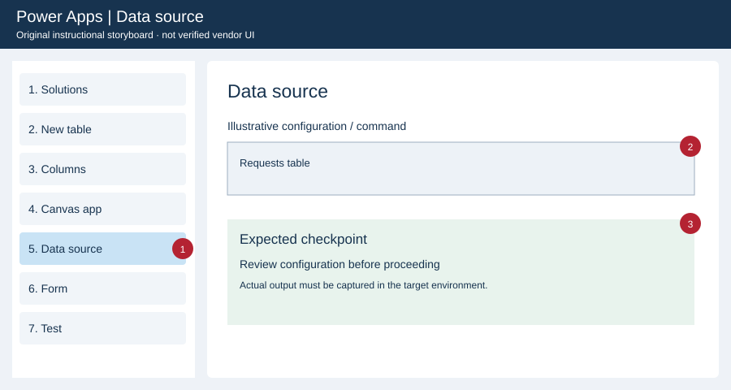
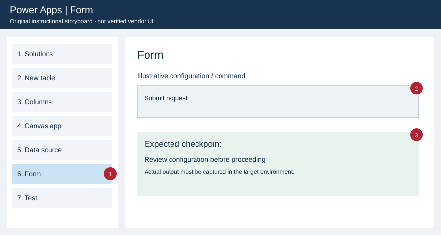
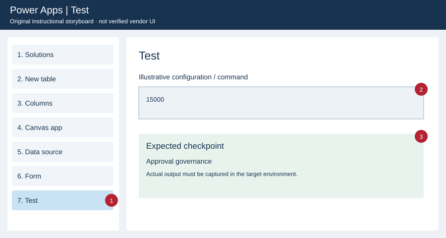

# Power Apps — numbered implementation walkthrough

Independent instructional storyboard. The navigation labels below are illustrative task stages, not verified vendor menu paths. No vendor deployment is claimed. Use synthetic data only. Prerequisites: browser for local illustrations; actual platform account, permissions and licensing must be established separately.

## Step 1: Solutions
1. In the illustrated Power Apps workflow, locate callout 1 (Solutions).
2. Inspect callout 2 and the sample value `Integration pilot`.
3. Review the expected checkpoint at callout 3: configuration reviewed before continuing.
4. In the real environment, verify the equivalent control and capture actual output before proceeding.

## Step 2: New table
1. In the illustrated Power Apps workflow, locate callout 1 (New table).
2. Inspect callout 2 and the sample value `Requests`.
3. Review the expected checkpoint at callout 3: configuration reviewed before continuing.
4. In the real environment, verify the equivalent control and capture actual output before proceeding.

## Step 3: Columns
1. In the illustrated Power Apps workflow, locate callout 1 (Columns).
2. Inspect callout 2 and the sample value `Amount`.
3. Review the expected checkpoint at callout 3: configuration reviewed before continuing.
4. In the real environment, verify the equivalent control and capture actual output before proceeding.

## Step 4: Canvas app
1. In the illustrated Power Apps workflow, locate callout 1 (Canvas app).
2. Inspect callout 2 and the sample value `Request app`.
3. Review the expected checkpoint at callout 3: configuration reviewed before continuing.
4. In the real environment, verify the equivalent control and capture actual output before proceeding.

## Step 5: Data source
1. In the illustrated Power Apps workflow, locate callout 1 (Data source).
2. Inspect callout 2 and the sample value `Requests table`.
3. Review the expected checkpoint at callout 3: configuration reviewed before continuing.
4. In the real environment, verify the equivalent control and capture actual output before proceeding.

## Step 6: Form
1. In the illustrated Power Apps workflow, locate callout 1 (Form).
2. Inspect callout 2 and the sample value `Submit request`.
3. Review the expected checkpoint at callout 3: configuration reviewed before continuing.
4. In the real environment, verify the equivalent control and capture actual output before proceeding.

## Step 7: Test
1. In the illustrated Power Apps workflow, locate callout 1 (Test).
2. Inspect callout 2 and the sample value `15000`.
3. Review the expected checkpoint at callout 3: Approval governance.
4. In the real environment, verify the equivalent control and capture actual output before proceeding.

## Troubleshooting and executive acceptance
If a control is unavailable, verify role permissions, licensing and product version. If validation fails, stop, preserve the error and correct the input. Executive gate: Approval governance. Record actual test output, reviewer and decision; do not claim completion without evidence.
