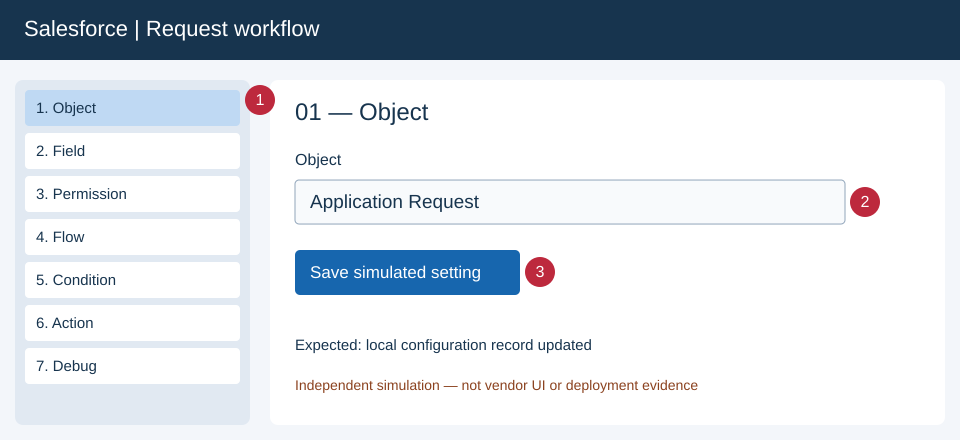
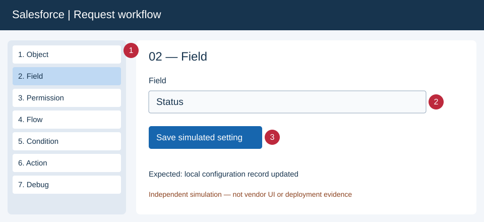
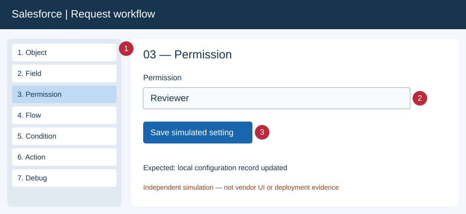
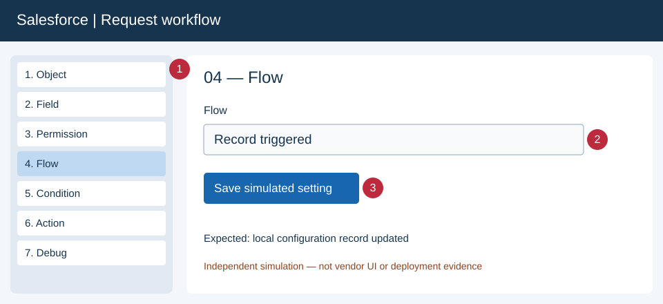
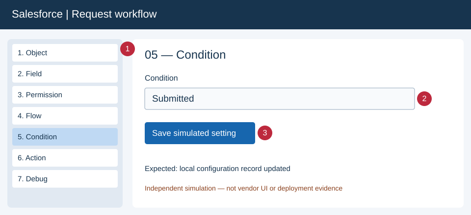
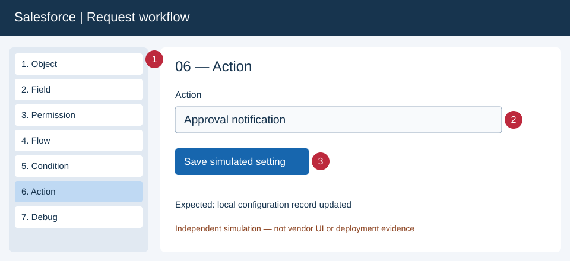
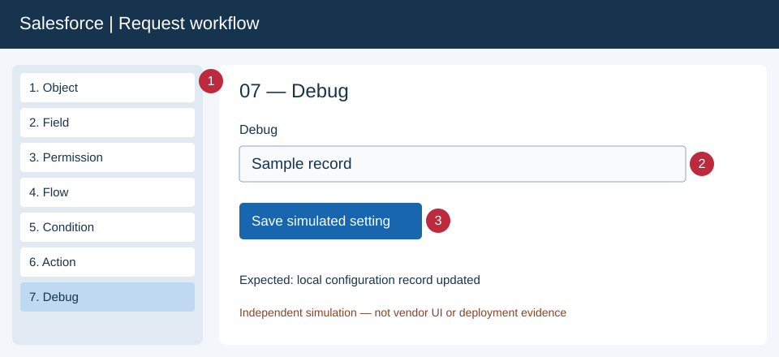

# Salesforce — Request workflow

Original interactive configuration simulation. Download index.html and open locally in a browser. GitHub file preview does not execute HTML. This is not a replica of the vendor interface; settings are illustrative and must be verified in a real sandbox.

[Interactive HTML source](index.html)

## 01 — Object

Select **Object** in the simulation navigation, enter `Application Request`, then select **Save simulated setting**. Confirm the configuration record contains the value before selecting Next step. This verifies local state only.

## 02 — Field

Select **Field** in the simulation navigation, enter `Status`, then select **Save simulated setting**. Confirm the configuration record contains the value before selecting Next step. This verifies local state only.

## 03 — Permission

Select **Permission** in the simulation navigation, enter `Reviewer`, then select **Save simulated setting**. Confirm the configuration record contains the value before selecting Next step. This verifies local state only.

## 04 — Flow

Select **Flow** in the simulation navigation, enter `Record triggered`, then select **Save simulated setting**. Confirm the configuration record contains the value before selecting Next step. This verifies local state only.

## 05 — Condition

Select **Condition** in the simulation navigation, enter `Submitted`, then select **Save simulated setting**. Confirm the configuration record contains the value before selecting Next step. This verifies local state only.

## 06 — Action

Select **Action** in the simulation navigation, enter `Approval notification`, then select **Save simulated setting**. Confirm the configuration record contains the value before selecting Next step. This verifies local state only.

## 07 — Debug

Select **Debug** in the simulation navigation, enter `Sample record`, then select **Save simulated setting**. Confirm the configuration record contains the value before selecting Next step. This verifies local state only.

