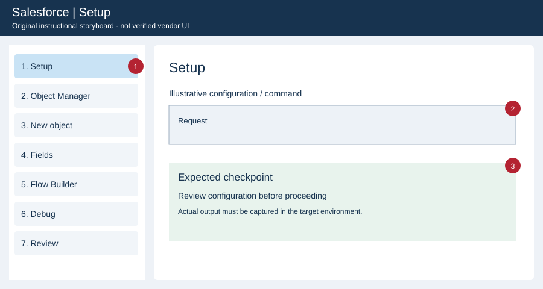
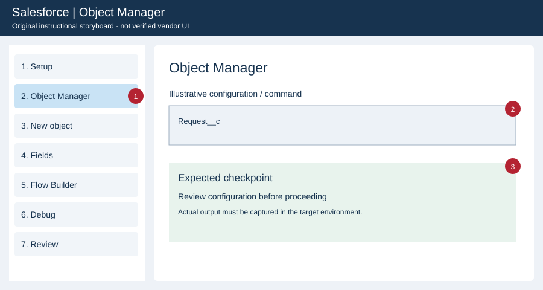
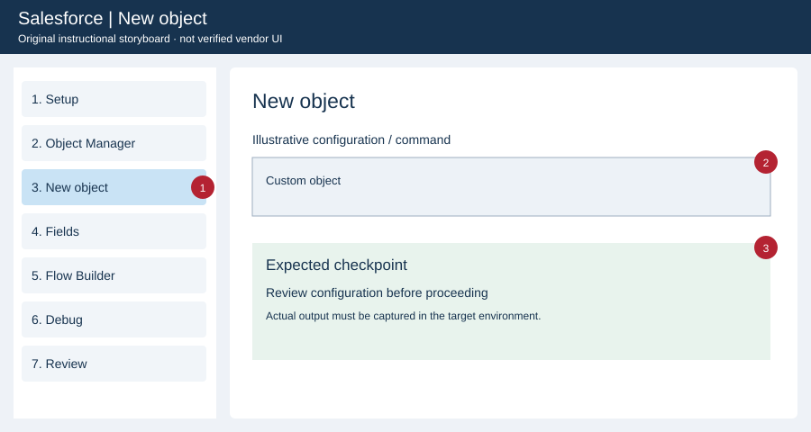
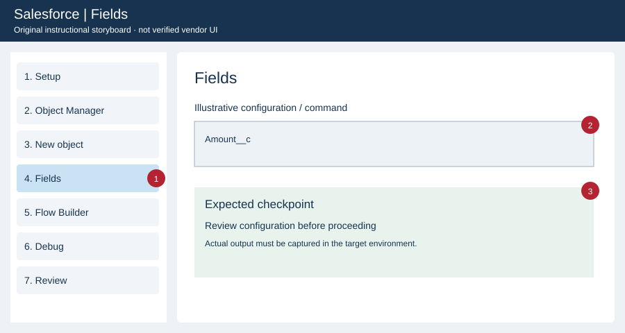
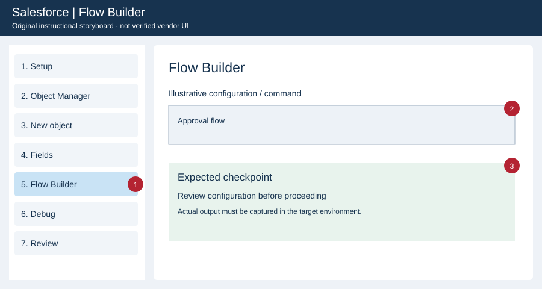
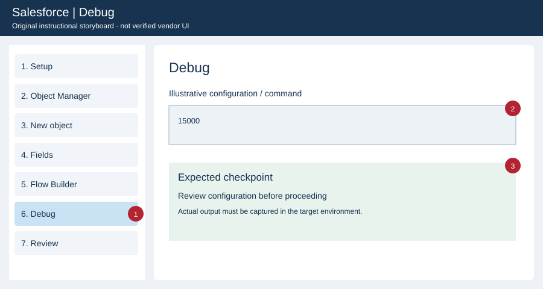
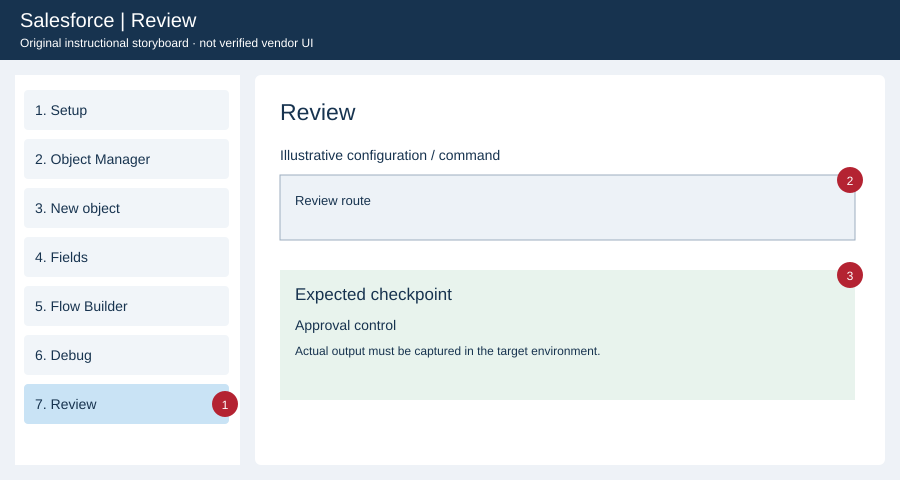

# Salesforce — numbered implementation walkthrough

Independent instructional storyboard. The navigation labels below are illustrative task stages, not verified vendor menu paths. No vendor deployment is claimed. Use synthetic data only. Prerequisites: browser for local illustrations; actual platform account, permissions and licensing must be established separately.

## Step 1: Setup
1. In the illustrated Salesforce workflow, locate callout 1 (Setup).
2. Inspect callout 2 and the sample value `Request`.
3. Review the expected checkpoint at callout 3: configuration reviewed before continuing.
4. In the real environment, verify the equivalent control and capture actual output before proceeding.

## Step 2: Object Manager
1. In the illustrated Salesforce workflow, locate callout 1 (Object Manager).
2. Inspect callout 2 and the sample value `Request__c`.
3. Review the expected checkpoint at callout 3: configuration reviewed before continuing.
4. In the real environment, verify the equivalent control and capture actual output before proceeding.

## Step 3: New object
1. In the illustrated Salesforce workflow, locate callout 1 (New object).
2. Inspect callout 2 and the sample value `Custom object`.
3. Review the expected checkpoint at callout 3: configuration reviewed before continuing.
4. In the real environment, verify the equivalent control and capture actual output before proceeding.

## Step 4: Fields
1. In the illustrated Salesforce workflow, locate callout 1 (Fields).
2. Inspect callout 2 and the sample value `Amount__c`.
3. Review the expected checkpoint at callout 3: configuration reviewed before continuing.
4. In the real environment, verify the equivalent control and capture actual output before proceeding.

## Step 5: Flow Builder
1. In the illustrated Salesforce workflow, locate callout 1 (Flow Builder).
2. Inspect callout 2 and the sample value `Approval flow`.
3. Review the expected checkpoint at callout 3: configuration reviewed before continuing.
4. In the real environment, verify the equivalent control and capture actual output before proceeding.

## Step 6: Debug
1. In the illustrated Salesforce workflow, locate callout 1 (Debug).
2. Inspect callout 2 and the sample value `15000`.
3. Review the expected checkpoint at callout 3: configuration reviewed before continuing.
4. In the real environment, verify the equivalent control and capture actual output before proceeding.

## Step 7: Review
1. In the illustrated Salesforce workflow, locate callout 1 (Review).
2. Inspect callout 2 and the sample value `Review route`.
3. Review the expected checkpoint at callout 3: Approval control.
4. In the real environment, verify the equivalent control and capture actual output before proceeding.

## Troubleshooting and executive acceptance
If a control is unavailable, verify role permissions, licensing and product version. If validation fails, stop, preserve the error and correct the input. Executive gate: Approval control. Record actual test output, reviewer and decision; do not claim completion without evidence.
