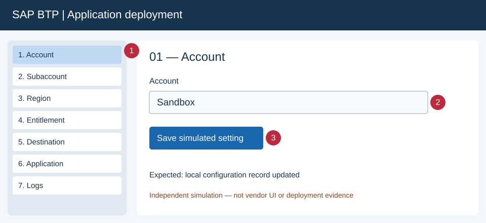
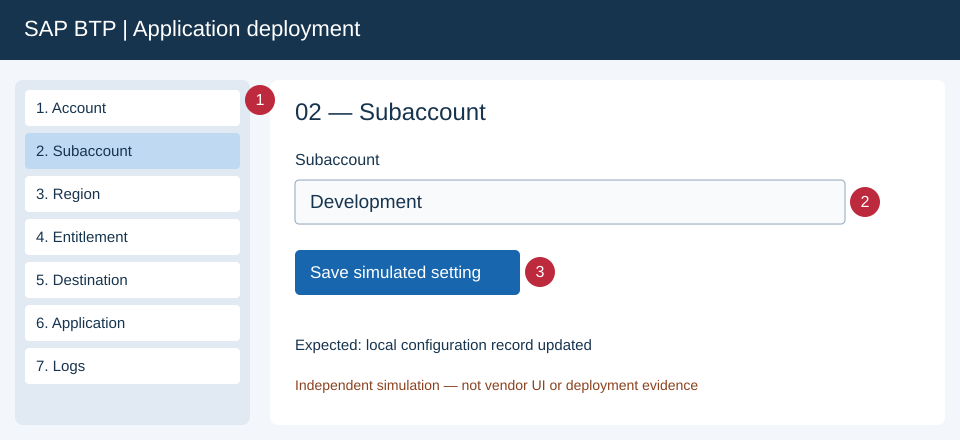
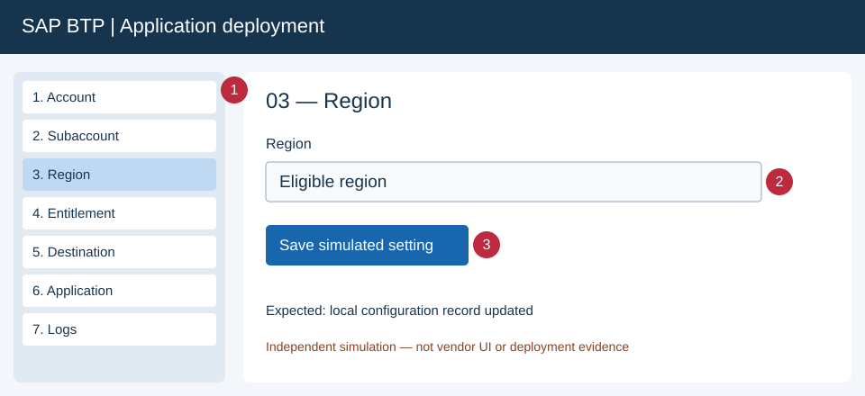
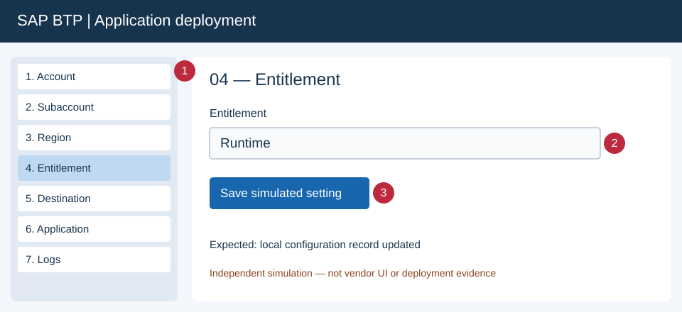
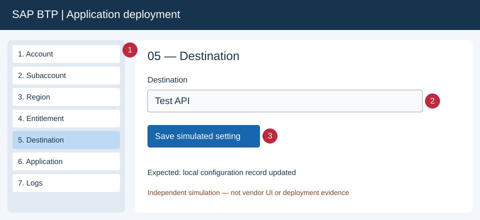
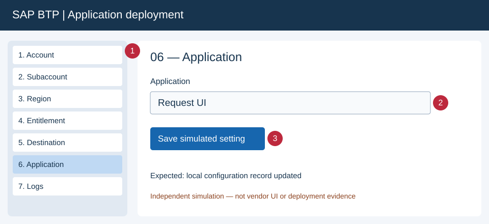
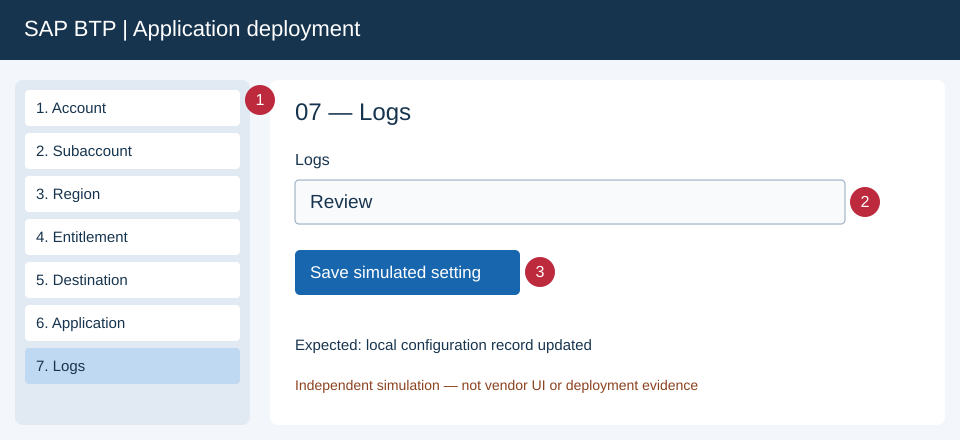

# SAP BTP — Application deployment

Original interactive configuration simulation. Download index.html and open locally in a browser. GitHub file preview does not execute HTML. This is not a replica of the vendor interface; settings are illustrative and must be verified in a real sandbox.

[Interactive HTML source](index.html)

## 01 — Account

Select **Account** in the simulation navigation, enter `Sandbox`, then select **Save simulated setting**. Confirm the configuration record contains the value before selecting Next step. This verifies local state only.

## 02 — Subaccount

Select **Subaccount** in the simulation navigation, enter `Development`, then select **Save simulated setting**. Confirm the configuration record contains the value before selecting Next step. This verifies local state only.

## 03 — Region

Select **Region** in the simulation navigation, enter `Eligible region`, then select **Save simulated setting**. Confirm the configuration record contains the value before selecting Next step. This verifies local state only.

## 04 — Entitlement

Select **Entitlement** in the simulation navigation, enter `Runtime`, then select **Save simulated setting**. Confirm the configuration record contains the value before selecting Next step. This verifies local state only.

## 05 — Destination

Select **Destination** in the simulation navigation, enter `Test API`, then select **Save simulated setting**. Confirm the configuration record contains the value before selecting Next step. This verifies local state only.

## 06 — Application

Select **Application** in the simulation navigation, enter `Request UI`, then select **Save simulated setting**. Confirm the configuration record contains the value before selecting Next step. This verifies local state only.

## 07 — Logs

Select **Logs** in the simulation navigation, enter `Review`, then select **Save simulated setting**. Confirm the configuration record contains the value before selecting Next step. This verifies local state only.

