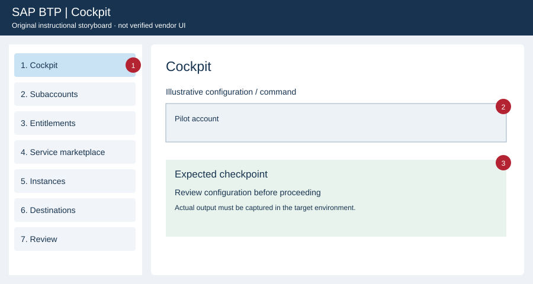
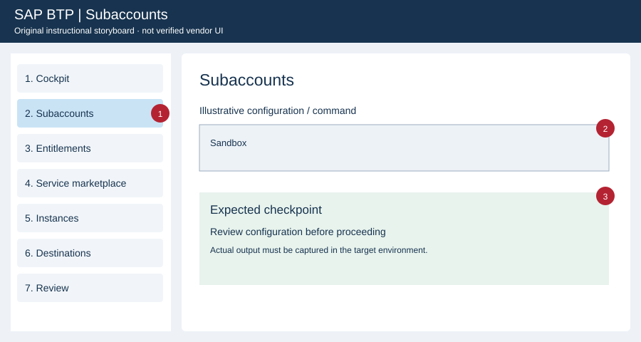
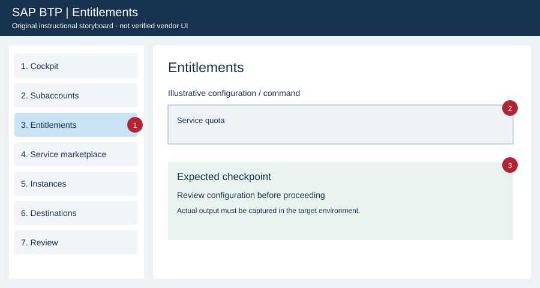
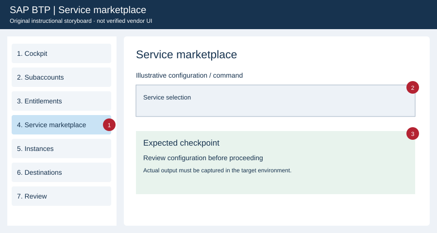
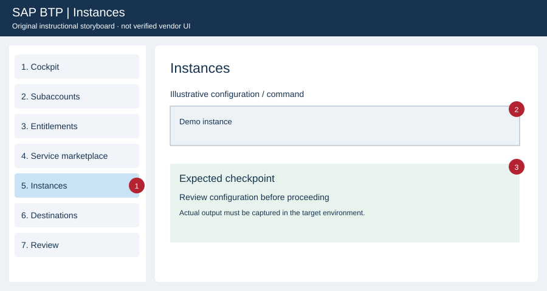
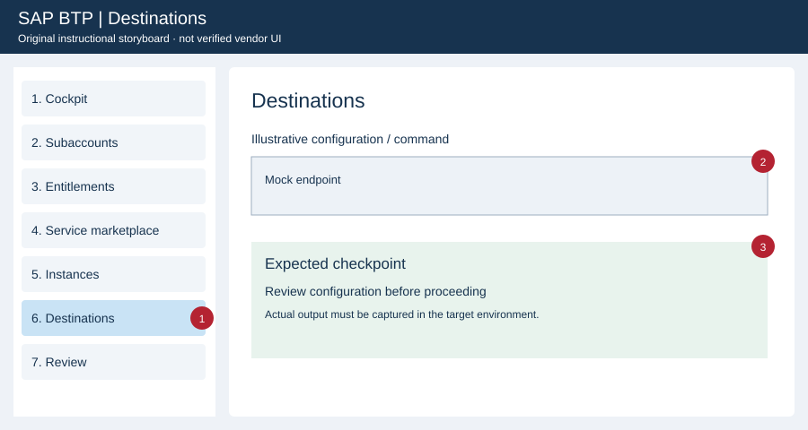
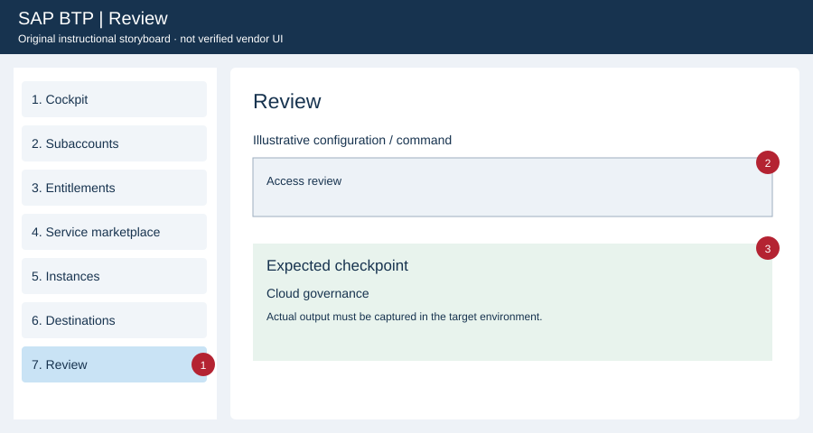

# SAP BTP — numbered implementation walkthrough

Independent instructional storyboard. The navigation labels below are illustrative task stages, not verified vendor menu paths. No vendor deployment is claimed. Use synthetic data only. Prerequisites: browser for local illustrations; actual platform account, permissions and licensing must be established separately.

## Step 1: Cockpit
1. In the illustrated SAP BTP workflow, locate callout 1 (Cockpit).
2. Inspect callout 2 and the sample value `Pilot account`.
3. Review the expected checkpoint at callout 3: configuration reviewed before continuing.
4. In the real environment, verify the equivalent control and capture actual output before proceeding.

## Step 2: Subaccounts
1. In the illustrated SAP BTP workflow, locate callout 1 (Subaccounts).
2. Inspect callout 2 and the sample value `Sandbox`.
3. Review the expected checkpoint at callout 3: configuration reviewed before continuing.
4. In the real environment, verify the equivalent control and capture actual output before proceeding.

## Step 3: Entitlements
1. In the illustrated SAP BTP workflow, locate callout 1 (Entitlements).
2. Inspect callout 2 and the sample value `Service quota`.
3. Review the expected checkpoint at callout 3: configuration reviewed before continuing.
4. In the real environment, verify the equivalent control and capture actual output before proceeding.

## Step 4: Service marketplace
1. In the illustrated SAP BTP workflow, locate callout 1 (Service marketplace).
2. Inspect callout 2 and the sample value `Service selection`.
3. Review the expected checkpoint at callout 3: configuration reviewed before continuing.
4. In the real environment, verify the equivalent control and capture actual output before proceeding.

## Step 5: Instances
1. In the illustrated SAP BTP workflow, locate callout 1 (Instances).
2. Inspect callout 2 and the sample value `Demo instance`.
3. Review the expected checkpoint at callout 3: configuration reviewed before continuing.
4. In the real environment, verify the equivalent control and capture actual output before proceeding.

## Step 6: Destinations
1. In the illustrated SAP BTP workflow, locate callout 1 (Destinations).
2. Inspect callout 2 and the sample value `Mock endpoint`.
3. Review the expected checkpoint at callout 3: configuration reviewed before continuing.
4. In the real environment, verify the equivalent control and capture actual output before proceeding.

## Step 7: Review
1. In the illustrated SAP BTP workflow, locate callout 1 (Review).
2. Inspect callout 2 and the sample value `Access review`.
3. Review the expected checkpoint at callout 3: Cloud governance.
4. In the real environment, verify the equivalent control and capture actual output before proceeding.

## Troubleshooting and executive acceptance
If a control is unavailable, verify role permissions, licensing and product version. If validation fails, stop, preserve the error and correct the input. Executive gate: Cloud governance. Record actual test output, reviewer and decision; do not claim completion without evidence.
