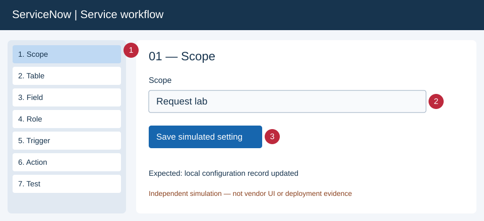
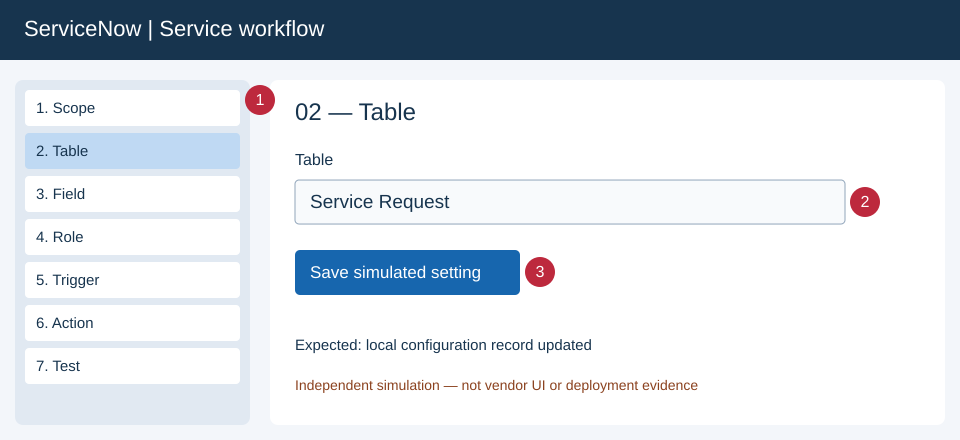
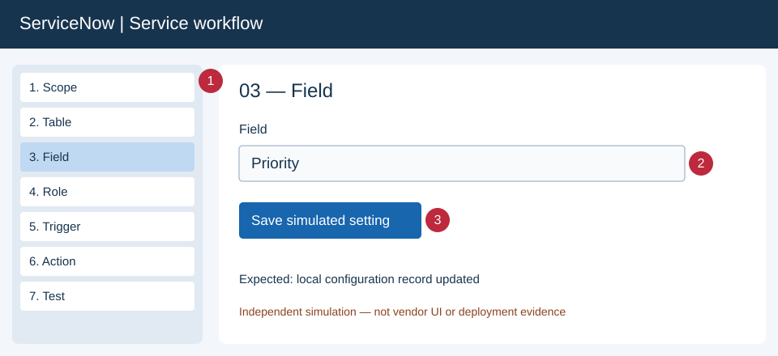
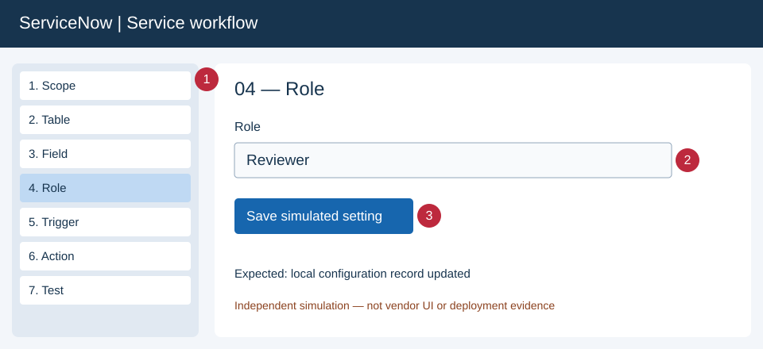
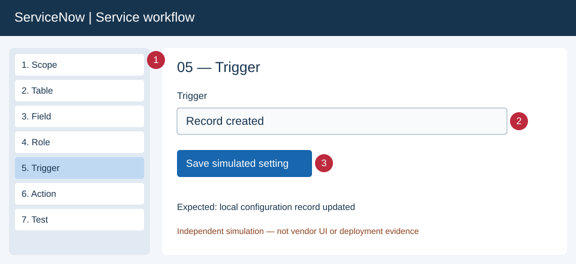
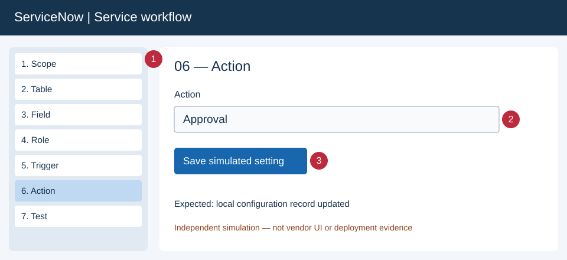
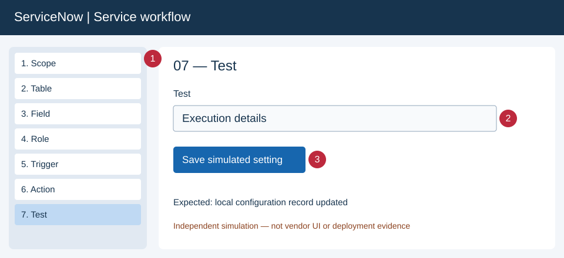

# ServiceNow — Service workflow

Original interactive configuration simulation. Download index.html and open locally in a browser. GitHub file preview does not execute HTML. This is not a replica of the vendor interface; settings are illustrative and must be verified in a real sandbox.

[Interactive HTML source](index.html)

## 01 — Scope

Select **Scope** in the simulation navigation, enter `Request lab`, then select **Save simulated setting**. Confirm the configuration record contains the value before selecting Next step. This verifies local state only.

## 02 — Table

Select **Table** in the simulation navigation, enter `Service Request`, then select **Save simulated setting**. Confirm the configuration record contains the value before selecting Next step. This verifies local state only.

## 03 — Field

Select **Field** in the simulation navigation, enter `Priority`, then select **Save simulated setting**. Confirm the configuration record contains the value before selecting Next step. This verifies local state only.

## 04 — Role

Select **Role** in the simulation navigation, enter `Reviewer`, then select **Save simulated setting**. Confirm the configuration record contains the value before selecting Next step. This verifies local state only.

## 05 — Trigger

Select **Trigger** in the simulation navigation, enter `Record created`, then select **Save simulated setting**. Confirm the configuration record contains the value before selecting Next step. This verifies local state only.

## 06 — Action

Select **Action** in the simulation navigation, enter `Approval`, then select **Save simulated setting**. Confirm the configuration record contains the value before selecting Next step. This verifies local state only.

## 07 — Test

Select **Test** in the simulation navigation, enter `Execution details`, then select **Save simulated setting**. Confirm the configuration record contains the value before selecting Next step. This verifies local state only.

