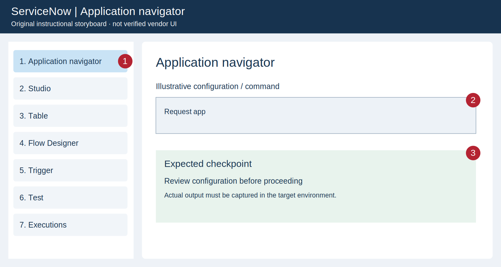
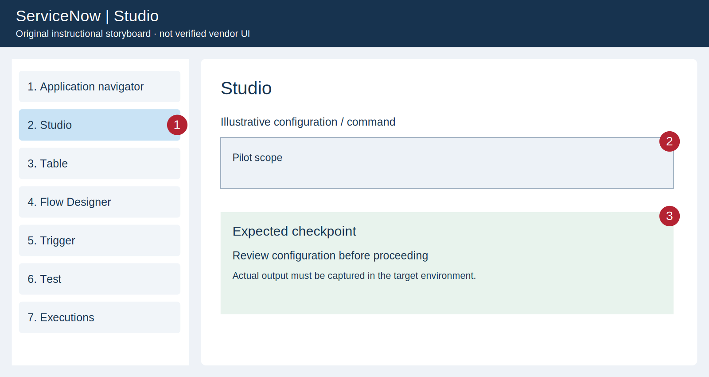
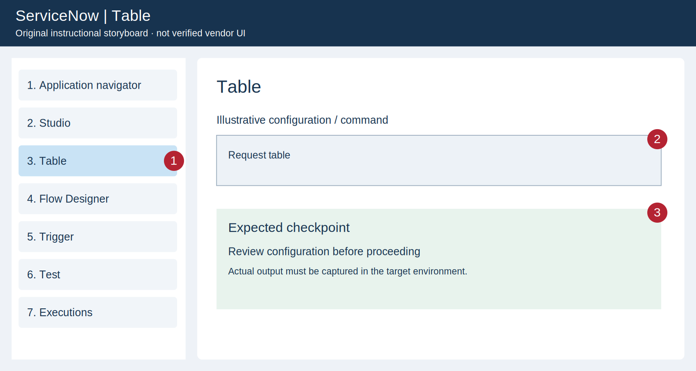
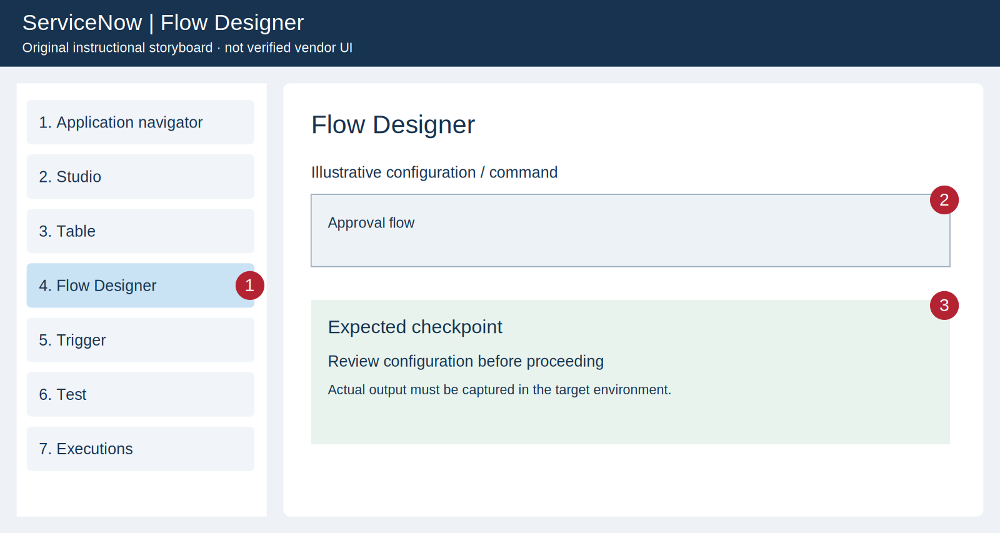
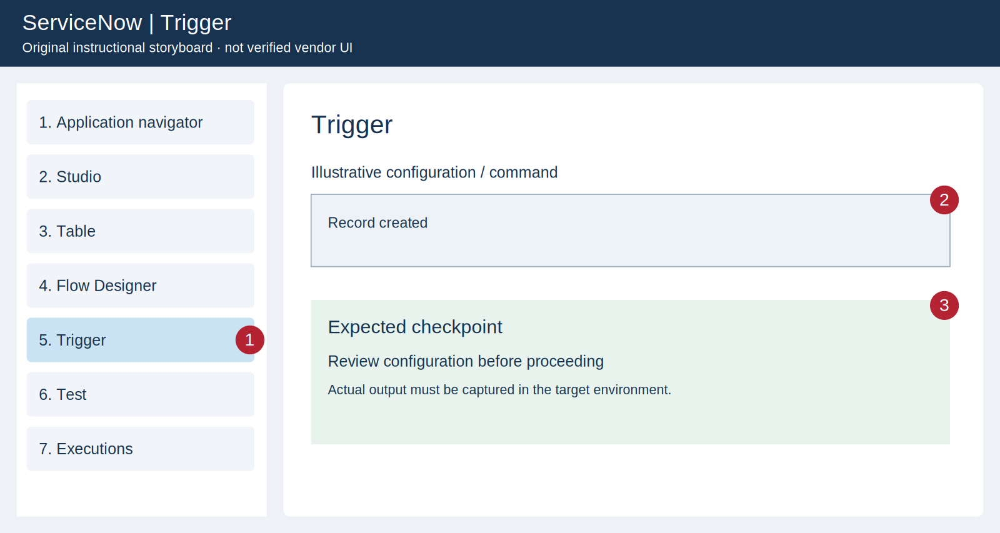
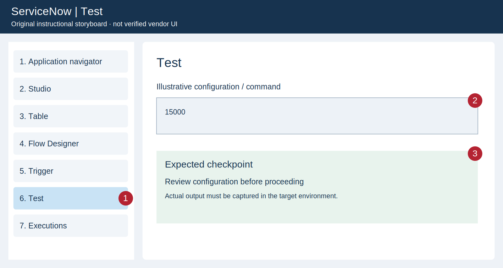
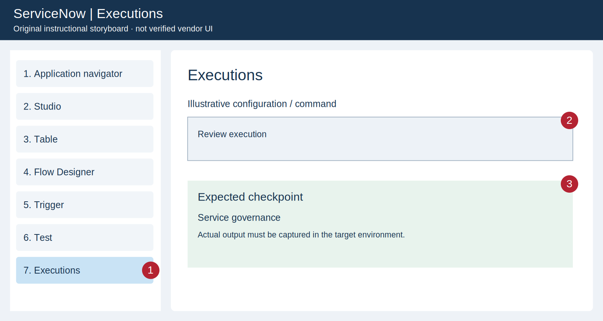

# ServiceNow — numbered implementation walkthrough

Independent instructional storyboard. The navigation labels below are illustrative task stages, not verified vendor menu paths. No vendor deployment is claimed. Use synthetic data only. Prerequisites: browser for local illustrations; actual platform account, permissions and licensing must be established separately.

## Step 1: Application navigator
1. In the illustrated ServiceNow workflow, locate callout 1 (Application navigator).
2. Inspect callout 2 and the sample value `Request app`.
3. Review the expected checkpoint at callout 3: configuration reviewed before continuing.
4. In the real environment, verify the equivalent control and capture actual output before proceeding.

## Step 2: Studio
1. In the illustrated ServiceNow workflow, locate callout 1 (Studio).
2. Inspect callout 2 and the sample value `Pilot scope`.
3. Review the expected checkpoint at callout 3: configuration reviewed before continuing.
4. In the real environment, verify the equivalent control and capture actual output before proceeding.

## Step 3: Table
1. In the illustrated ServiceNow workflow, locate callout 1 (Table).
2. Inspect callout 2 and the sample value `Request table`.
3. Review the expected checkpoint at callout 3: configuration reviewed before continuing.
4. In the real environment, verify the equivalent control and capture actual output before proceeding.

## Step 4: Flow Designer
1. In the illustrated ServiceNow workflow, locate callout 1 (Flow Designer).
2. Inspect callout 2 and the sample value `Approval flow`.
3. Review the expected checkpoint at callout 3: configuration reviewed before continuing.
4. In the real environment, verify the equivalent control and capture actual output before proceeding.

## Step 5: Trigger
1. In the illustrated ServiceNow workflow, locate callout 1 (Trigger).
2. Inspect callout 2 and the sample value `Record created`.
3. Review the expected checkpoint at callout 3: configuration reviewed before continuing.
4. In the real environment, verify the equivalent control and capture actual output before proceeding.

## Step 6: Test
1. In the illustrated ServiceNow workflow, locate callout 1 (Test).
2. Inspect callout 2 and the sample value `15000`.
3. Review the expected checkpoint at callout 3: configuration reviewed before continuing.
4. In the real environment, verify the equivalent control and capture actual output before proceeding.

## Step 7: Executions
1. In the illustrated ServiceNow workflow, locate callout 1 (Executions).
2. Inspect callout 2 and the sample value `Review execution`.
3. Review the expected checkpoint at callout 3: Service governance.
4. In the real environment, verify the equivalent control and capture actual output before proceeding.

## Troubleshooting and executive acceptance
If a control is unavailable, verify role permissions, licensing and product version. If validation fails, stop, preserve the error and correct the input. Executive gate: Service governance. Record actual test output, reviewer and decision; do not claim completion without evidence.
