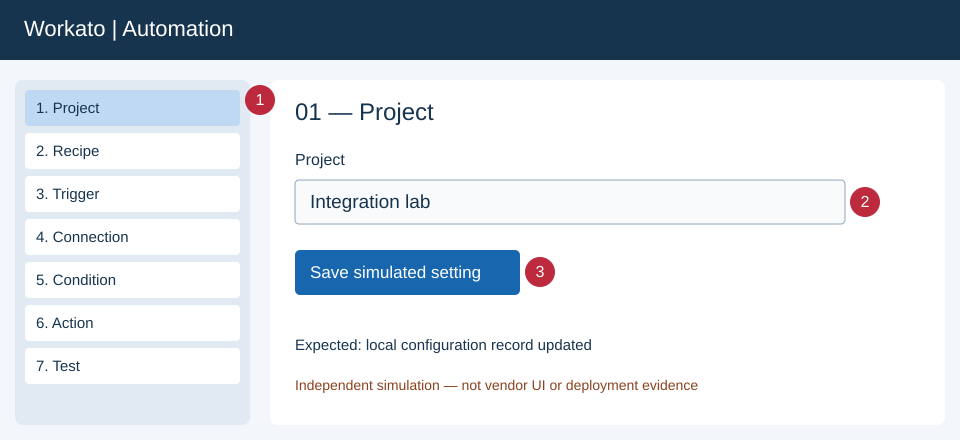
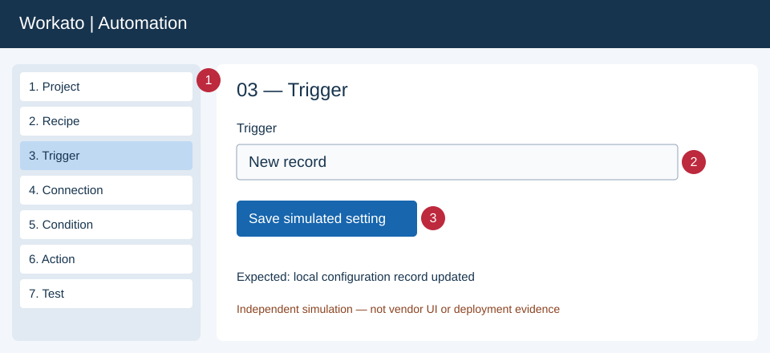
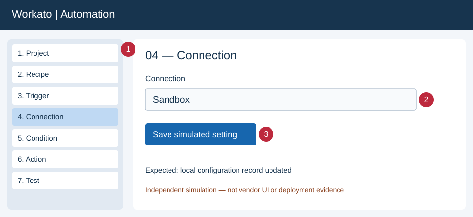
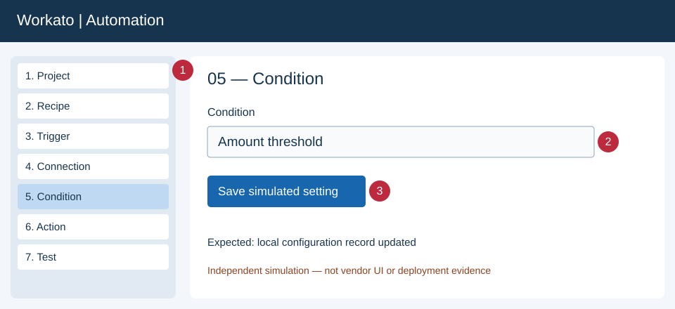
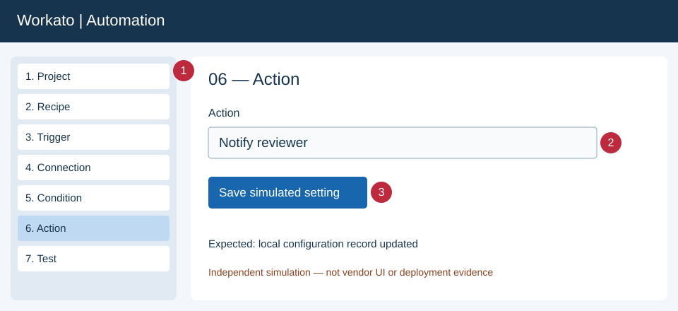
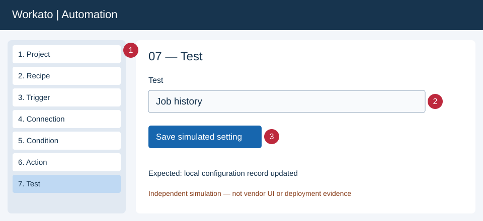

# Workato — Automation

Original interactive configuration simulation. Download index.html and open locally in a browser. GitHub file preview does not execute HTML. This is not a replica of the vendor interface; settings are illustrative and must be verified in a real sandbox.

[Interactive HTML source](index.html)

## 01 — Project

Select **Project** in the simulation navigation, enter `Integration lab`, then select **Save simulated setting**. Confirm the configuration record contains the value before selecting Next step. This verifies local state only.

## 02 — Recipe

Select **Recipe** in the simulation navigation, enter `Request approval`, then select **Save simulated setting**. Confirm the configuration record contains the value before selecting Next step. This verifies local state only.

## 03 — Trigger

Select **Trigger** in the simulation navigation, enter `New record`, then select **Save simulated setting**. Confirm the configuration record contains the value before selecting Next step. This verifies local state only.

## 04 — Connection

Select **Connection** in the simulation navigation, enter `Sandbox`, then select **Save simulated setting**. Confirm the configuration record contains the value before selecting Next step. This verifies local state only.

## 05 — Condition

Select **Condition** in the simulation navigation, enter `Amount threshold`, then select **Save simulated setting**. Confirm the configuration record contains the value before selecting Next step. This verifies local state only.

## 06 — Action

Select **Action** in the simulation navigation, enter `Notify reviewer`, then select **Save simulated setting**. Confirm the configuration record contains the value before selecting Next step. This verifies local state only.

## 07 — Test

Select **Test** in the simulation navigation, enter `Job history`, then select **Save simulated setting**. Confirm the configuration record contains the value before selecting Next step. This verifies local state only.

