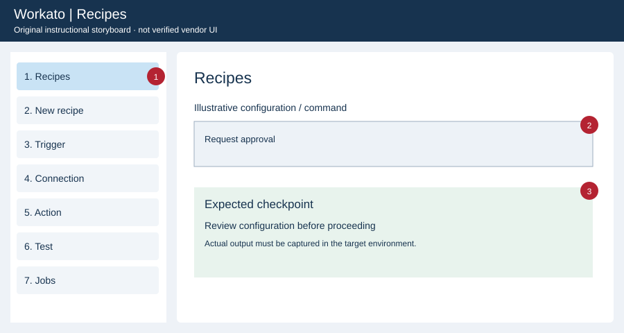
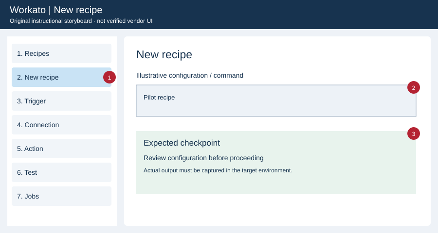
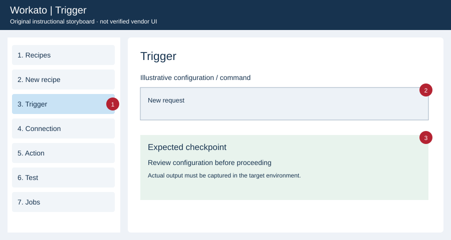
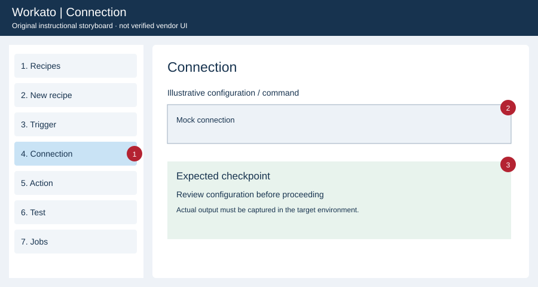
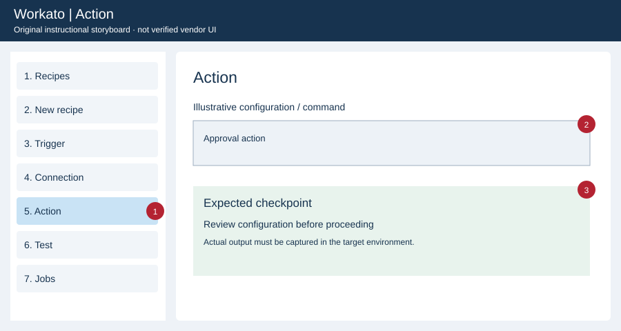
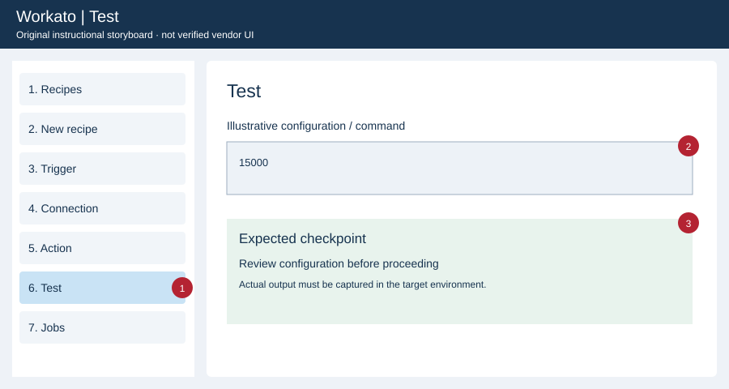
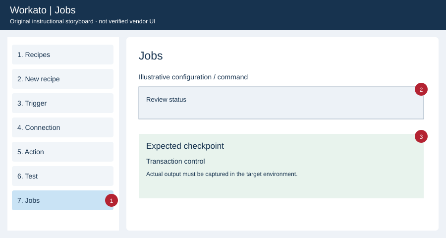

# Workato — numbered implementation walkthrough

Independent instructional storyboard. The navigation labels below are illustrative task stages, not verified vendor menu paths. No vendor deployment is claimed. Use synthetic data only. Prerequisites: browser for local illustrations; actual platform account, permissions and licensing must be established separately.

## Step 1: Recipes
1. In the illustrated Workato workflow, locate callout 1 (Recipes).
2. Inspect callout 2 and the sample value `Request approval`.
3. Review the expected checkpoint at callout 3: configuration reviewed before continuing.
4. In the real environment, verify the equivalent control and capture actual output before proceeding.

## Step 2: New recipe
1. In the illustrated Workato workflow, locate callout 1 (New recipe).
2. Inspect callout 2 and the sample value `Pilot recipe`.
3. Review the expected checkpoint at callout 3: configuration reviewed before continuing.
4. In the real environment, verify the equivalent control and capture actual output before proceeding.

## Step 3: Trigger
1. In the illustrated Workato workflow, locate callout 1 (Trigger).
2. Inspect callout 2 and the sample value `New request`.
3. Review the expected checkpoint at callout 3: configuration reviewed before continuing.
4. In the real environment, verify the equivalent control and capture actual output before proceeding.

## Step 4: Connection
1. In the illustrated Workato workflow, locate callout 1 (Connection).
2. Inspect callout 2 and the sample value `Mock connection`.
3. Review the expected checkpoint at callout 3: configuration reviewed before continuing.
4. In the real environment, verify the equivalent control and capture actual output before proceeding.

## Step 5: Action
1. In the illustrated Workato workflow, locate callout 1 (Action).
2. Inspect callout 2 and the sample value `Approval action`.
3. Review the expected checkpoint at callout 3: configuration reviewed before continuing.
4. In the real environment, verify the equivalent control and capture actual output before proceeding.

## Step 6: Test
1. In the illustrated Workato workflow, locate callout 1 (Test).
2. Inspect callout 2 and the sample value `15000`.
3. Review the expected checkpoint at callout 3: configuration reviewed before continuing.
4. In the real environment, verify the equivalent control and capture actual output before proceeding.

## Step 7: Jobs
1. In the illustrated Workato workflow, locate callout 1 (Jobs).
2. Inspect callout 2 and the sample value `Review status`.
3. Review the expected checkpoint at callout 3: Transaction control.
4. In the real environment, verify the equivalent control and capture actual output before proceeding.

## Troubleshooting and executive acceptance
If a control is unavailable, verify role permissions, licensing and product version. If validation fails, stop, preserve the error and correct the input. Executive gate: Transaction control. Record actual test output, reviewer and decision; do not claim completion without evidence.
