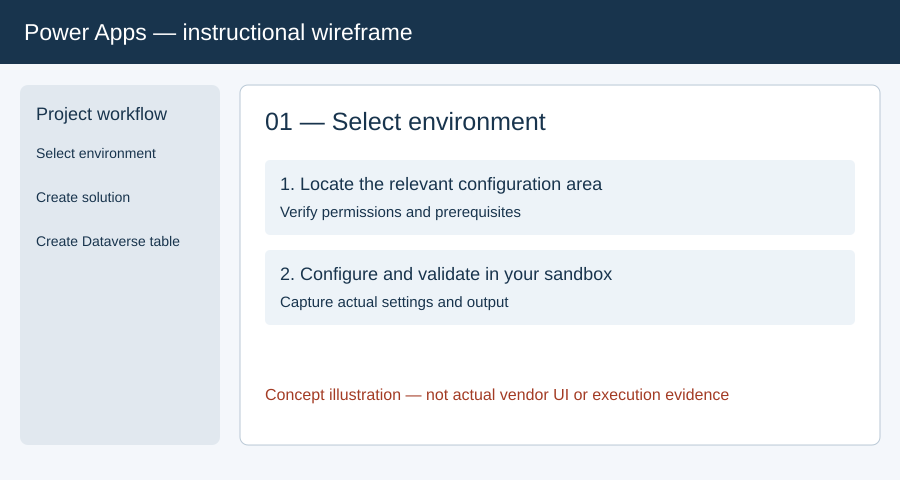
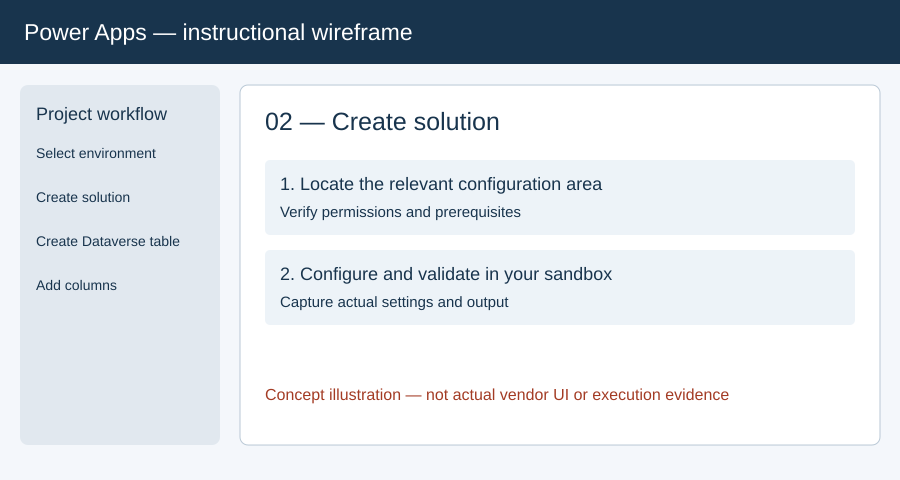
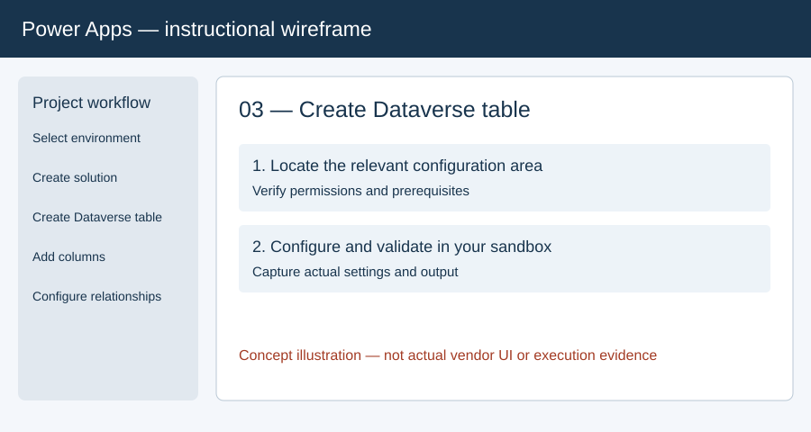
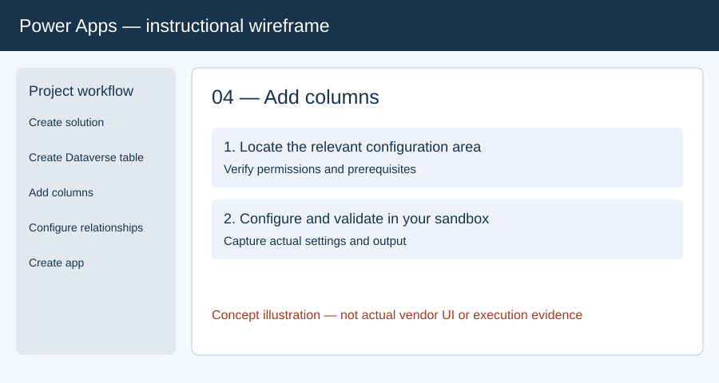
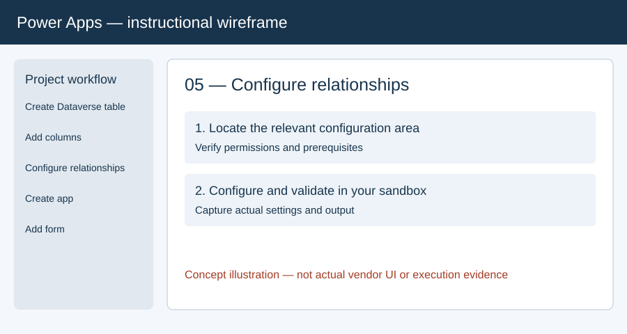
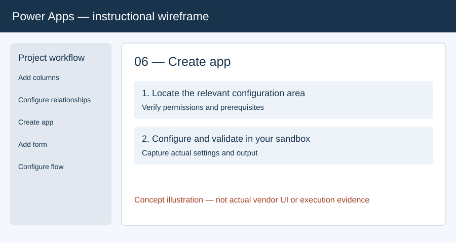
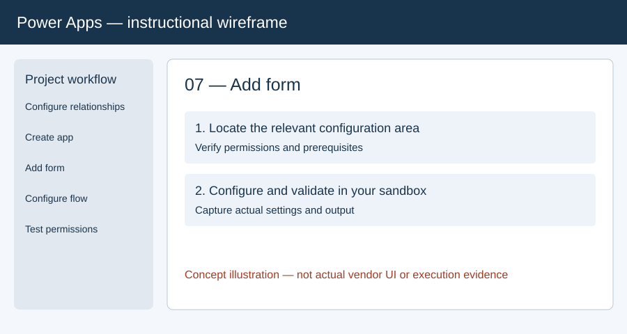
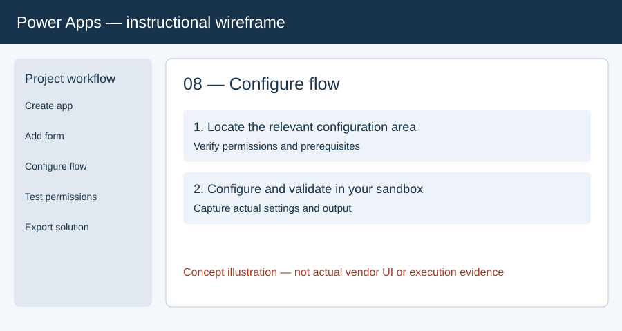
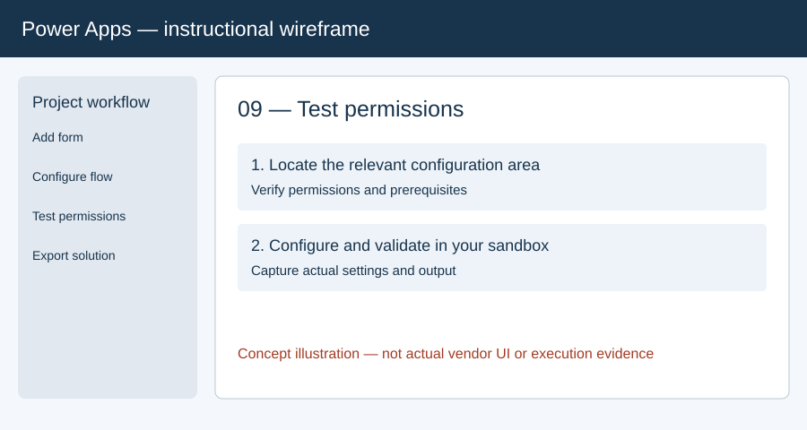
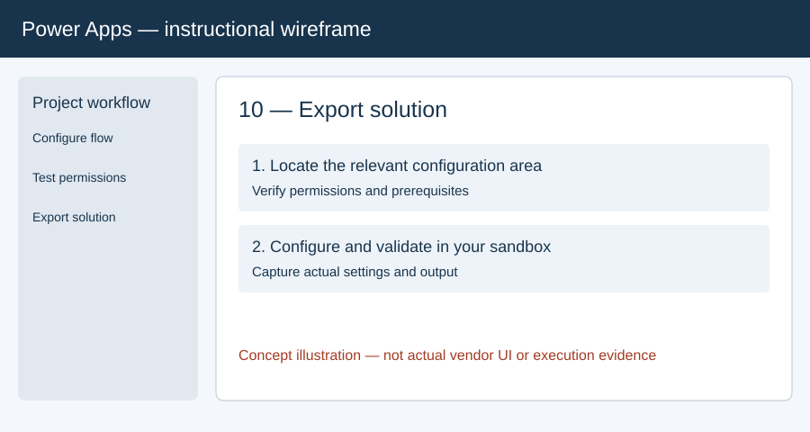

# Power Apps: visual implementation guide

**Status:** original instructional wireframes, not vendor screenshots. Navigation and licensing must be verified in a live sandbox. Use fictional data; do not publish secrets.

## 01 — Select environment

**Action:** In your Power Apps sandbox, locate the select environment capability using the relevant workspace or administration area. Review prerequisites and permissions before changing resources.

**Validation:** Capture the actual configuration and resulting output; record any errors and confirm the change against the project requirements. This step has not been executed in a vendor environment.

## 02 — Create solution

**Action:** In your Power Apps sandbox, locate the create solution capability using the relevant workspace or administration area. Review prerequisites and permissions before changing resources.

**Validation:** Capture the actual configuration and resulting output; record any errors and confirm the change against the project requirements. This step has not been executed in a vendor environment.

## 03 — Create Dataverse table

**Action:** In your Power Apps sandbox, locate the create dataverse table capability using the relevant workspace or administration area. Review prerequisites and permissions before changing resources.

**Validation:** Capture the actual configuration and resulting output; record any errors and confirm the change against the project requirements. This step has not been executed in a vendor environment.

## 04 — Add columns

**Action:** In your Power Apps sandbox, locate the add columns capability using the relevant workspace or administration area. Review prerequisites and permissions before changing resources.

**Validation:** Capture the actual configuration and resulting output; record any errors and confirm the change against the project requirements. This step has not been executed in a vendor environment.

## 05 — Configure relationships

**Action:** In your Power Apps sandbox, locate the configure relationships capability using the relevant workspace or administration area. Review prerequisites and permissions before changing resources.

**Validation:** Capture the actual configuration and resulting output; record any errors and confirm the change against the project requirements. This step has not been executed in a vendor environment.

## 06 — Create app

**Action:** In your Power Apps sandbox, locate the create app capability using the relevant workspace or administration area. Review prerequisites and permissions before changing resources.

**Validation:** Capture the actual configuration and resulting output; record any errors and confirm the change against the project requirements. This step has not been executed in a vendor environment.

## 07 — Add form

**Action:** In your Power Apps sandbox, locate the add form capability using the relevant workspace or administration area. Review prerequisites and permissions before changing resources.

**Validation:** Capture the actual configuration and resulting output; record any errors and confirm the change against the project requirements. This step has not been executed in a vendor environment.

## 08 — Configure flow

**Action:** In your Power Apps sandbox, locate the configure flow capability using the relevant workspace or administration area. Review prerequisites and permissions before changing resources.

**Validation:** Capture the actual configuration and resulting output; record any errors and confirm the change against the project requirements. This step has not been executed in a vendor environment.

## 09 — Test permissions

**Action:** In your Power Apps sandbox, locate the test permissions capability using the relevant workspace or administration area. Review prerequisites and permissions before changing resources.

**Validation:** Capture the actual configuration and resulting output; record any errors and confirm the change against the project requirements. This step has not been executed in a vendor environment.

## 10 — Export solution

**Action:** In your Power Apps sandbox, locate the export solution capability using the relevant workspace or administration area. Review prerequisites and permissions before changing resources.

**Validation:** Capture the actual configuration and resulting output; record any errors and confirm the change against the project requirements. This step has not been executed in a vendor environment.

