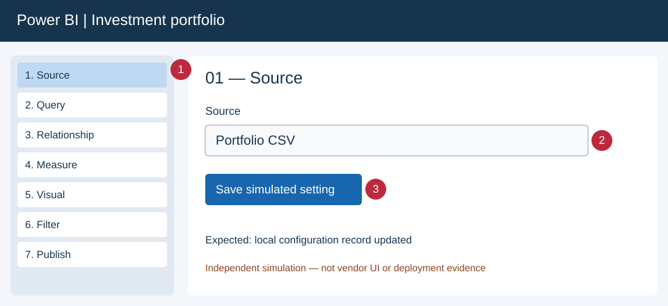
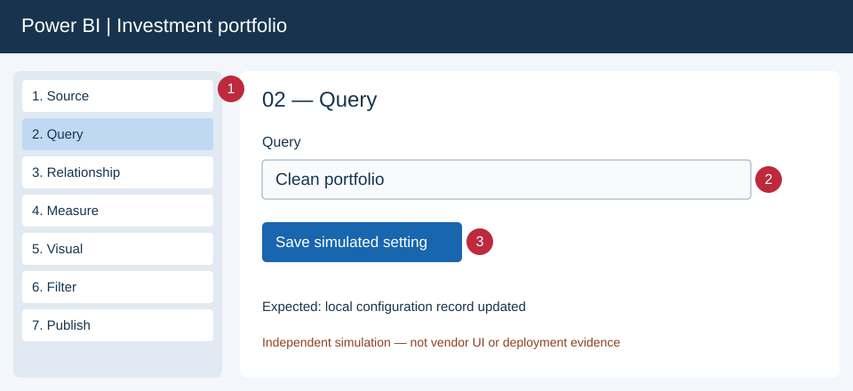
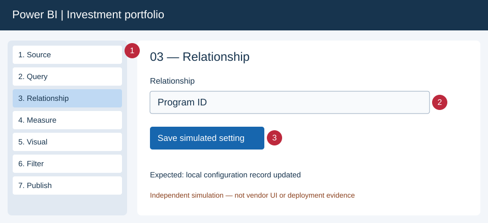
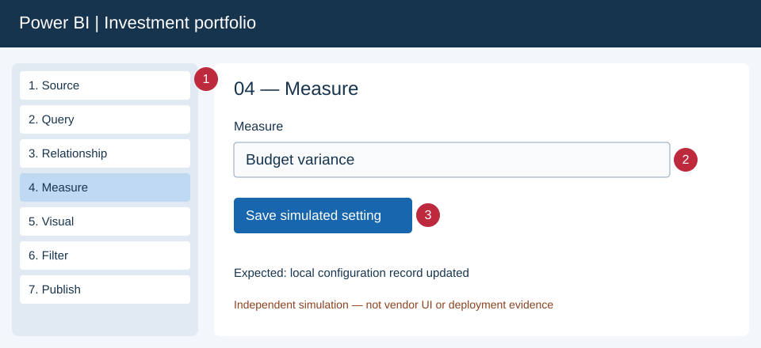
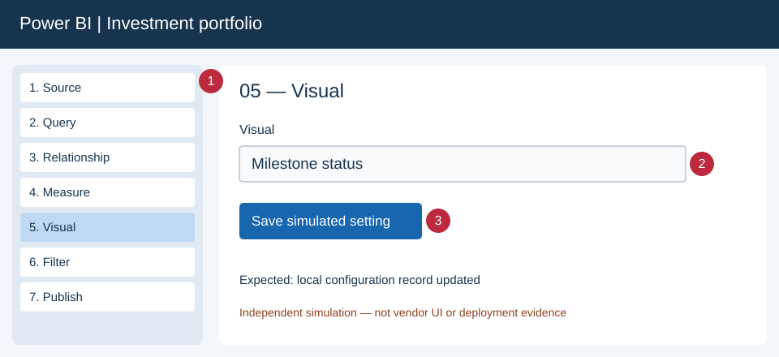
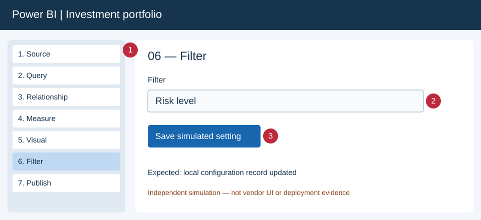
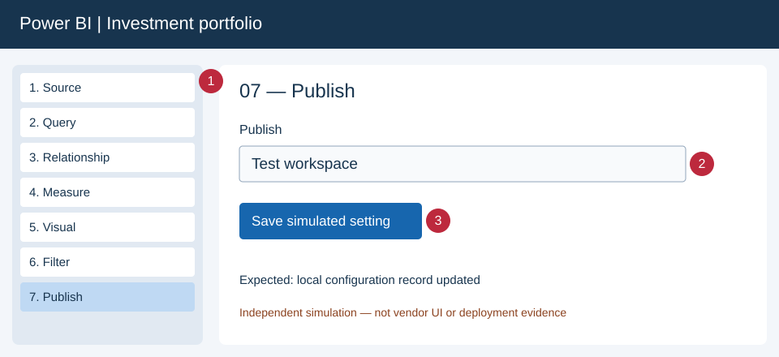

# Power BI — Investment portfolio

Original interactive configuration simulation. Download index.html and open locally in a browser. GitHub file preview does not execute HTML. This is not a replica of the vendor interface; settings are illustrative and must be verified in a real sandbox.

[Interactive HTML source](index.html)

## 01 — Source

Select **Source** in the simulation navigation, enter `Portfolio CSV`, then select **Save simulated setting**. Confirm the configuration record contains the value before selecting Next step. This verifies local state only.

## 02 — Query

Select **Query** in the simulation navigation, enter `Clean portfolio`, then select **Save simulated setting**. Confirm the configuration record contains the value before selecting Next step. This verifies local state only.

## 03 — Relationship

Select **Relationship** in the simulation navigation, enter `Program ID`, then select **Save simulated setting**. Confirm the configuration record contains the value before selecting Next step. This verifies local state only.

## 04 — Measure

Select **Measure** in the simulation navigation, enter `Budget variance`, then select **Save simulated setting**. Confirm the configuration record contains the value before selecting Next step. This verifies local state only.

## 05 — Visual

Select **Visual** in the simulation navigation, enter `Milestone status`, then select **Save simulated setting**. Confirm the configuration record contains the value before selecting Next step. This verifies local state only.

## 06 — Filter

Select **Filter** in the simulation navigation, enter `Risk level`, then select **Save simulated setting**. Confirm the configuration record contains the value before selecting Next step. This verifies local state only.

## 07 — Publish

Select **Publish** in the simulation navigation, enter `Test workspace`, then select **Save simulated setting**. Confirm the configuration record contains the value before selecting Next step. This verifies local state only.

