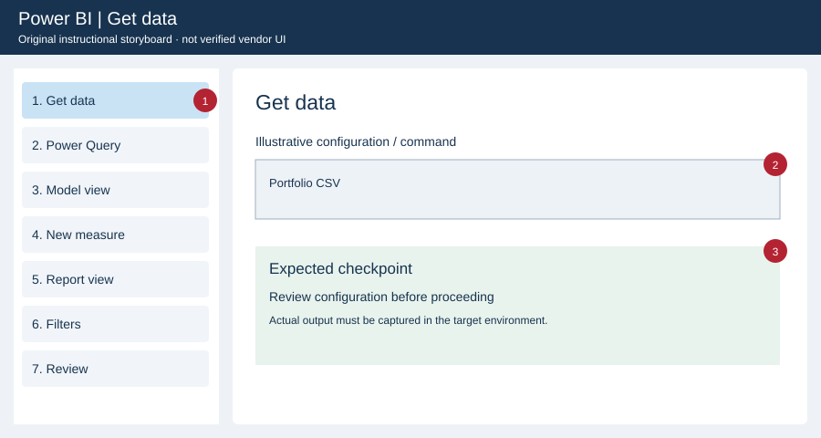
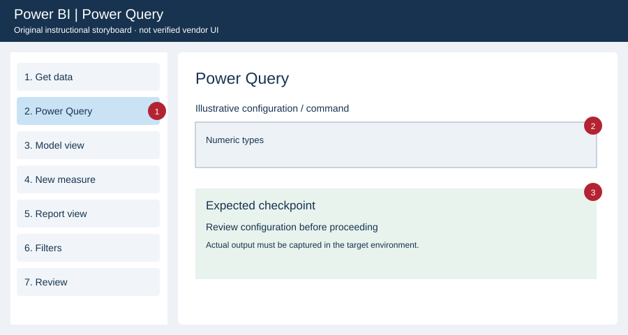
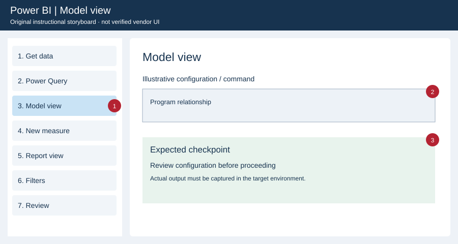
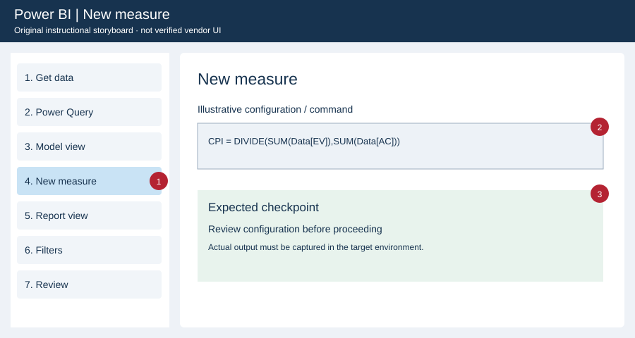
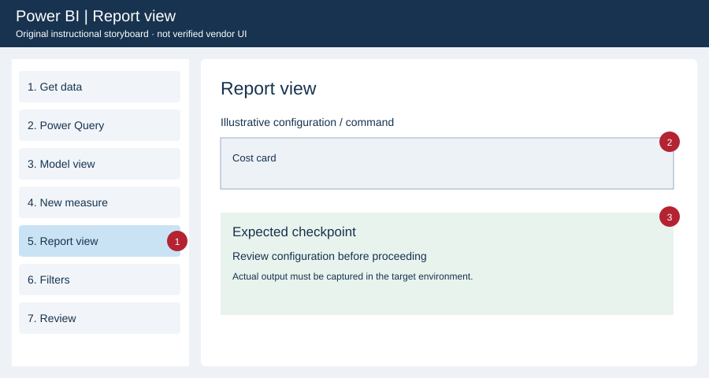
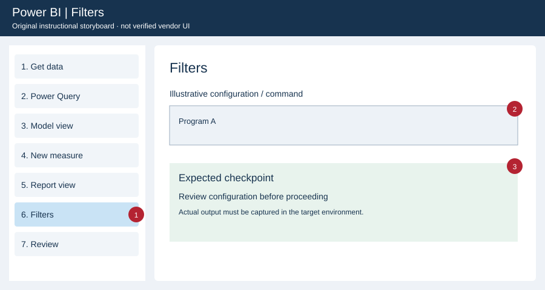
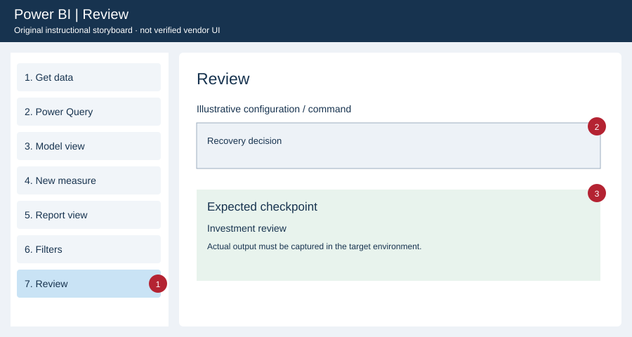

# Power BI — numbered implementation walkthrough

Independent instructional storyboard. The navigation labels below are illustrative task stages, not verified vendor menu paths. No vendor deployment is claimed. Use synthetic data only. Prerequisites: browser for local illustrations; actual platform account, permissions and licensing must be established separately.

## Step 1: Get data
1. In the illustrated Power BI workflow, locate callout 1 (Get data).
2. Inspect callout 2 and the sample value `Portfolio CSV`.
3. Review the expected checkpoint at callout 3: configuration reviewed before continuing.
4. In the real environment, verify the equivalent control and capture actual output before proceeding.

## Step 2: Power Query
1. In the illustrated Power BI workflow, locate callout 1 (Power Query).
2. Inspect callout 2 and the sample value `Numeric types`.
3. Review the expected checkpoint at callout 3: configuration reviewed before continuing.
4. In the real environment, verify the equivalent control and capture actual output before proceeding.

## Step 3: Model view
1. In the illustrated Power BI workflow, locate callout 1 (Model view).
2. Inspect callout 2 and the sample value `Program relationship`.
3. Review the expected checkpoint at callout 3: configuration reviewed before continuing.
4. In the real environment, verify the equivalent control and capture actual output before proceeding.

## Step 4: New measure
1. In the illustrated Power BI workflow, locate callout 1 (New measure).
2. Inspect callout 2 and the sample value `CPI = DIVIDE(SUM(Data[EV]),SUM(Data[AC]))`.
3. Review the expected checkpoint at callout 3: configuration reviewed before continuing.
4. In the real environment, verify the equivalent control and capture actual output before proceeding.

## Step 5: Report view
1. In the illustrated Power BI workflow, locate callout 1 (Report view).
2. Inspect callout 2 and the sample value `Cost card`.
3. Review the expected checkpoint at callout 3: configuration reviewed before continuing.
4. In the real environment, verify the equivalent control and capture actual output before proceeding.

## Step 6: Filters
1. In the illustrated Power BI workflow, locate callout 1 (Filters).
2. Inspect callout 2 and the sample value `Program A`.
3. Review the expected checkpoint at callout 3: configuration reviewed before continuing.
4. In the real environment, verify the equivalent control and capture actual output before proceeding.

## Step 7: Review
1. In the illustrated Power BI workflow, locate callout 1 (Review).
2. Inspect callout 2 and the sample value `Recovery decision`.
3. Review the expected checkpoint at callout 3: Investment review.
4. In the real environment, verify the equivalent control and capture actual output before proceeding.

## Troubleshooting and executive acceptance
If a control is unavailable, verify role permissions, licensing and product version. If validation fails, stop, preserve the error and correct the input. Executive gate: Investment review. Record actual test output, reviewer and decision; do not claim completion without evidence.
