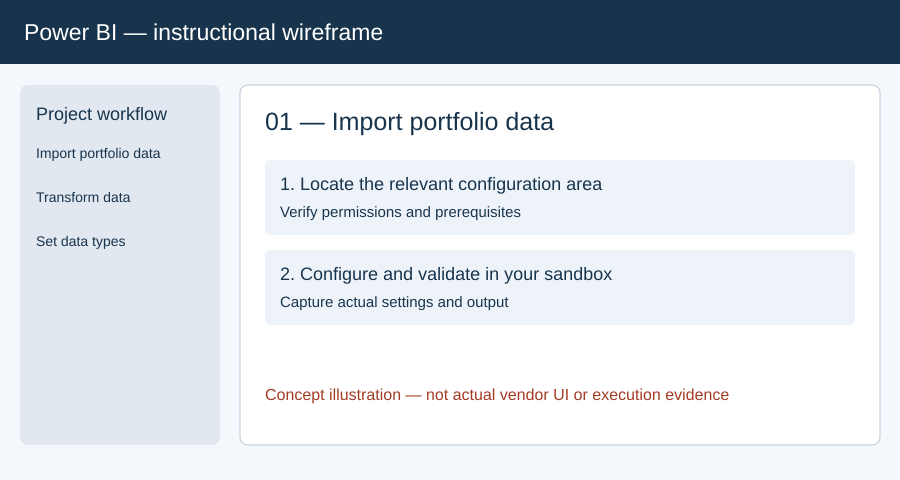
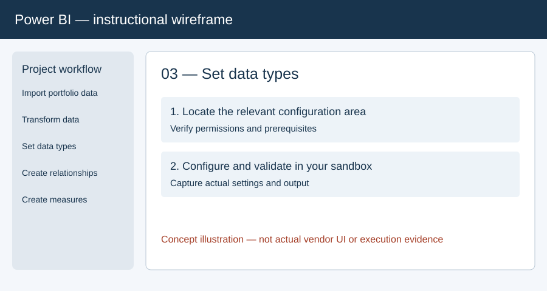
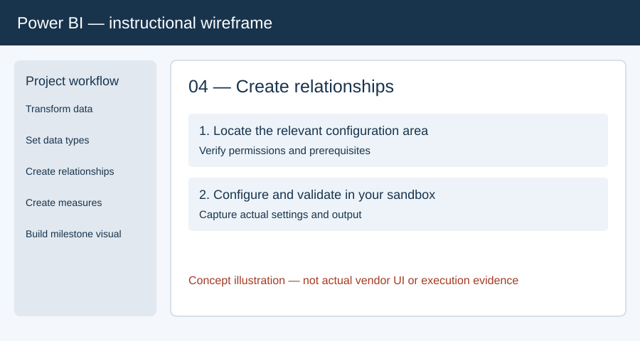
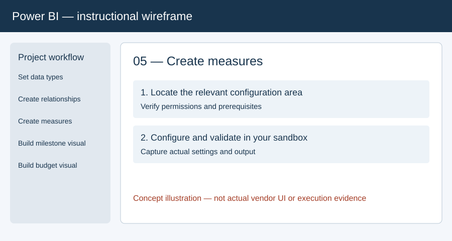
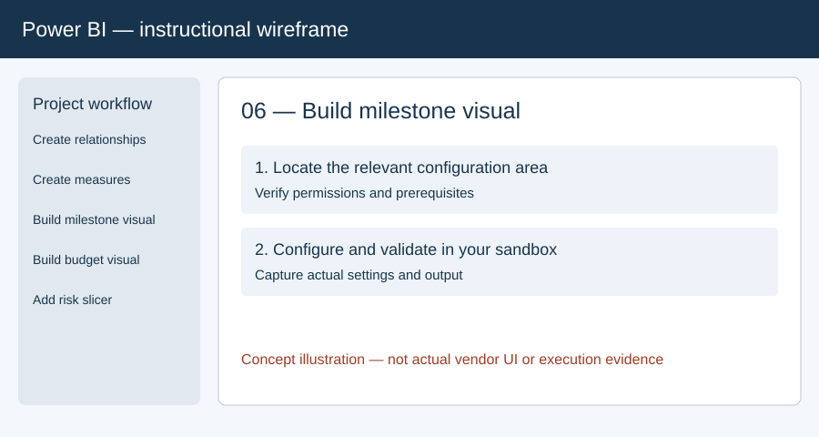
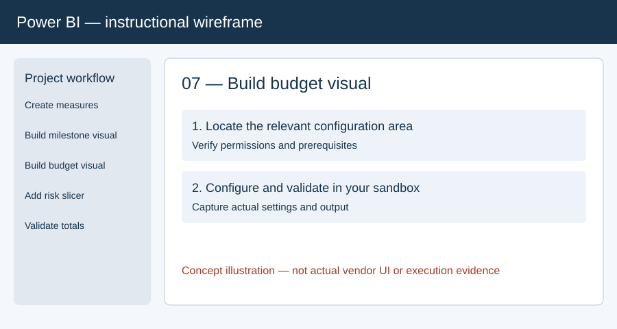
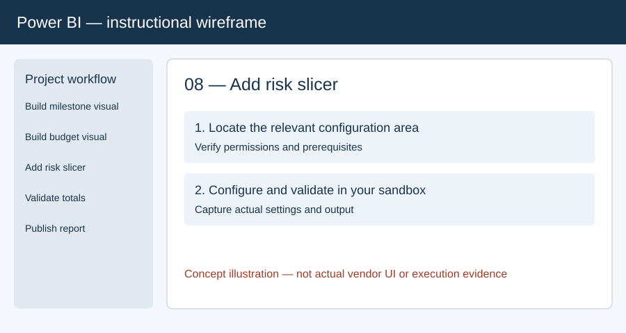
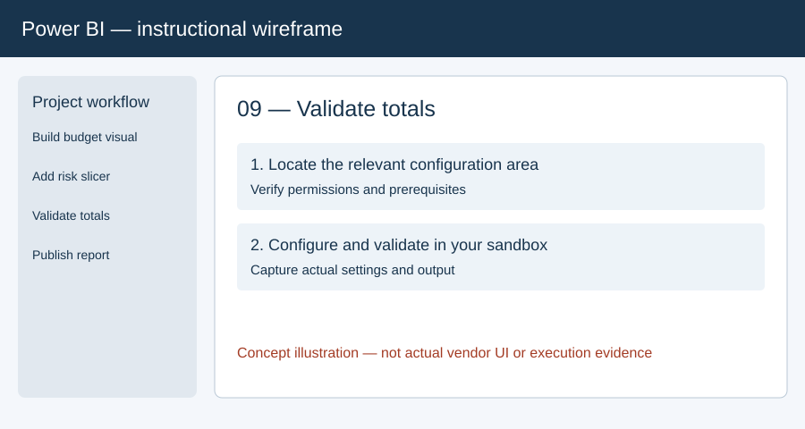
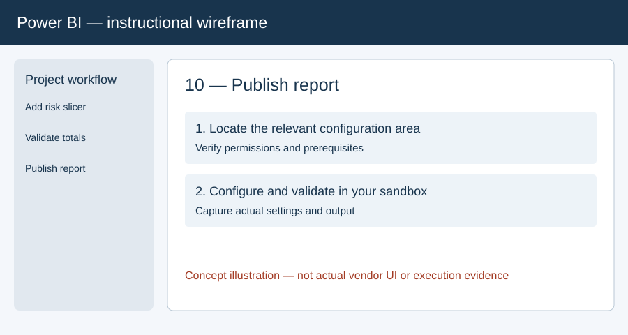

# Power BI: visual implementation guide

**Status:** original instructional wireframes, not vendor screenshots. Navigation and licensing must be verified in a live sandbox. Use fictional data; do not publish secrets.

## 01 — Import portfolio data

**Action:** In your Power BI sandbox, locate the import portfolio data capability using the relevant workspace or administration area. Review prerequisites and permissions before changing resources.

**Validation:** Capture the actual configuration and resulting output; record any errors and confirm the change against the project requirements. This step has not been executed in a vendor environment.

## 02 — Transform data

**Action:** In your Power BI sandbox, locate the transform data capability using the relevant workspace or administration area. Review prerequisites and permissions before changing resources.

**Validation:** Capture the actual configuration and resulting output; record any errors and confirm the change against the project requirements. This step has not been executed in a vendor environment.

## 03 — Set data types

**Action:** In your Power BI sandbox, locate the set data types capability using the relevant workspace or administration area. Review prerequisites and permissions before changing resources.

**Validation:** Capture the actual configuration and resulting output; record any errors and confirm the change against the project requirements. This step has not been executed in a vendor environment.

## 04 — Create relationships

**Action:** In your Power BI sandbox, locate the create relationships capability using the relevant workspace or administration area. Review prerequisites and permissions before changing resources.

**Validation:** Capture the actual configuration and resulting output; record any errors and confirm the change against the project requirements. This step has not been executed in a vendor environment.

## 05 — Create measures

**Action:** In your Power BI sandbox, locate the create measures capability using the relevant workspace or administration area. Review prerequisites and permissions before changing resources.

**Validation:** Capture the actual configuration and resulting output; record any errors and confirm the change against the project requirements. This step has not been executed in a vendor environment.

## 06 — Build milestone visual

**Action:** In your Power BI sandbox, locate the build milestone visual capability using the relevant workspace or administration area. Review prerequisites and permissions before changing resources.

**Validation:** Capture the actual configuration and resulting output; record any errors and confirm the change against the project requirements. This step has not been executed in a vendor environment.

## 07 — Build budget visual

**Action:** In your Power BI sandbox, locate the build budget visual capability using the relevant workspace or administration area. Review prerequisites and permissions before changing resources.

**Validation:** Capture the actual configuration and resulting output; record any errors and confirm the change against the project requirements. This step has not been executed in a vendor environment.

## 08 — Add risk slicer

**Action:** In your Power BI sandbox, locate the add risk slicer capability using the relevant workspace or administration area. Review prerequisites and permissions before changing resources.

**Validation:** Capture the actual configuration and resulting output; record any errors and confirm the change against the project requirements. This step has not been executed in a vendor environment.

## 09 — Validate totals

**Action:** In your Power BI sandbox, locate the validate totals capability using the relevant workspace or administration area. Review prerequisites and permissions before changing resources.

**Validation:** Capture the actual configuration and resulting output; record any errors and confirm the change against the project requirements. This step has not been executed in a vendor environment.

## 10 — Publish report

**Action:** In your Power BI sandbox, locate the publish report capability using the relevant workspace or administration area. Review prerequisites and permissions before changing resources.

**Validation:** Capture the actual configuration and resulting output; record any errors and confirm the change against the project requirements. This step has not been executed in a vendor environment.

