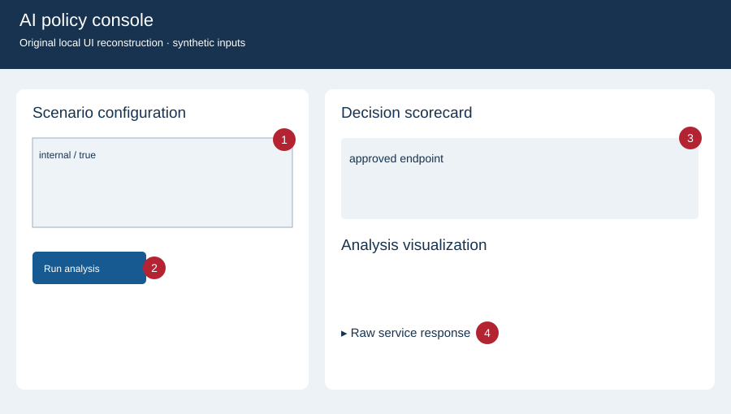

# AI policy console: technical walkthrough and executive evidence

Independent synthetic case study, not employer work or a measured business outcome.

## Click-by-click local application
1. Clone the repository and run `python service.py` from the root.
2. Open http://127.0.0.1:8765/service-index.html; select **AI policy console** (or open http://127.0.0.1:8765/service-demos/Enterprise-AI-Architect.html directly).
3. In Scenario configuration, enter internal / true. See callout 1.
4. Select **Run analysis** (callout 2).
5. Read Decision scorecard (callout 3). Expected: approved endpoint.
6. Expand Raw service response to inspect the JSON (callout 4).
7. Set restricted / true, then Run analysis again. Expected: deny.
8. Inspect local SQLite runs table to confirm successful requests were saved. Do not use confidential data.

Actual screenshot capture is configured in browser CI, not yet verified. This drawing is an original reconstruction of the local application, not a vendor screenshot.

## Executive leadership case
| Decision element | Proposed evidence |
|---|---|
| Accountable forum | Security review board |
| Decision | Permit synthetic pilot only; require authenticated policy enforcement |
| Acceptance metric | 100% restricted requests denied in acceptance cases |
| Risk and response | Unauthorized approval; require identity verification |
| Evidence | Expected synthetic result: approved endpoint |

### Governance and delivery
Sponsor owns funding and acceptance; technical lead owns implementation; independent reviewer validates test evidence; operations lead owns support. Proposed 30-day pilot: week 1 baseline and scope; week 2 build; week 3 acceptance and risk review; week 4 sponsor decision. No actual sponsor decision, funding, or realized outcome is claimed. Production authorization requires security, integration and operational readiness evidence.
