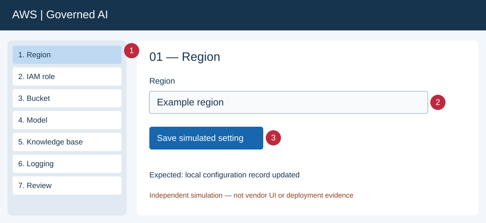
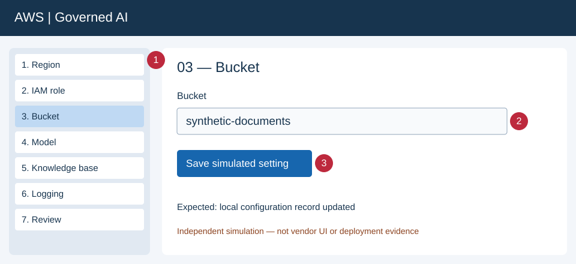
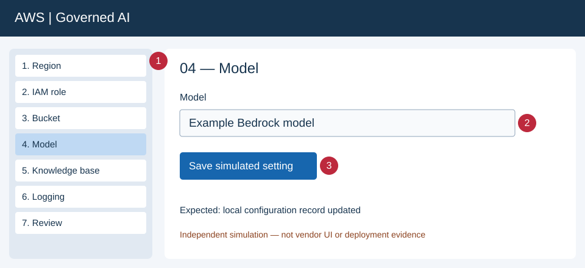
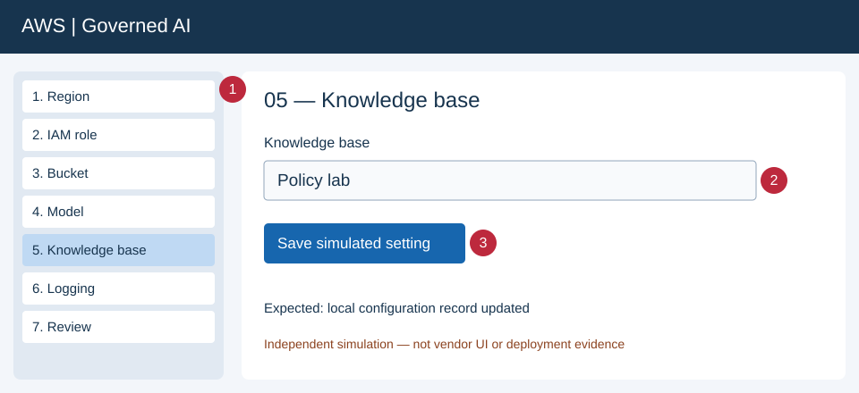
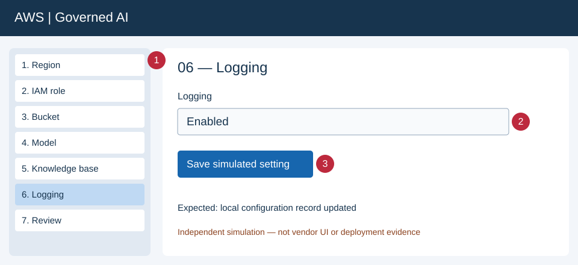
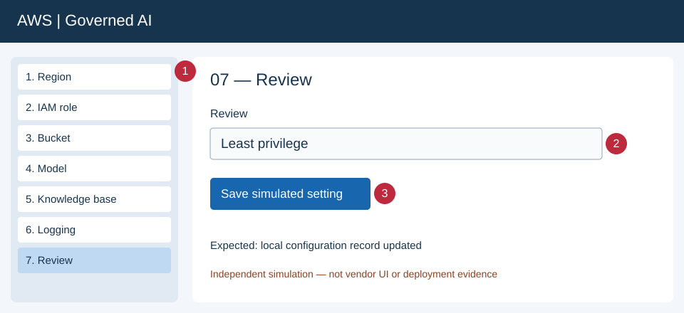

# AWS — Governed AI

Original interactive configuration simulation. Download index.html and open locally in a browser. GitHub file preview does not execute HTML. This is not a replica of the vendor interface; settings are illustrative and must be verified in a real sandbox.

[Interactive HTML source](index.html)

## 01 — Region

Select **Region** in the simulation navigation, enter `Example region`, then select **Save simulated setting**. Confirm the configuration record contains the value before selecting Next step. This verifies local state only.

## 02 — IAM role

Select **IAM role** in the simulation navigation, enter `Lab read role`, then select **Save simulated setting**. Confirm the configuration record contains the value before selecting Next step. This verifies local state only.

## 03 — Bucket

Select **Bucket** in the simulation navigation, enter `synthetic-documents`, then select **Save simulated setting**. Confirm the configuration record contains the value before selecting Next step. This verifies local state only.

## 04 — Model

Select **Model** in the simulation navigation, enter `Example Bedrock model`, then select **Save simulated setting**. Confirm the configuration record contains the value before selecting Next step. This verifies local state only.

## 05 — Knowledge base

Select **Knowledge base** in the simulation navigation, enter `Policy lab`, then select **Save simulated setting**. Confirm the configuration record contains the value before selecting Next step. This verifies local state only.

## 06 — Logging

Select **Logging** in the simulation navigation, enter `Enabled`, then select **Save simulated setting**. Confirm the configuration record contains the value before selecting Next step. This verifies local state only.

## 07 — Review

Select **Review** in the simulation navigation, enter `Least privilege`, then select **Save simulated setting**. Confirm the configuration record contains the value before selecting Next step. This verifies local state only.

