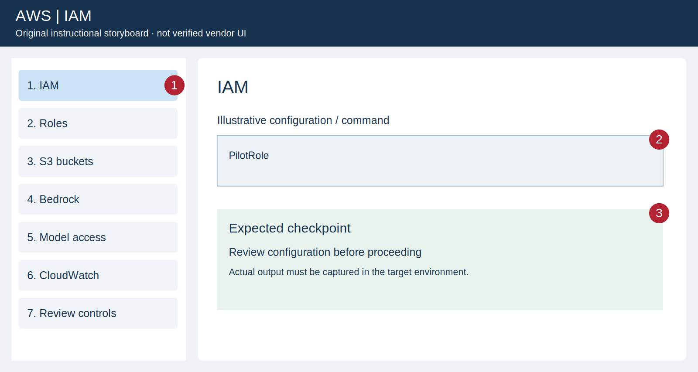
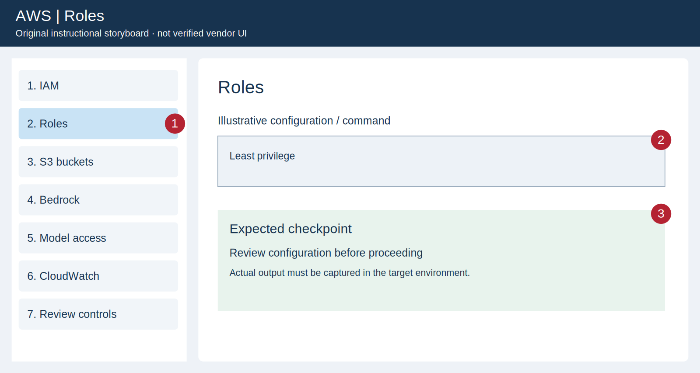
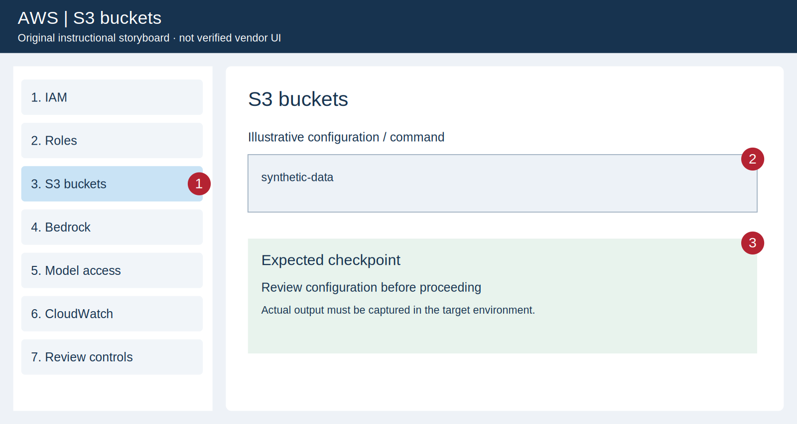
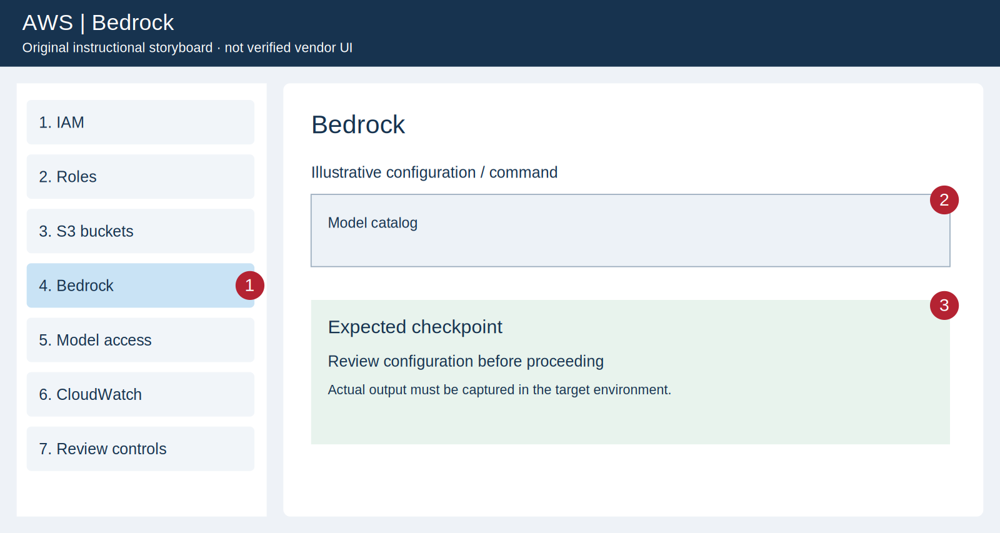
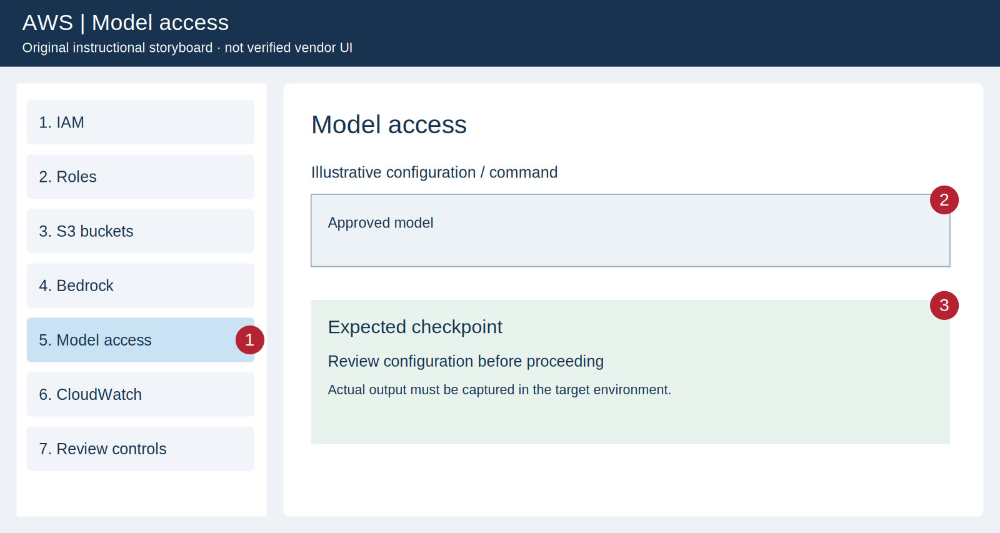
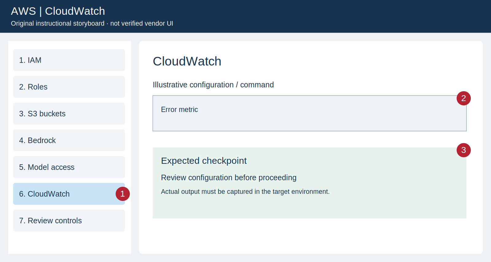
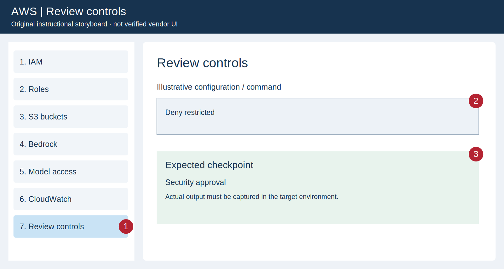

# AWS — numbered implementation walkthrough

Independent instructional storyboard. The navigation labels below are illustrative task stages, not verified vendor menu paths. No vendor deployment is claimed. Use synthetic data only. Prerequisites: browser for local illustrations; actual platform account, permissions and licensing must be established separately.

## Step 1: IAM
1. In the illustrated AWS workflow, locate callout 1 (IAM).
2. Inspect callout 2 and the sample value `PilotRole`.
3. Review the expected checkpoint at callout 3: configuration reviewed before continuing.
4. In the real environment, verify the equivalent control and capture actual output before proceeding.

## Step 2: Roles
1. In the illustrated AWS workflow, locate callout 1 (Roles).
2. Inspect callout 2 and the sample value `Least privilege`.
3. Review the expected checkpoint at callout 3: configuration reviewed before continuing.
4. In the real environment, verify the equivalent control and capture actual output before proceeding.

## Step 3: S3 buckets
1. In the illustrated AWS workflow, locate callout 1 (S3 buckets).
2. Inspect callout 2 and the sample value `synthetic-data`.
3. Review the expected checkpoint at callout 3: configuration reviewed before continuing.
4. In the real environment, verify the equivalent control and capture actual output before proceeding.

## Step 4: Bedrock
1. In the illustrated AWS workflow, locate callout 1 (Bedrock).
2. Inspect callout 2 and the sample value `Model catalog`.
3. Review the expected checkpoint at callout 3: configuration reviewed before continuing.
4. In the real environment, verify the equivalent control and capture actual output before proceeding.

## Step 5: Model access
1. In the illustrated AWS workflow, locate callout 1 (Model access).
2. Inspect callout 2 and the sample value `Approved model`.
3. Review the expected checkpoint at callout 3: configuration reviewed before continuing.
4. In the real environment, verify the equivalent control and capture actual output before proceeding.

## Step 6: CloudWatch
1. In the illustrated AWS workflow, locate callout 1 (CloudWatch).
2. Inspect callout 2 and the sample value `Error metric`.
3. Review the expected checkpoint at callout 3: configuration reviewed before continuing.
4. In the real environment, verify the equivalent control and capture actual output before proceeding.

## Step 7: Review controls
1. In the illustrated AWS workflow, locate callout 1 (Review controls).
2. Inspect callout 2 and the sample value `Deny restricted`.
3. Review the expected checkpoint at callout 3: Security approval.
4. In the real environment, verify the equivalent control and capture actual output before proceeding.

## Troubleshooting and executive acceptance
If a control is unavailable, verify role permissions, licensing and product version. If validation fails, stop, preserve the error and correct the input. Executive gate: Security approval. Record actual test output, reviewer and decision; do not claim completion without evidence.
