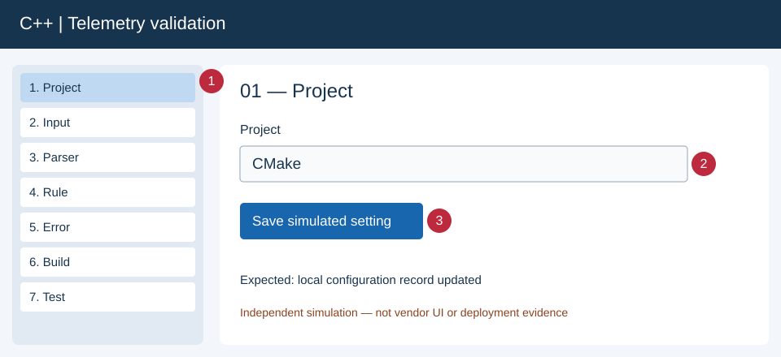
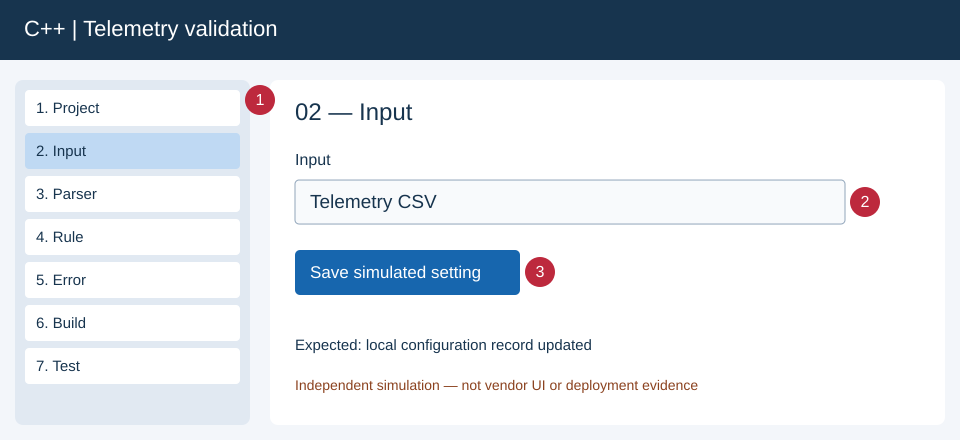
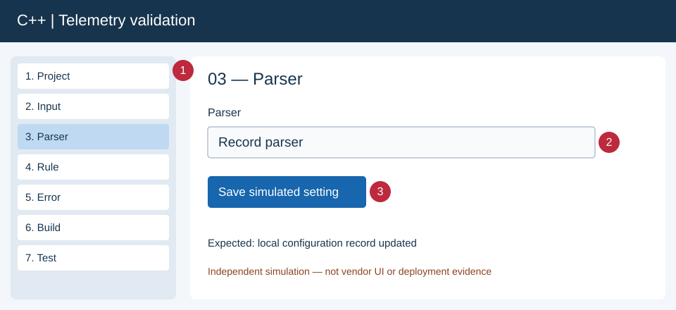
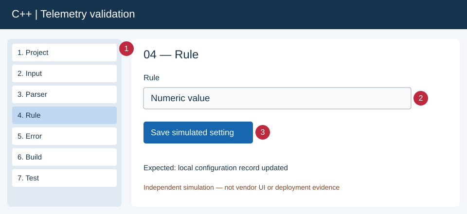
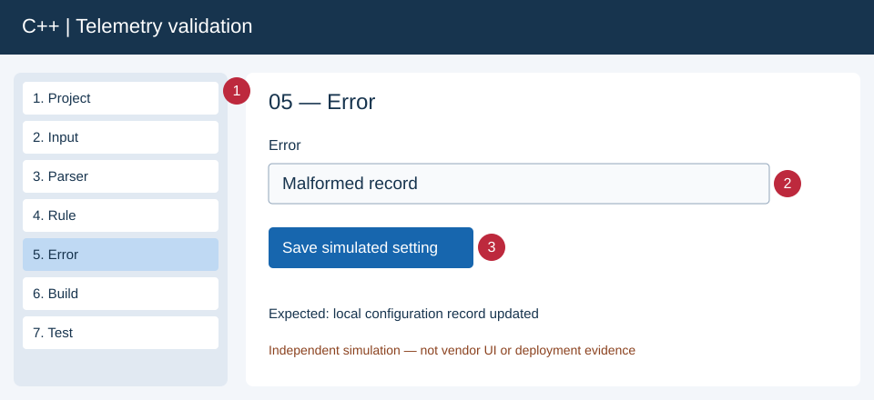
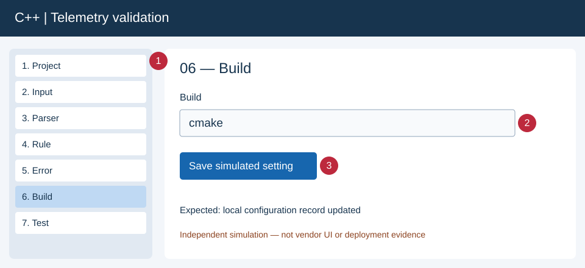
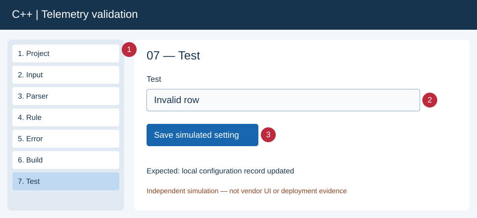

# C++ — Telemetry validation

Original interactive configuration simulation. Download index.html and open locally in a browser. GitHub file preview does not execute HTML. This is not a replica of the vendor interface; settings are illustrative and must be verified in a real sandbox.

[Interactive HTML source](index.html)

## 01 — Project

Select **Project** in the simulation navigation, enter `CMake`, then select **Save simulated setting**. Confirm the configuration record contains the value before selecting Next step. This verifies local state only.

## 02 — Input

Select **Input** in the simulation navigation, enter `Telemetry CSV`, then select **Save simulated setting**. Confirm the configuration record contains the value before selecting Next step. This verifies local state only.

## 03 — Parser

Select **Parser** in the simulation navigation, enter `Record parser`, then select **Save simulated setting**. Confirm the configuration record contains the value before selecting Next step. This verifies local state only.

## 04 — Rule

Select **Rule** in the simulation navigation, enter `Numeric value`, then select **Save simulated setting**. Confirm the configuration record contains the value before selecting Next step. This verifies local state only.

## 05 — Error

Select **Error** in the simulation navigation, enter `Malformed record`, then select **Save simulated setting**. Confirm the configuration record contains the value before selecting Next step. This verifies local state only.

## 06 — Build

Select **Build** in the simulation navigation, enter `cmake`, then select **Save simulated setting**. Confirm the configuration record contains the value before selecting Next step. This verifies local state only.

## 07 — Test

Select **Test** in the simulation navigation, enter `Invalid row`, then select **Save simulated setting**. Confirm the configuration record contains the value before selecting Next step. This verifies local state only.

