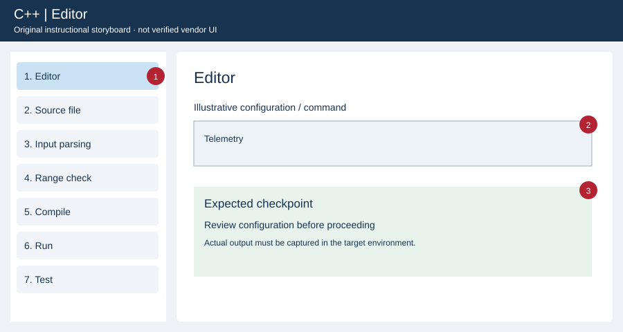
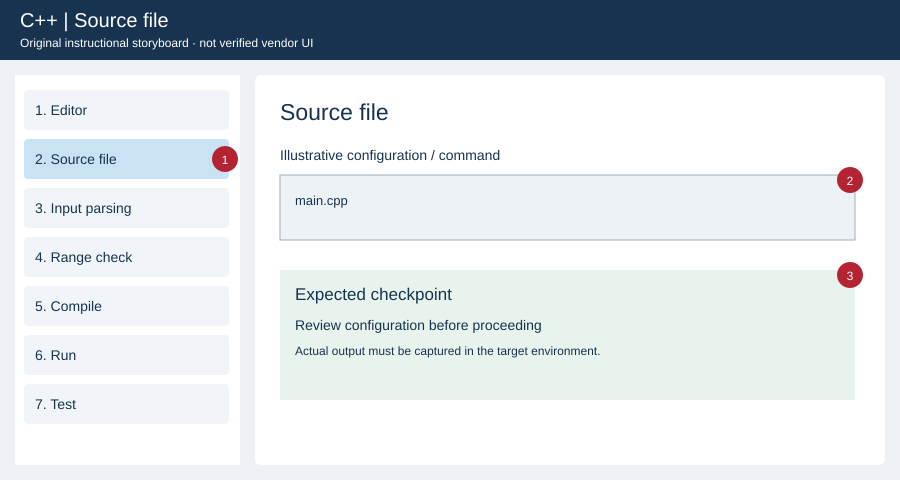
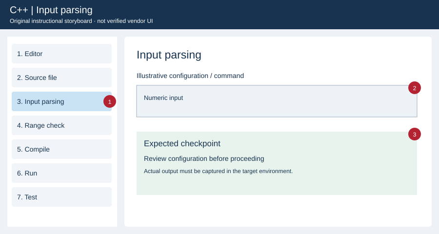
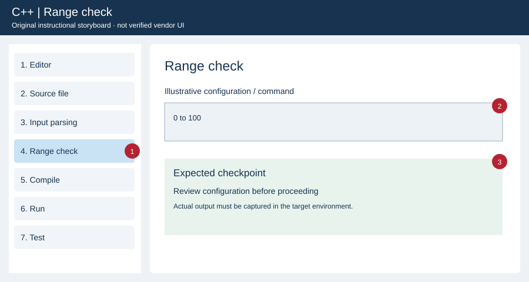
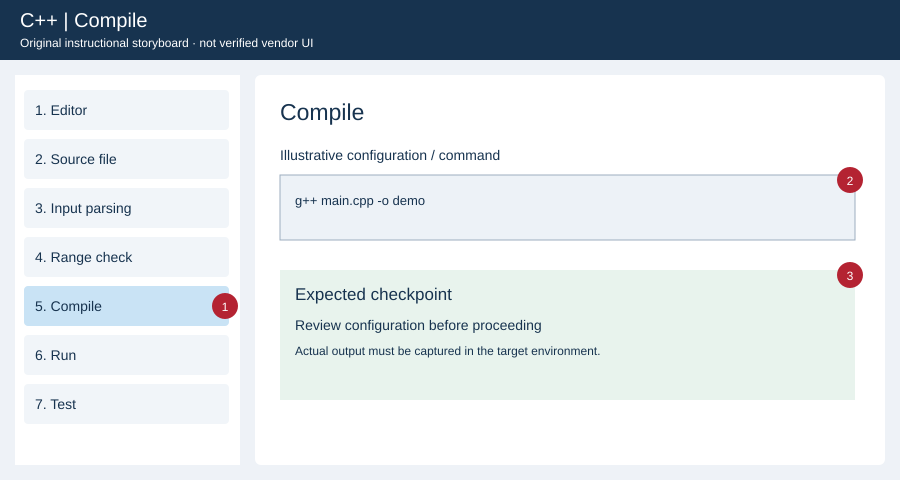
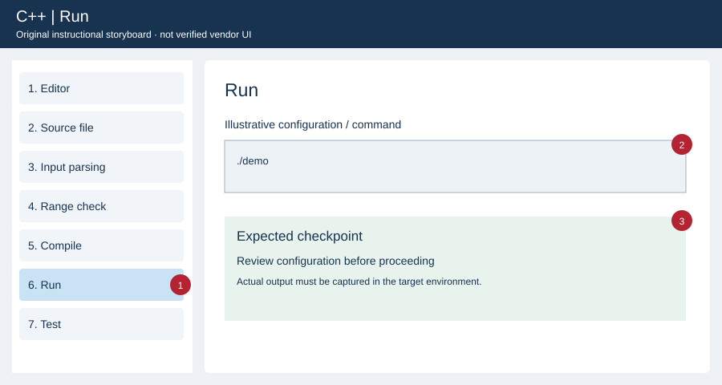
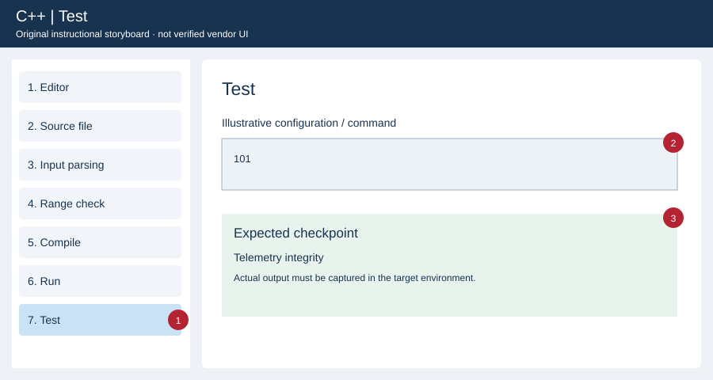

# C++ — numbered implementation walkthrough

Independent instructional storyboard. The navigation labels below are illustrative task stages, not verified vendor menu paths. No vendor deployment is claimed. Use synthetic data only. Prerequisites: browser for local illustrations; actual platform account, permissions and licensing must be established separately.

## Step 1: Editor
1. In the illustrated C++ workflow, locate callout 1 (Editor).
2. Inspect callout 2 and the sample value `Telemetry`.
3. Review the expected checkpoint at callout 3: configuration reviewed before continuing.
4. In the real environment, verify the equivalent control and capture actual output before proceeding.

## Step 2: Source file
1. In the illustrated C++ workflow, locate callout 1 (Source file).
2. Inspect callout 2 and the sample value `main.cpp`.
3. Review the expected checkpoint at callout 3: configuration reviewed before continuing.
4. In the real environment, verify the equivalent control and capture actual output before proceeding.

## Step 3: Input parsing
1. In the illustrated C++ workflow, locate callout 1 (Input parsing).
2. Inspect callout 2 and the sample value `Numeric input`.
3. Review the expected checkpoint at callout 3: configuration reviewed before continuing.
4. In the real environment, verify the equivalent control and capture actual output before proceeding.

## Step 4: Range check
1. In the illustrated C++ workflow, locate callout 1 (Range check).
2. Inspect callout 2 and the sample value `0 to 100`.
3. Review the expected checkpoint at callout 3: configuration reviewed before continuing.
4. In the real environment, verify the equivalent control and capture actual output before proceeding.

## Step 5: Compile
1. In the illustrated C++ workflow, locate callout 1 (Compile).
2. Inspect callout 2 and the sample value `g++ main.cpp -o demo`.
3. Review the expected checkpoint at callout 3: configuration reviewed before continuing.
4. In the real environment, verify the equivalent control and capture actual output before proceeding.

## Step 6: Run
1. In the illustrated C++ workflow, locate callout 1 (Run).
2. Inspect callout 2 and the sample value `./demo`.
3. Review the expected checkpoint at callout 3: configuration reviewed before continuing.
4. In the real environment, verify the equivalent control and capture actual output before proceeding.

## Step 7: Test
1. In the illustrated C++ workflow, locate callout 1 (Test).
2. Inspect callout 2 and the sample value `101`.
3. Review the expected checkpoint at callout 3: Telemetry integrity.
4. In the real environment, verify the equivalent control and capture actual output before proceeding.

## Troubleshooting and executive acceptance
If a control is unavailable, verify role permissions, licensing and product version. If validation fails, stop, preserve the error and correct the input. Executive gate: Telemetry integrity. Record actual test output, reviewer and decision; do not claim completion without evidence.
