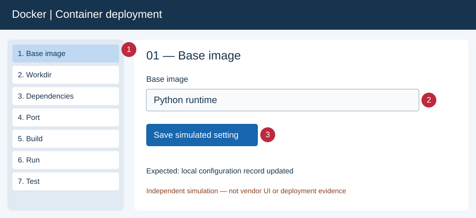
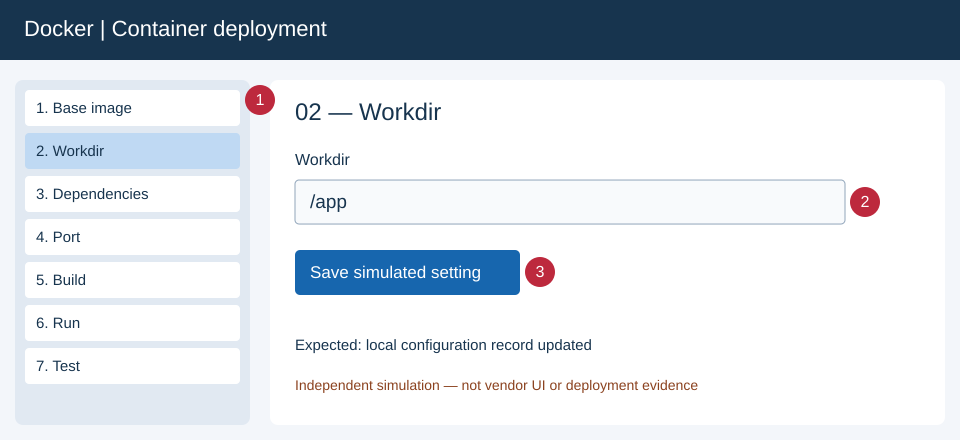
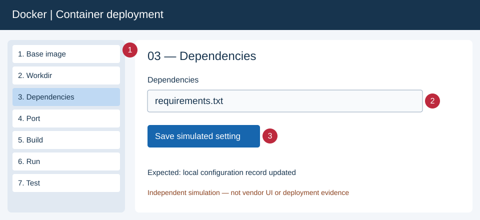
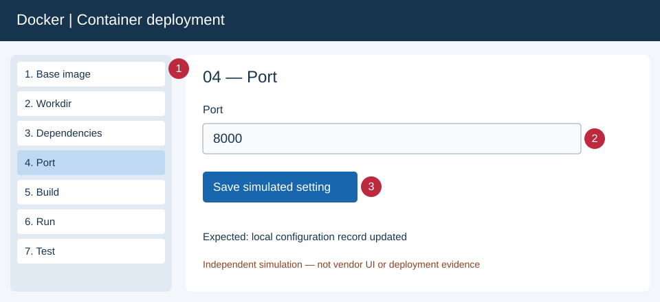
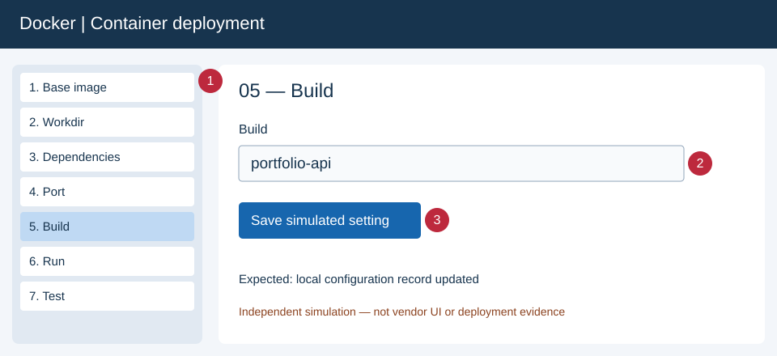
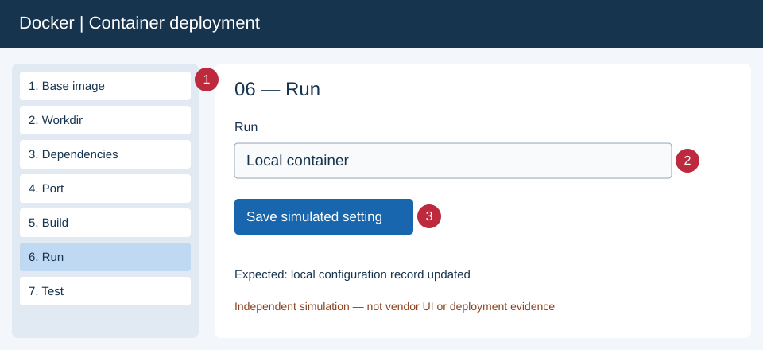
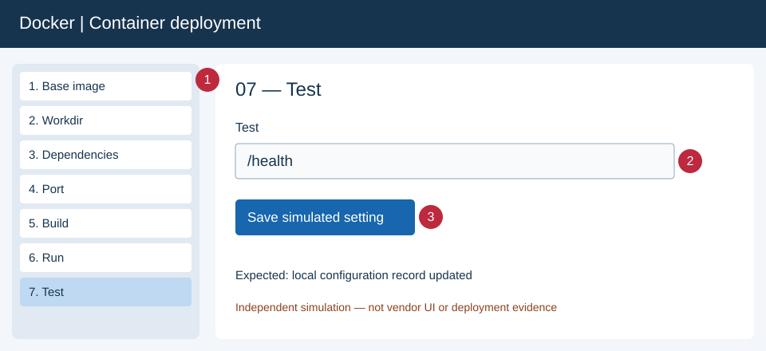

# Docker — Container deployment

Original interactive configuration simulation. Download index.html and open locally in a browser. GitHub file preview does not execute HTML. This is not a replica of the vendor interface; settings are illustrative and must be verified in a real sandbox.

[Interactive HTML source](index.html)

## 01 — Base image

Select **Base image** in the simulation navigation, enter `Python runtime`, then select **Save simulated setting**. Confirm the configuration record contains the value before selecting Next step. This verifies local state only.

## 02 — Workdir

Select **Workdir** in the simulation navigation, enter `/app`, then select **Save simulated setting**. Confirm the configuration record contains the value before selecting Next step. This verifies local state only.

## 03 — Dependencies

Select **Dependencies** in the simulation navigation, enter `requirements.txt`, then select **Save simulated setting**. Confirm the configuration record contains the value before selecting Next step. This verifies local state only.

## 04 — Port

Select **Port** in the simulation navigation, enter `8000`, then select **Save simulated setting**. Confirm the configuration record contains the value before selecting Next step. This verifies local state only.

## 05 — Build

Select **Build** in the simulation navigation, enter `portfolio-api`, then select **Save simulated setting**. Confirm the configuration record contains the value before selecting Next step. This verifies local state only.

## 06 — Run

Select **Run** in the simulation navigation, enter `Local container`, then select **Save simulated setting**. Confirm the configuration record contains the value before selecting Next step. This verifies local state only.

## 07 — Test

Select **Test** in the simulation navigation, enter `/health`, then select **Save simulated setting**. Confirm the configuration record contains the value before selecting Next step. This verifies local state only.

